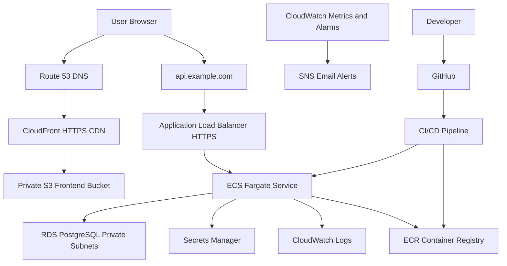

# AWS Complete Cloud Webapp Masterclass: From Account To Enterprise Production

This AWS set builds one complete production-style cloud webapp and then expands it into advanced AWS operations.

## Phase 1: What Are We Building?

We are building a real AWS cloud web application:

1. React frontend.
2. FastAPI backend.
3. PostgreSQL database on Amazon RDS.
4. Container image in Amazon ECR.
5. Backend running on Amazon ECS with AWS Fargate.
6. Application Load Balancer for API traffic.
7. Static frontend hosted in Amazon S3.
8. Amazon CloudFront distribution in front of the frontend.
9. AWS Certificate Manager TLS certificate.
10. Route 53 DNS records.
11. Secrets stored in AWS Secrets Manager.
12. Logs and metrics in Amazon CloudWatch.
13. Alarms and dashboards.
14. CI/CD pipeline.
15. Terraform infrastructure as code.
16. Security hardening, scaling, cost optimization, and disaster recovery.

## Phase 2: Why Does It Exist?

This is the standard production pattern for many companies:

1. Frontend assets are served globally from CloudFront.
2. API containers run without server management on Fargate.
3. Persistent data lives in RDS.
4. Secrets are not stored in code.
5. Logs and metrics are centralized.
6. Deployments are repeatable.
7. Infrastructure is versioned.
8. Costs are visible.
9. Security is built into every layer.

## Phase 3: Real World Use Case

The app is called `taskflow`.

Users can:

1. Open a web frontend.
2. Create tasks.
3. View tasks.
4. Mark tasks complete.
5. Delete tasks.

The backend exposes:

1. `GET /health`
2. `GET /ready`
3. `GET /tasks`
4. `POST /tasks`
5. `PATCH /tasks/{task_id}`
6. `DELETE /tasks/{task_id}`

## Phase 4: Production Architecture Diagram



## Phase 5: Prerequisites

You need:

1. AWS account with root MFA.
2. IAM admin or IAM Identity Center admin access.
3. AWS CLI configured.
4. Docker installed.
5. Node.js installed.
6. Python 3.12 installed.
7. Git installed.
8. A domain in Route 53 for the custom-domain section.

Verify:

```bash
aws sts get-caller-identity --profile learning-admin
docker version
node --version
python --version
git --version
```

## Phase 6: Document Set

Read and build in this order:

1. `12-aws-complete-cloud-webapp-master-index.md`
2. `13-aws-taskflow-webapp-complete-source-code.md`
3. `14-aws-console-step-by-step-deploy-taskflow.md`
4. `15-aws-cli-step-by-step-deploy-taskflow.md`
5. `16-aws-terraform-complete-production-webapp.md`
6. `17-aws-cicd-pipelines-github-actions-codepipeline.md`
7. `18-aws-monitoring-logging-alerting-runbooks.md`
8. `19-aws-security-scaling-cost-dr-enterprise.md`

## Phase 7: AWS Services Used

### Amazon S3

Stores static frontend build files.

Production choice:
Use a private bucket and serve through CloudFront with Origin Access Control.

### Amazon CloudFront

Global CDN for frontend delivery.

Production choice:
Redirect HTTP to HTTPS, use OAC for S3 access, configure caching, and invalidate after deploys.

### Amazon ECR

Stores backend Docker images.

Production choice:
Enable image scanning and lifecycle policies.

### Amazon ECS With AWS Fargate

Runs backend containers without managing EC2 servers.

Production choice:
Run tasks in private subnets, expose only through ALB, configure autoscaling.

### Application Load Balancer

Receives HTTPS API traffic and forwards it to ECS tasks.

Production choice:
Use health checks, TLS certificate, access logs, and security groups.

### Amazon RDS For PostgreSQL

Stores application data.

Production choice:
Private subnets, encryption, backups, Multi-AZ for production, no public access.

### AWS Secrets Manager

Stores database credentials and app secrets.

Production choice:
Grant ECS task role only the exact secrets it needs.

### Amazon CloudWatch

Stores logs, metrics, alarms, dashboards.

Production choice:
Create error, latency, CPU, memory, database, and budget alarms.

### AWS Certificate Manager

Issues TLS certificates.

Production choice:
Use DNS validation through Route 53.

### Route 53

DNS hosting.

Production choice:
Alias `app.example.com` to CloudFront and `api.example.com` to ALB.

## Phase 8: Environments

We build:

1. `dev`
2. `staging`
3. `prod`

Each environment has:

1. Separate ECS service.
2. Separate RDS database.
3. Separate S3 bucket.
4. Separate CloudFront distribution.
5. Separate secrets.
6. Separate alarms.

For learning, start with `dev`.

## Phase 9: Naming Standard

Use:

```text
taskflow-dev-vpc
taskflow-dev-cluster
taskflow-dev-api
taskflow-dev-db
taskflow-dev-frontend-bucket
taskflow-dev-api-sg
taskflow-dev-alb-sg
```

Tags:

```text
Project=taskflow
Environment=dev
Owner=your-name
ManagedBy=manual-or-terraform
CostCenter=learning
```

## Phase 10: Security Standard

1. Root account has MFA.
2. No root access keys.
3. Database is private.
4. ECS tasks are private.
5. ALB is public.
6. S3 frontend bucket is private.
7. CloudFront uses OAC.
8. Secrets are in Secrets Manager.
9. IAM permissions are least privilege.
10. Logs are retained and reviewed.

## Phase 11: Monitoring Standard

We monitor:

1. ALB HTTP 5xx.
2. ALB target 5xx.
3. ALB latency.
4. ECS CPU.
5. ECS memory.
6. ECS running task count.
7. ECS stopped tasks.
8. RDS CPU.
9. RDS connections.
10. RDS free storage.
11. RDS replication and backup state.
12. CloudFront 4xx and 5xx.
13. CloudWatch log errors.

## Phase 12: Cost Standard

Before deploying:

1. Create budget.
2. Use small RDS instance for dev.
3. Use Fargate minimum task count of 1 in dev.
4. Delete unused NAT gateways in experiments.
5. Set log retention.
6. Use lifecycle policies.

## Phase 13: Debugging Standard

When deployment fails:

1. Check ECS service events.
2. Check task stopped reason.
3. Check CloudWatch logs.
4. Check ALB target health.
5. Check security groups.
6. Check subnet routing.
7. Check RDS connectivity.
8. Check Secrets Manager permissions.
9. Check container environment variables.
10. Check image architecture and tag.

## Phase 14: Official AWS References

These documents informed the implementation path:

1. Amazon ECS and Fargate concepts: `https://docs.aws.amazon.com/AmazonECS/latest/developerguide/Welcome.html`
2. CloudFront Origin Access Control for private S3 origins: `https://docs.aws.amazon.com/AmazonCloudFront/latest/DeveloperGuide/private-content-restricting-access-to-s3.html`
3. Amazon RDS for PostgreSQL: `https://docs.aws.amazon.com/AmazonRDS/latest/UserGuide/CHAP_PostgreSQL.html`
4. CodePipeline with ECR and ECS deployment: `https://docs.aws.amazon.com/codepipeline/latest/userguide/tutorials-ecs-ecr-codedeploy.html`

