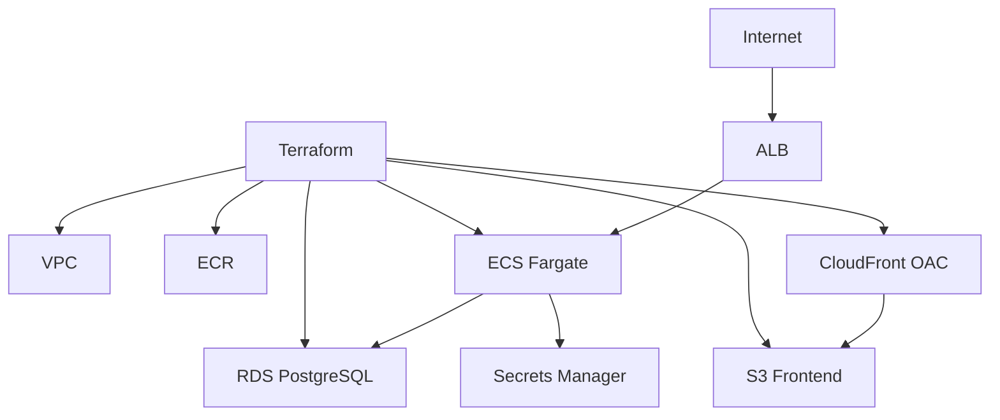

# AWS Terraform Complete Production Webapp: VPC, ECR, ECS Fargate, ALB, RDS, Secrets, S3, CloudFront

## Phase 1: What Are We Building?

We are building Taskflow infrastructure with Terraform:

1. VPC.
2. Public subnets.
3. Private subnets.
4. Internet Gateway.
5. NAT Gateway.
6. Security groups.
7. ECR repository.
8. CloudWatch log group.
9. RDS PostgreSQL.
10. Secrets Manager secret.
11. ECS cluster.
12. ECS task definition.
13. ECS service.
14. Application Load Balancer.
15. Target group.
16. S3 frontend bucket.
17. CloudFront Origin Access Control.
18. CloudFront distribution.
19. IAM roles.
20. Useful outputs.

## Phase 2: Why Terraform?

Terraform makes AWS infrastructure:

1. Repeatable.
2. Reviewable.
3. Version-controlled.
4. Destroyable.
5. Re-creatable across environments.

## Phase 3: Real World Use Case

The console guide teaches AWS. This Terraform guide turns the same architecture into production-style infrastructure as code.

## Phase 4: Architecture Diagram



## Phase 5: Prerequisites

You need:

1. Terraform installed.
2. AWS CLI configured.
3. S3 backend bucket from `01-aws-account-iam-billing.md`.
4. DynamoDB lock table from `01-aws-account-iam-billing.md`.

Verify:

```bash
terraform version
aws sts get-caller-identity --profile learning-admin
```

## Phase 6: Folder Structure

```text
taskflow-infra/
  backend.tf
  providers.tf
  variables.tf
  main.tf
  network.tf
  security-groups.tf
  ecr.tf
  rds.tf
  secrets.tf
  ecs.tf
  alb.tf
  frontend.tf
  outputs.tf
  terraform.tfvars.example
```

## Phase 7: backend.tf

```hcl
terraform {
  backend "s3" {
    bucket         = "learning-terraform-state-123456789012"
    key            = "taskflow/dev/terraform.tfstate"
    region         = "us-east-1"
    dynamodb_table = "terraform-locks"
    encrypt        = true
  }
}
```

Explanation:

1. `bucket` stores Terraform state.
2. `key` separates this project from other projects.
3. `dynamodb_table` prevents simultaneous writes.
4. `encrypt` protects state at rest.

## Phase 8: providers.tf

```hcl
terraform {
  required_version = ">= 1.6.0"

  required_providers {
    aws = {
      source  = "hashicorp/aws"
      version = "~> 5.80"
    }
    random = {
      source  = "hashicorp/random"
      version = "~> 3.6"
    }
  }
}

provider "aws" {
  region  = var.aws_region
  profile = var.aws_profile

  default_tags {
    tags = {
      Project     = var.project
      Environment = var.environment
      ManagedBy   = "terraform"
      Owner       = var.owner
    }
  }
}
```

## Phase 9: variables.tf

```hcl
variable "aws_region" {
  type    = string
  default = "us-east-1"
}

variable "aws_profile" {
  type    = string
  default = "learning-admin"
}

variable "project" {
  type    = string
  default = "taskflow"
}

variable "environment" {
  type    = string
  default = "dev"
}

variable "owner" {
  type    = string
  default = "learning"
}

variable "vpc_cidr" {
  type    = string
  default = "10.30.0.0/16"
}

variable "container_image" {
  type        = string
  description = "Full ECR image URI for the taskflow API"
}

variable "frontend_cors_origin" {
  type        = string
  description = "Frontend URL allowed by backend CORS"
  default     = "http://localhost:5173"
}
```

## Phase 10: terraform.tfvars.example

```hcl
aws_region           = "us-east-1"
aws_profile          = "learning-admin"
project              = "taskflow"
environment          = "dev"
owner                = "your-name"
vpc_cidr             = "10.30.0.0/16"
container_image      = "123456789012.dkr.ecr.us-east-1.amazonaws.com/taskflow-api:1"
frontend_cors_origin = "https://example-cloudfront-domain.cloudfront.net"
```

## Phase 11: main.tf

```hcl
data "aws_availability_zones" "available" {
  state = "available"
}

data "aws_caller_identity" "current" {}

locals {
  name = "${var.project}-${var.environment}"
  azs  = slice(data.aws_availability_zones.available.names, 0, 2)
}

resource "random_password" "db" {
  length  = 24
  special = true
}
```

## Phase 12: network.tf

```hcl
resource "aws_vpc" "this" {
  cidr_block           = var.vpc_cidr
  enable_dns_hostnames = true
  enable_dns_support   = true

  tags = {
    Name = "${local.name}-vpc"
  }
}

resource "aws_internet_gateway" "this" {
  vpc_id = aws_vpc.this.id

  tags = {
    Name = "${local.name}-igw"
  }
}

resource "aws_subnet" "public" {
  count                   = 2
  vpc_id                  = aws_vpc.this.id
  cidr_block              = cidrsubnet(var.vpc_cidr, 8, count.index)
  availability_zone       = local.azs[count.index]
  map_public_ip_on_launch = true

  tags = {
    Name = "${local.name}-public-${count.index + 1}"
    Tier = "public"
  }
}

resource "aws_subnet" "private" {
  count             = 2
  vpc_id            = aws_vpc.this.id
  cidr_block        = cidrsubnet(var.vpc_cidr, 8, count.index + 10)
  availability_zone = local.azs[count.index]

  tags = {
    Name = "${local.name}-private-${count.index + 1}"
    Tier = "private"
  }
}

resource "aws_eip" "nat" {
  domain = "vpc"

  tags = {
    Name = "${local.name}-nat-eip"
  }
}

resource "aws_nat_gateway" "this" {
  allocation_id = aws_eip.nat.id
  subnet_id     = aws_subnet.public[0].id

  tags = {
    Name = "${local.name}-nat"
  }

  depends_on = [aws_internet_gateway.this]
}

resource "aws_route_table" "public" {
  vpc_id = aws_vpc.this.id

  route {
    cidr_block = "0.0.0.0/0"
    gateway_id = aws_internet_gateway.this.id
  }

  tags = {
    Name = "${local.name}-public-rt"
  }
}

resource "aws_route_table" "private" {
  vpc_id = aws_vpc.this.id

  route {
    cidr_block     = "0.0.0.0/0"
    nat_gateway_id = aws_nat_gateway.this.id
  }

  tags = {
    Name = "${local.name}-private-rt"
  }
}

resource "aws_route_table_association" "public" {
  count          = 2
  subnet_id      = aws_subnet.public[count.index].id
  route_table_id = aws_route_table.public.id
}

resource "aws_route_table_association" "private" {
  count          = 2
  subnet_id      = aws_subnet.private[count.index].id
  route_table_id = aws_route_table.private.id
}
```

## Phase 13: security-groups.tf

```hcl
resource "aws_security_group" "alb" {
  name        = "${local.name}-alb-sg"
  description = "Public HTTP and HTTPS access to ALB"
  vpc_id      = aws_vpc.this.id

  ingress {
    from_port   = 80
    to_port     = 80
    protocol    = "tcp"
    cidr_blocks = ["0.0.0.0/0"]
  }

  ingress {
    from_port   = 443
    to_port     = 443
    protocol    = "tcp"
    cidr_blocks = ["0.0.0.0/0"]
  }

  egress {
    from_port   = 0
    to_port     = 0
    protocol    = "-1"
    cidr_blocks = ["0.0.0.0/0"]
  }
}

resource "aws_security_group" "ecs" {
  name        = "${local.name}-ecs-sg"
  description = "Allow ALB to reach ECS tasks"
  vpc_id      = aws_vpc.this.id

  ingress {
    from_port       = 8000
    to_port         = 8000
    protocol        = "tcp"
    security_groups = [aws_security_group.alb.id]
  }

  egress {
    from_port   = 0
    to_port     = 0
    protocol    = "-1"
    cidr_blocks = ["0.0.0.0/0"]
  }
}

resource "aws_security_group" "rds" {
  name        = "${local.name}-rds-sg"
  description = "Allow ECS to reach RDS"
  vpc_id      = aws_vpc.this.id

  ingress {
    from_port       = 5432
    to_port         = 5432
    protocol        = "tcp"
    security_groups = [aws_security_group.ecs.id]
  }

  egress {
    from_port   = 0
    to_port     = 0
    protocol    = "-1"
    cidr_blocks = ["0.0.0.0/0"]
  }
}
```

## Phase 14: ecr.tf

```hcl
resource "aws_ecr_repository" "api" {
  name                 = "${local.name}-api"
  image_tag_mutability = "IMMUTABLE"

  image_scanning_configuration {
    scan_on_push = true
  }

  encryption_configuration {
    encryption_type = "AES256"
  }
}

resource "aws_ecr_lifecycle_policy" "api" {
  repository = aws_ecr_repository.api.name

  policy = jsonencode({
    rules = [
      {
        rulePriority = 1
        description  = "Keep last 20 images"
        selection = {
          tagStatus   = "any"
          countType   = "imageCountMoreThan"
          countNumber = 20
        }
        action = {
          type = "expire"
        }
      }
    ]
  })
}
```

## Phase 15: rds.tf

```hcl
resource "aws_db_subnet_group" "this" {
  name       = "${local.name}-db-subnets"
  subnet_ids = aws_subnet.private[*].id
}

resource "aws_db_instance" "postgres" {
  identifier              = "${local.name}-db"
  engine                  = "postgres"
  engine_version          = "16.3"
  instance_class          = "db.t4g.micro"
  allocated_storage       = 20
  max_allocated_storage   = 100
  storage_type            = "gp3"
  db_name                 = "taskflow"
  username                = "taskflow"
  password                = random_password.db.result
  db_subnet_group_name    = aws_db_subnet_group.this.name
  vpc_security_group_ids  = [aws_security_group.rds.id]
  publicly_accessible     = false
  storage_encrypted       = true
  backup_retention_period = 7
  deletion_protection     = false
  skip_final_snapshot     = true
}
```

Production change:
Set `deletion_protection = true`, `skip_final_snapshot = false`, and use Multi-AZ for production.

## Phase 16: secrets.tf

```hcl
resource "aws_secretsmanager_secret" "api" {
  name = "${var.project}/${var.environment}/api"
}

resource "aws_secretsmanager_secret_version" "api" {
  secret_id = aws_secretsmanager_secret.api.id

  secret_string = jsonencode({
    DATABASE_URL = "postgresql+psycopg://taskflow:${random_password.db.result}@${aws_db_instance.postgres.address}:5432/taskflow"
  })
}
```

## Phase 17: alb.tf

```hcl
resource "aws_lb" "api" {
  name               = "${local.name}-alb"
  internal           = false
  load_balancer_type = "application"
  security_groups    = [aws_security_group.alb.id]
  subnets            = aws_subnet.public[*].id
}

resource "aws_lb_target_group" "api" {
  name        = "${local.name}-api-tg"
  port        = 8000
  protocol    = "HTTP"
  vpc_id      = aws_vpc.this.id
  target_type = "ip"

  health_check {
    enabled             = true
    path                = "/health"
    matcher             = "200"
    interval            = 30
    timeout             = 5
    healthy_threshold   = 2
    unhealthy_threshold = 3
  }
}

resource "aws_lb_listener" "http" {
  load_balancer_arn = aws_lb.api.arn
  port              = 80
  protocol          = "HTTP"

  default_action {
    type             = "forward"
    target_group_arn = aws_lb_target_group.api.arn
  }
}
```

## Phase 18: ecs.tf

```hcl
resource "aws_cloudwatch_log_group" "api" {
  name              = "/ecs/${local.name}-api"
  retention_in_days = 7
}

resource "aws_ecs_cluster" "this" {
  name = "${local.name}-cluster"
}

resource "aws_iam_role" "task_execution" {
  name = "${local.name}-ecs-task-execution-role"

  assume_role_policy = jsonencode({
    Version = "2012-10-17"
    Statement = [
      {
        Effect = "Allow"
        Principal = {
          Service = "ecs-tasks.amazonaws.com"
        }
        Action = "sts:AssumeRole"
      }
    ]
  })
}

resource "aws_iam_role_policy_attachment" "task_execution" {
  role       = aws_iam_role.task_execution.name
  policy_arn = "arn:aws:iam::aws:policy/service-role/AmazonECSTaskExecutionRolePolicy"
}

resource "aws_iam_role_policy" "read_secret" {
  name = "${local.name}-read-secret"
  role = aws_iam_role.task_execution.id

  policy = jsonencode({
    Version = "2012-10-17"
    Statement = [
      {
        Effect   = "Allow"
        Action   = ["secretsmanager:GetSecretValue"]
        Resource = aws_secretsmanager_secret.api.arn
      }
    ]
  })
}

resource "aws_ecs_task_definition" "api" {
  family                   = "${local.name}-api"
  network_mode             = "awsvpc"
  requires_compatibilities = ["FARGATE"]
  cpu                      = "256"
  memory                   = "512"
  execution_role_arn       = aws_iam_role.task_execution.arn

  container_definitions = jsonencode([
    {
      name      = "api"
      image     = var.container_image
      essential = true
      portMappings = [
        {
          containerPort = 8000
          hostPort      = 8000
          protocol      = "tcp"
        }
      ]
      environment = [
        {
          name  = "ENVIRONMENT"
          value = var.environment
        },
        {
          name  = "CORS_ORIGIN"
          value = var.frontend_cors_origin
        }
      ]
      secrets = [
        {
          name      = "DATABASE_URL"
          valueFrom = "${aws_secretsmanager_secret.api.arn}:DATABASE_URL::"
        }
      ]
      logConfiguration = {
        logDriver = "awslogs"
        options = {
          awslogs-group         = aws_cloudwatch_log_group.api.name
          awslogs-region        = var.aws_region
          awslogs-stream-prefix = "ecs"
        }
      }
      healthCheck = {
        command     = ["CMD-SHELL", "curl -f http://localhost:8000/health || exit 1"]
        interval    = 30
        timeout     = 5
        retries     = 3
        startPeriod = 30
      }
    }
  ])
}

resource "aws_ecs_service" "api" {
  name            = "${local.name}-api"
  cluster         = aws_ecs_cluster.this.id
  task_definition = aws_ecs_task_definition.api.arn
  desired_count   = 1
  launch_type     = "FARGATE"

  network_configuration {
    subnets          = aws_subnet.private[*].id
    security_groups  = [aws_security_group.ecs.id]
    assign_public_ip = false
  }

  load_balancer {
    target_group_arn = aws_lb_target_group.api.arn
    container_name   = "api"
    container_port   = 8000
  }

  health_check_grace_period_seconds = 60

  depends_on = [
    aws_lb_listener.http,
    aws_iam_role_policy_attachment.task_execution,
    aws_iam_role_policy.read_secret
  ]
}
```

## Phase 19: frontend.tf

```hcl
resource "aws_s3_bucket" "frontend" {
  bucket = "${local.name}-frontend-${data.aws_caller_identity.current.account_id}"
}

resource "aws_s3_bucket_public_access_block" "frontend" {
  bucket                  = aws_s3_bucket.frontend.id
  block_public_acls       = true
  block_public_policy     = true
  ignore_public_acls      = true
  restrict_public_buckets = true
}

resource "aws_s3_bucket_server_side_encryption_configuration" "frontend" {
  bucket = aws_s3_bucket.frontend.id

  rule {
    apply_server_side_encryption_by_default {
      sse_algorithm = "AES256"
    }
  }
}

resource "aws_cloudfront_origin_access_control" "frontend" {
  name                              = "${local.name}-frontend-oac"
  description                       = "OAC for ${local.name} frontend"
  origin_access_control_origin_type = "s3"
  signing_behavior                  = "always"
  signing_protocol                  = "sigv4"
}

resource "aws_cloudfront_distribution" "frontend" {
  enabled             = true
  default_root_object = "index.html"

  origin {
    domain_name              = aws_s3_bucket.frontend.bucket_regional_domain_name
    origin_id                = "s3-frontend"
    origin_access_control_id = aws_cloudfront_origin_access_control.frontend.id
  }

  default_cache_behavior {
    target_origin_id       = "s3-frontend"
    viewer_protocol_policy = "redirect-to-https"
    allowed_methods        = ["GET", "HEAD"]
    cached_methods         = ["GET", "HEAD"]
    compress               = true

    forwarded_values {
      query_string = false
      cookies {
        forward = "none"
      }
    }
  }

  restrictions {
    geo_restriction {
      restriction_type = "none"
    }
  }

  viewer_certificate {
    cloudfront_default_certificate = true
  }
}

resource "aws_s3_bucket_policy" "frontend" {
  bucket = aws_s3_bucket.frontend.id

  policy = jsonencode({
    Version = "2012-10-17"
    Statement = [
      {
        Sid    = "AllowCloudFrontServicePrincipalReadOnly"
        Effect = "Allow"
        Principal = {
          Service = "cloudfront.amazonaws.com"
        }
        Action   = "s3:GetObject"
        Resource = "${aws_s3_bucket.frontend.arn}/*"
        Condition = {
          StringEquals = {
            "AWS:SourceArn" = aws_cloudfront_distribution.frontend.arn
          }
        }
      }
    ]
  })

  depends_on = [aws_s3_bucket_public_access_block.frontend]
}
```

## Phase 20: outputs.tf

```hcl
output "ecr_repository_url" {
  value = aws_ecr_repository.api.repository_url
}

output "alb_dns_name" {
  value = aws_lb.api.dns_name
}

output "cloudfront_domain_name" {
  value = aws_cloudfront_distribution.frontend.domain_name
}

output "frontend_bucket" {
  value = aws_s3_bucket.frontend.bucket
}

output "rds_endpoint" {
  value = aws_db_instance.postgres.address
}

output "secret_name" {
  value = aws_secretsmanager_secret.api.name
}
```

## Phase 21: Deploy Infrastructure

Copy variables:

```bash
cp terraform.tfvars.example terraform.tfvars
```

Initialize:

```bash
terraform init
```

Validate:

```bash
terraform validate
```

Plan:

```bash
terraform plan
```

Apply:

```bash
terraform apply
```

When prompted, type:

```text
yes
```

## Phase 22: Build And Push Image After ECR Exists

Get output:

```bash
terraform output ecr_repository_url
```

Login:

```bash
aws ecr get-login-password --region us-east-1 --profile learning-admin \
  | docker login --username AWS --password-stdin 123456789012.dkr.ecr.us-east-1.amazonaws.com
```

Build and push:

```bash
docker build -t taskflow-api:1 ../taskflow/backend
docker tag taskflow-api:1 ECR_REPOSITORY_URL:1
docker push ECR_REPOSITORY_URL:1
```

Update `terraform.tfvars`:

```hcl
container_image = "ECR_REPOSITORY_URL:1"
```

Apply again:

```bash
terraform apply
```

## Phase 23: Upload Frontend

Get outputs:

```bash
terraform output frontend_bucket
terraform output cloudfront_domain_name
terraform output alb_dns_name
```

Build:

```bash
cd ../taskflow/frontend
VITE_API_BASE_URL=http://ALB_DNS_NAME npm run build
```

Upload:

```bash
aws s3 sync dist s3://FRONTEND_BUCKET --delete --profile learning-admin
```

Invalidate:

```bash
aws cloudfront create-invalidation \
  --distribution-id DISTRIBUTION_ID \
  --paths "/*" \
  --profile learning-admin
```

Find distribution ID:

```bash
aws cloudfront list-distributions \
  --query "DistributionList.Items[*].[Id,DomainName]" \
  --output table \
  --profile learning-admin
```

## Phase 24: Run Migration

Use ECS run task with command override:

```bash
aws ecs run-task \
  --cluster taskflow-dev-cluster \
  --launch-type FARGATE \
  --task-definition taskflow-dev-api \
  --network-configuration "awsvpcConfiguration={subnets=[PRIVATE_SUBNET_1,PRIVATE_SUBNET_2],securityGroups=[ECS_SECURITY_GROUP],assignPublicIp=DISABLED}" \
  --overrides '{"containerOverrides":[{"name":"api","command":["alembic","upgrade","head"]}]}' \
  --profile learning-admin
```

## Phase 25: Monitoring

Check Terraform state:

```bash
terraform state list
```

Check ECS:

```bash
aws ecs describe-services \
  --cluster taskflow-dev-cluster \
  --services taskflow-dev-api \
  --profile learning-admin
```

Check logs:

```bash
aws logs tail /ecs/taskflow-dev-api --follow --profile learning-admin
```

## Phase 26: Debugging

Terraform dependency error:

```bash
terraform graph
```

AWS permission error:

```bash
aws sts get-caller-identity --profile learning-admin
```

ECS deployment stuck:

```bash
aws ecs describe-services --cluster taskflow-dev-cluster --services taskflow-dev-api \
  --query "services[0].events[0:10]" \
  --profile learning-admin
```

## Phase 27: Security

1. State bucket must be encrypted.
2. State bucket must not be public.
3. Do not commit `terraform.tfvars`.
4. Use private RDS.
5. Use private ECS tasks.
6. Use CloudFront OAC.
7. Use least privilege IAM.

## Phase 28: Scaling

Add ECS autoscaling:

```hcl
resource "aws_appautoscaling_target" "api" {
  max_capacity       = 10
  min_capacity       = 2
  resource_id        = "service/${aws_ecs_cluster.this.name}/${aws_ecs_service.api.name}"
  scalable_dimension = "ecs:service:DesiredCount"
  service_namespace  = "ecs"
}

resource "aws_appautoscaling_policy" "api_cpu" {
  name               = "${local.name}-api-cpu"
  policy_type        = "TargetTrackingScaling"
  resource_id        = aws_appautoscaling_target.api.resource_id
  scalable_dimension = aws_appautoscaling_target.api.scalable_dimension
  service_namespace  = aws_appautoscaling_target.api.service_namespace

  target_tracking_scaling_policy_configuration {
    target_value = 60
    predefined_metric_specification {
      predefined_metric_type = "ECSServiceAverageCPUUtilization"
    }
  }
}
```

## Phase 29: Destroy Dev Environment

Use only for dev cleanup:

```bash
terraform destroy
```

Before destroying:

1. Empty S3 bucket.
2. Confirm no production environment uses this state.
3. Confirm RDS data can be deleted.

