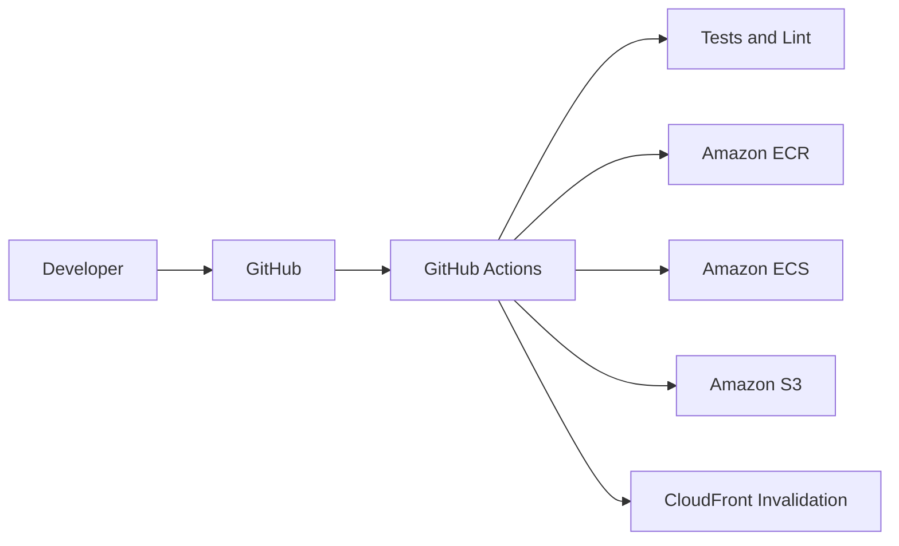

# AWS CI/CD Pipelines: GitHub Actions, ECR, ECS Deployment, S3 Frontend, CloudFront Invalidation, CodePipeline

## Phase 1: What Are We Building?

We are building two CI/CD options:

1. GitHub Actions pipeline.
2. AWS CodePipeline path.

Both pipelines:

1. Test backend.
2. Build backend Docker image.
3. Push image to ECR.
4. Deploy ECS service.
5. Build frontend.
6. Upload frontend to S3.
7. Invalidate CloudFront.

## Phase 2: Why CI/CD?

CI/CD makes deployments consistent. A production team should not deploy by manually clicking through the console every time code changes.

## Phase 3: Real World Use Case

Every merge to `main` deploys to dev or staging. Production deployment requires approval.

## Phase 4: Architecture Diagram



## Phase 5: Prerequisites

You need:

1. GitHub repository.
2. ECR repository.
3. ECS service.
4. S3 frontend bucket.
5. CloudFront distribution.
6. IAM role for GitHub OIDC.

## Phase 6: GitHub OIDC IAM Role

Console steps:

1. Open AWS Console.
2. Search `IAM`.
3. Click `Identity providers`.
4. Click `Add provider`.
5. Provider type: `OpenID Connect`.
6. Provider URL: `https://token.actions.githubusercontent.com`.
7. Audience: `sts.amazonaws.com`.
8. Click `Add provider`.

Create role:

1. Click `Roles`.
2. Click `Create role`.
3. Trusted entity type: `Web identity`.
4. Identity provider: `token.actions.githubusercontent.com`.
5. Audience: `sts.amazonaws.com`.
6. GitHub organization: your GitHub username or org.
7. Repository: `taskflow`.
8. Branch: `main`.
9. Click `Next`.
10. Add permissions later with inline policy.
11. Role name: `taskflow-github-actions-deploy-role`.
12. Click `Create role`.

Inline deploy policy:

```json
{
  "Version": "2012-10-17",
  "Statement": [
    {
      "Effect": "Allow",
      "Action": [
        "ecr:GetAuthorizationToken"
      ],
      "Resource": "*"
    },
    {
      "Effect": "Allow",
      "Action": [
        "ecr:BatchCheckLayerAvailability",
        "ecr:CompleteLayerUpload",
        "ecr:InitiateLayerUpload",
        "ecr:PutImage",
        "ecr:UploadLayerPart",
        "ecr:BatchGetImage",
        "ecr:DescribeImages"
      ],
      "Resource": "arn:aws:ecr:us-east-1:123456789012:repository/taskflow-api"
    },
    {
      "Effect": "Allow",
      "Action": [
        "ecs:DescribeServices",
        "ecs:DescribeTaskDefinition",
        "ecs:RegisterTaskDefinition",
        "ecs:UpdateService"
      ],
      "Resource": "*"
    },
    {
      "Effect": "Allow",
      "Action": [
        "iam:PassRole"
      ],
      "Resource": "arn:aws:iam::123456789012:role/taskflow-dev-ecs-task-execution-role"
    },
    {
      "Effect": "Allow",
      "Action": [
        "s3:ListBucket",
        "s3:PutObject",
        "s3:DeleteObject"
      ],
      "Resource": [
        "arn:aws:s3:::taskflow-dev-frontend-123456789012",
        "arn:aws:s3:::taskflow-dev-frontend-123456789012/*"
      ]
    },
    {
      "Effect": "Allow",
      "Action": [
        "cloudfront:CreateInvalidation"
      ],
      "Resource": "*"
    }
  ]
}
```

## Phase 7: GitHub Repository Secrets And Variables

Open GitHub:

1. Open repository.
2. Click `Settings`.
3. Click `Secrets and variables`.
4. Click `Actions`.
5. Add repository variables:
   - `AWS_REGION` = `us-east-1`
   - `ECR_REPOSITORY` = `taskflow-api`
   - `ECS_CLUSTER` = `taskflow-dev-cluster`
   - `ECS_SERVICE` = `taskflow-dev-api`
   - `ECS_CONTAINER` = `api`
   - `FRONTEND_BUCKET` = `taskflow-dev-frontend-123456789012`
   - `CLOUDFRONT_DISTRIBUTION_ID` = your distribution ID
   - `VITE_API_BASE_URL` = `https://api.example.com` or ALB URL
6. Add repository secret:
   - `AWS_ROLE_ARN` = GitHub Actions role ARN.

## Phase 8: GitHub Actions Workflow

Create `.github/workflows/deploy.yml`:

```yaml
name: Deploy Taskflow

on:
  push:
    branches:
      - main
  workflow_dispatch:

permissions:
  id-token: write
  contents: read

jobs:
  backend:
    name: Build and deploy backend
    runs-on: ubuntu-latest

    steps:
      - name: Checkout
        uses: actions/checkout@v4

      - name: Configure AWS credentials
        uses: aws-actions/configure-aws-credentials@v4
        with:
          role-to-assume: ${{ secrets.AWS_ROLE_ARN }}
          aws-region: ${{ vars.AWS_REGION }}

      - name: Login to Amazon ECR
        id: login-ecr
        uses: aws-actions/amazon-ecr-login@v2

      - name: Set up Python
        uses: actions/setup-python@v5
        with:
          python-version: "3.12"

      - name: Test backend
        working-directory: taskflow/backend
        run: |
          python -m pip install --upgrade pip
          pip install -r requirements-dev.txt
          pytest
          ruff check app tests

      - name: Build and push backend image
        env:
          ECR_REGISTRY: ${{ steps.login-ecr.outputs.registry }}
          IMAGE_TAG: ${{ github.sha }}
        run: |
          docker build -t $ECR_REGISTRY/${{ vars.ECR_REPOSITORY }}:$IMAGE_TAG taskflow/backend
          docker push $ECR_REGISTRY/${{ vars.ECR_REPOSITORY }}:$IMAGE_TAG
          echo "IMAGE_URI=$ECR_REGISTRY/${{ vars.ECR_REPOSITORY }}:$IMAGE_TAG" >> $GITHUB_ENV

      - name: Download current task definition
        run: |
          aws ecs describe-task-definition \
            --task-definition ${{ vars.ECS_SERVICE }} \
            --query taskDefinition > task-definition.json

      - name: Render new task definition
        id: task-def
        uses: aws-actions/amazon-ecs-render-task-definition@v1
        with:
          task-definition: task-definition.json
          container-name: ${{ vars.ECS_CONTAINER }}
          image: ${{ env.IMAGE_URI }}

      - name: Deploy ECS service
        uses: aws-actions/amazon-ecs-deploy-task-definition@v2
        with:
          task-definition: ${{ steps.task-def.outputs.task-definition }}
          service: ${{ vars.ECS_SERVICE }}
          cluster: ${{ vars.ECS_CLUSTER }}
          wait-for-service-stability: true

  frontend:
    name: Build and deploy frontend
    runs-on: ubuntu-latest
    needs: backend

    steps:
      - name: Checkout
        uses: actions/checkout@v4

      - name: Configure AWS credentials
        uses: aws-actions/configure-aws-credentials@v4
        with:
          role-to-assume: ${{ secrets.AWS_ROLE_ARN }}
          aws-region: ${{ vars.AWS_REGION }}

      - name: Set up Node
        uses: actions/setup-node@v4
        with:
          node-version: "22"

      - name: Build frontend
        working-directory: taskflow/frontend
        env:
          VITE_API_BASE_URL: ${{ vars.VITE_API_BASE_URL }}
        run: |
          npm install
          npm run build

      - name: Upload frontend to S3
        run: |
          aws s3 sync taskflow/frontend/dist s3://${{ vars.FRONTEND_BUCKET }} --delete

      - name: Invalidate CloudFront
        run: |
          aws cloudfront create-invalidation \
            --distribution-id ${{ vars.CLOUDFRONT_DISTRIBUTION_ID }} \
            --paths "/*"
```

## Phase 9: Command Explanation

`aws-actions/configure-aws-credentials`:

Purpose:
Uses GitHub OIDC to assume an AWS role without storing long-lived AWS keys.

Expected output:
Workflow receives temporary AWS credentials.

Common error:

```text
Not authorized to perform sts:AssumeRoleWithWebIdentity
```

Fix:
Check IAM role trust policy matches GitHub org, repo, and branch.

## Phase 10: CodePipeline Path

CodePipeline path:

1. Source: GitHub or CodeCommit.
2. Build: CodeBuild.
3. Deploy backend: ECS deploy action.
4. Deploy frontend: CodeBuild S3 sync and CloudFront invalidation.

## Phase 11: buildspec.yml For Backend

Create `buildspec-backend.yml`:

```yaml
version: 0.2

phases:
  pre_build:
    commands:
      - echo Logging in to ECR
      - aws ecr get-login-password --region $AWS_DEFAULT_REGION | docker login --username AWS --password-stdin $ACCOUNT_ID.dkr.ecr.$AWS_DEFAULT_REGION.amazonaws.com
      - IMAGE_TAG=$(echo $CODEBUILD_RESOLVED_SOURCE_VERSION | cut -c 1-12)
  build:
    commands:
      - echo Running tests
      - cd taskflow/backend
      - python -m pip install --upgrade pip
      - pip install -r requirements-dev.txt
      - pytest
      - ruff check app tests
      - cd ../..
      - echo Building Docker image
      - docker build -t $ECR_REPOSITORY:$IMAGE_TAG taskflow/backend
      - docker tag $ECR_REPOSITORY:$IMAGE_TAG $ACCOUNT_ID.dkr.ecr.$AWS_DEFAULT_REGION.amazonaws.com/$ECR_REPOSITORY:$IMAGE_TAG
  post_build:
    commands:
      - echo Pushing image
      - docker push $ACCOUNT_ID.dkr.ecr.$AWS_DEFAULT_REGION.amazonaws.com/$ECR_REPOSITORY:$IMAGE_TAG
      - printf '[{"name":"api","imageUri":"%s"}]' $ACCOUNT_ID.dkr.ecr.$AWS_DEFAULT_REGION.amazonaws.com/$ECR_REPOSITORY:$IMAGE_TAG > imagedefinitions.json

artifacts:
  files:
    - imagedefinitions.json
```

## Phase 12: buildspec.yml For Frontend

Create `buildspec-frontend.yml`:

```yaml
version: 0.2

phases:
  install:
    runtime-versions:
      nodejs: 22
  pre_build:
    commands:
      - cd taskflow/frontend
      - npm install
  build:
    commands:
      - VITE_API_BASE_URL=$VITE_API_BASE_URL npm run build
  post_build:
    commands:
      - aws s3 sync dist s3://$FRONTEND_BUCKET --delete
      - aws cloudfront create-invalidation --distribution-id $CLOUDFRONT_DISTRIBUTION_ID --paths "/*"
```

## Phase 13: CodePipeline Console Steps

1. Open AWS Console.
2. Search `CodePipeline`.
3. Click `Create pipeline`.
4. Pipeline name: `taskflow-dev-pipeline`.
5. Execution mode: `Queued`.
6. Service role: create new service role.
7. Artifact store: default S3 bucket.
8. Source provider: choose GitHub via CodeStar connection.
9. Connect GitHub account.
10. Repository: `taskflow`.
11. Branch: `main`.
12. Trigger: start on push.
13. Build provider: CodeBuild.
14. Create CodeBuild project:
    - Environment image: managed image.
    - Compute: small.
    - Privileged mode: enabled for Docker builds.
    - Buildspec: `buildspec-backend.yml`.
15. Deploy provider: Amazon ECS.
16. Cluster: `taskflow-dev-cluster`.
17. Service: `taskflow-dev-api`.
18. Image definitions file: `imagedefinitions.json`.
19. Click `Create pipeline`.

Frontend can be a second CodeBuild stage using `buildspec-frontend.yml`.

## Phase 14: Production Approval

For production:

1. Add staging deployment first.
2. Add manual approval stage.
3. Require approver from platform or release team.
4. Deploy production only after approval.

## Phase 15: Monitoring

GitHub Actions:

1. Open GitHub repository.
2. Click `Actions`.
3. Open workflow run.
4. Expand failed step.

AWS:

```bash
aws ecs describe-services --cluster taskflow-dev-cluster --services taskflow-dev-api
aws logs tail /ecs/taskflow-dev-api --since 30m
```

## Phase 16: Debugging

ECR push fails:

1. Check IAM role has ECR write permissions.
2. Check repository name.
3. Check region.

ECS deploy fails:

1. Check `iam:PassRole`.
2. Check task definition JSON.
3. Check service events.

Frontend deploy fails:

1. Check S3 bucket name.
2. Check CloudFront distribution ID.
3. Check Node build logs.

## Phase 17: Security

1. Prefer OIDC over static AWS keys.
2. Limit role trust policy to one repo and branch.
3. Use branch protection.
4. Require reviews.
5. Use separate deploy roles for dev, staging, production.
6. Do not give CI admin access.

## Phase 18: Interview Questions

1. Why use OIDC instead of AWS access keys?
2. What is `iam:PassRole`?
3. Why use immutable image tags?
4. What does ECS deploy action update?
5. Why invalidate CloudFront?
6. Why should production require approval?

