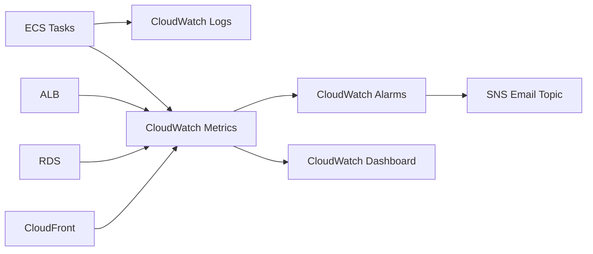

# AWS Monitoring, Logging, Alerts, Dashboards, And Incident Runbooks For Taskflow

## Phase 1: What Are We Building?

We are building production observability for AWS:

1. CloudWatch log groups.
2. ECS application logs.
3. ALB metrics.
4. ECS CPU and memory metrics.
5. RDS metrics.
6. CloudFront metrics.
7. CloudWatch alarms.
8. SNS email notifications.
9. CloudWatch dashboard.
10. Incident runbooks.

## Phase 2: Why Does It Exist?

You cannot operate what you cannot see. Monitoring tells you when users are affected. Logs tell you why.

## Phase 3: Real World Use Case

Taskflow returns 500 errors after deployment. You must identify whether the failure is caused by:

1. Bad image.
2. Database connection.
3. ECS task crash.
4. ALB target health.
5. Security group.
6. RDS failure.

## Phase 4: Architecture Diagram



## Phase 5: Create SNS Topic

Console steps:

1. Open AWS Console.
2. Search `SNS`.
3. Click `Simple Notification Service`.
4. Click `Topics`.
5. Click `Create topic`.
6. Type: `Standard`.
7. Name: `taskflow-dev-alerts`.
8. Click `Create topic`.
9. Open the topic.
10. Click `Create subscription`.
11. Protocol: `Email`.
12. Endpoint: your email.
13. Click `Create subscription`.
14. Open your email inbox.
15. Click the confirmation link.

CLI:

```bash
aws sns create-topic --name taskflow-dev-alerts --profile learning-admin
aws sns subscribe \
  --topic-arn arn:aws:sns:us-east-1:123456789012:taskflow-dev-alerts \
  --protocol email \
  --notification-endpoint you@example.com \
  --profile learning-admin
```

## Phase 6: ECS Log Monitoring

Tail logs:

```bash
aws logs tail /ecs/taskflow-dev-api --follow --profile learning-admin
```

Purpose:
Streams backend logs.

Expected output:

```text
request completed method=GET path=/health status=200 duration_ms=1.24
```

Search errors:

```bash
aws logs filter-log-events \
  --log-group-name /ecs/taskflow-dev-api \
  --filter-pattern "ERROR" \
  --profile learning-admin
```

Console steps:

1. Open `CloudWatch`.
2. Click `Logs`.
3. Click `Log groups`.
4. Open `/ecs/taskflow-dev-api`.
5. Open latest log stream.
6. Search `ERROR`.

## Phase 7: Create Metric Filter For Errors

Console steps:

1. Open CloudWatch.
2. Click `Log groups`.
3. Open `/ecs/taskflow-dev-api`.
4. Click `Metric filters`.
5. Click `Create metric filter`.
6. Filter pattern: `ERROR`.
7. Click `Next`.
8. Filter name: `taskflow-api-errors`.
9. Metric namespace: `Taskflow`.
10. Metric name: `ApiErrors`.
11. Metric value: `1`.
12. Click `Next`.
13. Click `Create metric filter`.

CLI:

```bash
aws logs put-metric-filter \
  --log-group-name /ecs/taskflow-dev-api \
  --filter-name taskflow-api-errors \
  --filter-pattern "ERROR" \
  --metric-transformations metricName=ApiErrors,metricNamespace=Taskflow,metricValue=1 \
  --profile learning-admin
```

## Phase 8: Create Alarm For API Errors

```bash
aws cloudwatch put-metric-alarm \
  --alarm-name taskflow-dev-api-errors \
  --namespace Taskflow \
  --metric-name ApiErrors \
  --statistic Sum \
  --period 300 \
  --threshold 1 \
  --comparison-operator GreaterThanOrEqualToThreshold \
  --evaluation-periods 1 \
  --alarm-actions arn:aws:sns:us-east-1:123456789012:taskflow-dev-alerts \
  --profile learning-admin
```

Purpose:
Sends email if one or more error logs appear in 5 minutes.

## Phase 9: ALB 5xx Alarm

```bash
aws cloudwatch put-metric-alarm \
  --alarm-name taskflow-dev-alb-5xx \
  --namespace AWS/ApplicationELB \
  --metric-name HTTPCode_ELB_5XX_Count \
  --dimensions Name=LoadBalancer,Value=app/taskflow-dev-alb/LOAD_BALANCER_ID \
  --statistic Sum \
  --period 300 \
  --threshold 1 \
  --comparison-operator GreaterThanOrEqualToThreshold \
  --evaluation-periods 1 \
  --alarm-actions arn:aws:sns:us-east-1:123456789012:taskflow-dev-alerts \
  --profile learning-admin
```

Find LoadBalancer dimension:

```bash
aws elbv2 describe-load-balancers \
  --names taskflow-dev-alb \
  --query "LoadBalancers[0].LoadBalancerArn" \
  --output text \
  --profile learning-admin
```

The CloudWatch dimension uses the ARN suffix after `loadbalancer/`.

## Phase 10: Target 5xx Alarm

```bash
aws cloudwatch put-metric-alarm \
  --alarm-name taskflow-dev-target-5xx \
  --namespace AWS/ApplicationELB \
  --metric-name HTTPCode_Target_5XX_Count \
  --dimensions Name=LoadBalancer,Value=app/taskflow-dev-alb/LOAD_BALANCER_ID \
  --statistic Sum \
  --period 300 \
  --threshold 1 \
  --comparison-operator GreaterThanOrEqualToThreshold \
  --evaluation-periods 1 \
  --alarm-actions arn:aws:sns:us-east-1:123456789012:taskflow-dev-alerts \
  --profile learning-admin
```

Difference:

1. ALB 5xx means load balancer itself failed.
2. Target 5xx means backend app returned 500.

## Phase 11: ECS CPU Alarm

```bash
aws cloudwatch put-metric-alarm \
  --alarm-name taskflow-dev-ecs-high-cpu \
  --namespace AWS/ECS \
  --metric-name CPUUtilization \
  --dimensions Name=ClusterName,Value=taskflow-dev-cluster Name=ServiceName,Value=taskflow-dev-api \
  --statistic Average \
  --period 300 \
  --threshold 80 \
  --comparison-operator GreaterThanThreshold \
  --evaluation-periods 2 \
  --alarm-actions arn:aws:sns:us-east-1:123456789012:taskflow-dev-alerts \
  --profile learning-admin
```

## Phase 12: ECS Memory Alarm

```bash
aws cloudwatch put-metric-alarm \
  --alarm-name taskflow-dev-ecs-high-memory \
  --namespace AWS/ECS \
  --metric-name MemoryUtilization \
  --dimensions Name=ClusterName,Value=taskflow-dev-cluster Name=ServiceName,Value=taskflow-dev-api \
  --statistic Average \
  --period 300 \
  --threshold 80 \
  --comparison-operator GreaterThanThreshold \
  --evaluation-periods 2 \
  --alarm-actions arn:aws:sns:us-east-1:123456789012:taskflow-dev-alerts \
  --profile learning-admin
```

## Phase 13: RDS Alarms

High CPU:

```bash
aws cloudwatch put-metric-alarm \
  --alarm-name taskflow-dev-rds-high-cpu \
  --namespace AWS/RDS \
  --metric-name CPUUtilization \
  --dimensions Name=DBInstanceIdentifier,Value=taskflow-dev-db \
  --statistic Average \
  --period 300 \
  --threshold 80 \
  --comparison-operator GreaterThanThreshold \
  --evaluation-periods 2 \
  --alarm-actions arn:aws:sns:us-east-1:123456789012:taskflow-dev-alerts \
  --profile learning-admin
```

Low storage:

```bash
aws cloudwatch put-metric-alarm \
  --alarm-name taskflow-dev-rds-low-storage \
  --namespace AWS/RDS \
  --metric-name FreeStorageSpace \
  --dimensions Name=DBInstanceIdentifier,Value=taskflow-dev-db \
  --statistic Average \
  --period 300 \
  --threshold 5000000000 \
  --comparison-operator LessThanThreshold \
  --evaluation-periods 2 \
  --alarm-actions arn:aws:sns:us-east-1:123456789012:taskflow-dev-alerts \
  --profile learning-admin
```

## Phase 14: Dashboard JSON

Create `taskflow-dashboard.json`:

```json
{
  "widgets": [
    {
      "type": "metric",
      "x": 0,
      "y": 0,
      "width": 12,
      "height": 6,
      "properties": {
        "metrics": [
          ["AWS/ECS", "CPUUtilization", "ClusterName", "taskflow-dev-cluster", "ServiceName", "taskflow-dev-api"],
          [".", "MemoryUtilization", ".", ".", ".", "."]
        ],
        "period": 300,
        "stat": "Average",
        "region": "us-east-1",
        "title": "ECS CPU and Memory"
      }
    },
    {
      "type": "metric",
      "x": 12,
      "y": 0,
      "width": 12,
      "height": 6,
      "properties": {
        "metrics": [
          ["AWS/RDS", "CPUUtilization", "DBInstanceIdentifier", "taskflow-dev-db"],
          [".", "DatabaseConnections", ".", "."],
          [".", "FreeStorageSpace", ".", "."]
        ],
        "period": 300,
        "stat": "Average",
        "region": "us-east-1",
        "title": "RDS Health"
      }
    }
  ]
}
```

Create:

```bash
aws cloudwatch put-dashboard \
  --dashboard-name taskflow-dev \
  --dashboard-body file://taskflow-dashboard.json \
  --profile learning-admin
```

## Phase 15: Incident Runbook - API 500 Errors

Step 1:
Open CloudWatch alarm details.

Step 2:
Check ECS service events:

```bash
aws ecs describe-services \
  --cluster taskflow-dev-cluster \
  --services taskflow-dev-api \
  --query "services[0].events[0:10]" \
  --profile learning-admin
```

Step 3:
Check logs:

```bash
aws logs tail /ecs/taskflow-dev-api --since 30m --profile learning-admin
```

Step 4:
Check target health:

```bash
aws elbv2 describe-target-health \
  --target-group-arn TARGET_GROUP_ARN \
  --profile learning-admin
```

Step 5:
Check recent deployment:

```bash
aws ecs describe-task-definition \
  --task-definition taskflow-dev-api \
  --profile learning-admin
```

Step 6:
If new deployment caused outage, roll back to previous task definition revision:

```bash
aws ecs update-service \
  --cluster taskflow-dev-cluster \
  --service taskflow-dev-api \
  --task-definition taskflow-dev-api:PREVIOUS_REVISION \
  --profile learning-admin
```

Step 7:
Wait:

```bash
aws ecs wait services-stable \
  --cluster taskflow-dev-cluster \
  --services taskflow-dev-api \
  --profile learning-admin
```

Step 8:
Verify:

```bash
curl http://ALB_DNS_NAME/health
curl http://ALB_DNS_NAME/tasks
```

## Phase 16: Incident Runbook - Database Connection Failure

Symptoms:

1. `/ready` returns 500.
2. Logs mention connection timeout.
3. ECS task may keep running but readiness fails.

Commands:

```bash
aws rds describe-db-instances \
  --db-instance-identifier taskflow-dev-db \
  --profile learning-admin

aws ec2 describe-security-groups \
  --group-ids RDS_SECURITY_GROUP_ID ECS_SECURITY_GROUP_ID \
  --profile learning-admin
```

Fix checklist:

1. RDS status is `available`.
2. RDS is in private subnet.
3. RDS security group allows PostgreSQL from ECS security group.
4. ECS task has outbound allowed.
5. Secret contains correct RDS endpoint.
6. Database password is correct.
7. Migration ran.

## Phase 17: Incident Runbook - CloudFront Stale Frontend

Symptoms:

1. Deployment succeeded.
2. Browser still shows old UI.

Fix:

```bash
aws cloudfront create-invalidation \
  --distribution-id DISTRIBUTION_ID \
  --paths "/*" \
  --profile learning-admin
```

Then hard refresh browser.

## Phase 18: Security

1. Do not log secrets.
2. Restrict dashboard access.
3. Restrict log group access.
4. Use least privilege alarm management permissions.
5. Set log retention.

## Phase 19: Scaling

As traffic increases:

1. Add ECS autoscaling.
2. Add RDS read replica for read-heavy workloads.
3. Add CloudFront caching rules.
4. Add database indexes.
5. Add application-level metrics.

## Phase 20: Interview Questions

1. What is the difference between ALB 5xx and target 5xx?
2. Why do logs and metrics both matter?
3. What does an ECS service event show?
4. What is a CloudWatch metric filter?
5. What is an actionable alert?

