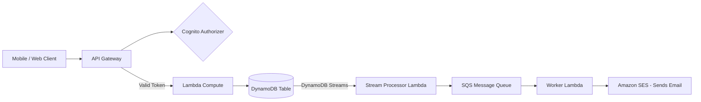

# 18. AWS Advanced Topics, Architectures, and Interview Preparation

This final guide bridges the gap between AWS theory and real-world execution. It covers advanced architecture designs, disaster recovery strategies, deployment patterns, and a comprehensive list of interview questions.

---

## 1. Solutions Architect Topics: High Availability and Disaster Recovery (DR)

When designing for disaster recovery, the two key metrics you must establish with business stakeholders are:
*   **Recovery Point Objective (RPO):** How much data loss (in time) can the business tolerate? (e.g., if RPO is 4 hours, backups must be taken at least every 4 hours).
*   **Recovery Time Objective (RTO):** How much downtime can the business tolerate? How fast must the system recover?

```
      [ Normal Operations ] ------ ( Disaster Occurs ) ------ [ System Recovered ]
      \___________________/                                  \___________________/
         Data lost during                                     Downtime duration
         this period is the                                   is the RTO
         RPO
```

### Disaster Recovery Strategies (Cost vs. Speed)

| DR Strategy | Cost | RTO / Recovery Speed | How it works |
| :--- | :--- | :--- | :--- |
| **Backup & Restore** | Lowest | Hours | Backup data to S3. If a disaster occurs, launch new servers and restore backups. |
| **Pilot Light** | Low | Minutes | Databases are kept running and replicated in a backup region. Application servers (EC2s) are turned off or kept as AMIs. They are launched only when a failover is triggered. |
| **Warm Standby** | Medium | Seconds to Minutes | A scaled-down version of the application runs in the backup region. If failover occurs, the ASG scales up to handle production traffic. |
| **Multi-Site (Active-Active)**| Highest | Near-Zero | Complete duplicate environments run in multiple regions simultaneously, sharing load via Route 53. If one region goes offline, the other handles everything instantly. |

---

## 2. Real-World Architectures

### 1. Classic 3-Tier Web Application Architecture
This architecture isolates the web tier, application tier, and database tier in separate subnets for high security and availability.

```mermaid
graph TD
    Client[Internet Clients] --> Route53[Route 53 DNS]
    Route53 --> ALB[Application Load Balancer - Public Subnet]
    
    subgraph Public Subnets (AZ-A & AZ-B)
        ALB
        Bastion[Bastion Host / SSH Jump]
    end
    
    subgraph Private Application Subnets
        ALB --> WebInstances[EC2 Web Servers in ASG]
    end
    
    subgraph Private Database Subnets
        WebInstances --> PrimaryDB[(RDS Primary DB - Write/Read)]
        PrimaryDB -.->|Sync Replication| StandbyDB[(RDS Standby DB - DR)]
        WebInstances --> Cache[(ElastiCache Redis Cache)]
    end
```

### 2. Serverless API & Event-Driven Processing Architecture
Fully serverless design using managed API gateway, compute, queues, and database. Scales from zero to millions of requests automatically.



---

## 3. DevOps & Security Best Practices

### DevOps Deployment Strategies:
*   **In-Place Deployment:** Replaces code on active servers one-by-one. Easy to run but reduces server capacity during deployment and has slow rollbacks.
*   **Blue/Green Deployment:** Provisions a duplicate, temporary server fleet (Green) with the new code. Once tested, traffic shifts from old (Blue) to new (Green). Very safe with near-instant rollback.
*   **Canary Deployment:** Deploys code to a single instance first, routing 5% of users. If metrics remain healthy, the remaining fleet updates. Prevents large-scale bugs.

### Incident Response and Security:
*   Use **AWS Secrets Manager** with auto-rotation for all DB credentials. Never hardcode keys in git repositories.
*   Isolate networks using strict **Security Groups** allowing only specific IP ranges or specific source Security Groups (e.g., Database only allows ingress traffic from the App Server security group).
*   Enforce **Encryption at Rest** (using KMS) for all EBS volumes, S3 buckets, and RDS instances.

---

## 4. AWS Interview Questions & Answers

### Beginner level
**Q1: What is the difference between S3 and EBS?**
*   **Answer:** Amazon S3 is an *Object Storage* service accessed via API calls over the internet. It stores files (objects) inside buckets globally. It features unlimited capacity and is designed for static assets, backups, and data lakes. Amazon EBS is a network-attached *Block Storage* volume. It behaves like a virtual hard drive that you plug into a single EC2 instance in a specific AZ. It is designed for running operating systems, databases, and application runtimes.

**Q2: What is the difference between a Public and a Private Subnet?**
*   **Answer:** A public subnet is a subnet whose Route Table contains a path directing internet-bound traffic (`0.0.0.0/0`) to an Internet Gateway (IGW). Instances in a public subnet can have public IP addresses and can be accessed from the internet. A private subnet does not have a route to an IGW. To access the internet, instances in a private subnet must route traffic through a NAT Gateway located in a public subnet.

**Q3: What is the purpose of AWS IAM?**
*   **Answer:** IAM (Identity and Access Management) manages authentication (verifying who you are) and authorization (verifying what resources you have permission to access) in your AWS account. It is a global service.

---

### Intermediate level
**Q4: Explain the difference between Security Groups and Network ACLs (NACLs).**
*   **Answer:** Security Groups operate at the instance level (virtual firewalls). They are stateful, meaning if you permit inbound traffic, outbound return traffic is automatically allowed. They support only "Allow" rules. NACLs operate at the subnet boundary. They are stateless, meaning you must write explicit rules for both inbound and outbound traffic (including Ephemeral Ports). They support both "Allow" and "Deny" rules, and are evaluated in number order.

**Q5: How do you handle database failover in RDS?**
*   **Answer:** You enable **Multi-AZ Deployment**. RDS provisions a synchronous standby replica in a different Availability Zone. If the primary database fails, RDS automatically updates the DNS endpoint to point to the standby instance. The failover takes under 2 minutes, requires no manual action, and requires no code changes.

**Q6: What is a "Cold Start" in AWS Lambda and how do you reduce it?**
*   **Answer:** A cold start is the latency overhead that occurs when a Lambda function runs for the first time or after a period of inactivity because AWS must spin up a new container and initialize the environment. You can reduce cold starts by:
    1. Keeping code packages small and importing only necessary libraries.
    2. Enabling **Provisioned Concurrency** to pre-warm containers.
    3. Initializing database connections outside the handler function to reuse them.

---

### Advanced level
**Q7: How would you design a multi-region active-active architecture on AWS?**
*   **Answer:** I would deploy duplicate application stacks (ALB, ASG, EC2/Fargate) in two separate AWS Regions (e.g., `us-east-1` and `eu-west-1`). I would use **Route 53 Latency-Based Routing** with health checks to route users to the nearest healthy region. For the database layer, I would use **Amazon Aurora Global Database** or **DynamoDB Global Tables** to handle multi-region active replication. Static files would be cached globally via **Amazon CloudFront** and backed up across S3 buckets using Cross-Region Replication (CRR).

**Q8: Explain the difference between VPC Peering and AWS Transit Gateway.**
*   **Answer:** VPC Peering is a point-to-point network connection between two VPCs. It is non-transitive, meaning you must create peer connections between every single VPC pair, resulting in a complex mesh network at scale. AWS Transit Gateway acts as a centralized cloud router (hub-and-spoke topology). It connects thousands of VPCs, VPNs, and Direct Connects to a single hub. It supports transitive routing, making network management simpler and cleaner.

**Q9: What is the AWS Shared Responsibility Model? If data is leaked due to an unencrypted S3 bucket, who is responsible?**
*   **Answer:** The Shared Responsibility Model defines that AWS is responsible for security *of* the cloud (physical infrastructure, hardware, hypervisors), while the customer is responsible for security *in* the cloud (data, encryption configurations, IAM keys, OS patches). If data leaks because an S3 bucket configuration was set to public or unencrypted, the **customer** is responsible because they misconfigured the security settings *in* the cloud.
