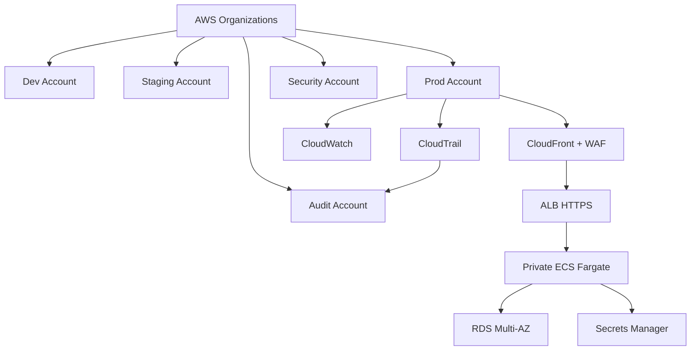

# AWS Security, Scaling, Cost Optimization, Disaster Recovery, And Enterprise Architecture For Taskflow

## Phase 1: What Are We Building?

We are hardening Taskflow for serious production:

1. IAM least privilege.
2. Network isolation.
3. Secrets management.
4. TLS everywhere.
5. WAF.
6. ECS autoscaling.
7. RDS production settings.
8. Backup and restore.
9. Cost controls.
10. Disaster recovery.
11. Multi-environment enterprise architecture.

## Phase 2: Why Does It Exist?

Production systems must handle attackers, traffic spikes, failed deployments, database problems, AWS service limits, and cost surprises.

## Phase 3: Real World Use Case

Taskflow becomes a customer-facing SaaS app. It needs:

1. Secure public access.
2. Private data stores.
3. Reliable deployments.
4. Backups.
5. Alerts.
6. Scale.
7. Auditable infrastructure.
8. Monthly cost visibility.

## Phase 4: Enterprise Architecture Diagram



## Phase 5: IAM Hardening

Root account:

1. MFA enabled.
2. No access keys.
3. Not used for daily work.

IAM Identity Center:

1. Create groups:
   - `PlatformAdmins`
   - `Developers`
   - `ReadOnlyAuditors`
   - `BillingViewers`
2. Assign permission sets.
3. Use short session durations for admin roles.
4. Use read-only access for auditors.

Least privilege ECS task execution policy:

```json
{
  "Version": "2012-10-17",
  "Statement": [
    {
      "Effect": "Allow",
      "Action": [
        "ecr:GetAuthorizationToken"
      ],
      "Resource": "*"
    },
    {
      "Effect": "Allow",
      "Action": [
        "ecr:BatchCheckLayerAvailability",
        "ecr:GetDownloadUrlForLayer",
        "ecr:BatchGetImage"
      ],
      "Resource": "arn:aws:ecr:us-east-1:123456789012:repository/taskflow-api"
    },
    {
      "Effect": "Allow",
      "Action": [
        "logs:CreateLogStream",
        "logs:PutLogEvents"
      ],
      "Resource": "arn:aws:logs:us-east-1:123456789012:log-group:/ecs/taskflow-dev-api:*"
    },
    {
      "Effect": "Allow",
      "Action": [
        "secretsmanager:GetSecretValue"
      ],
      "Resource": "arn:aws:secretsmanager:us-east-1:123456789012:secret:taskflow/dev/api-*"
    }
  ]
}
```

## Phase 6: Network Hardening

Production network rules:

1. ALB in public subnets.
2. ECS tasks in private subnets.
3. RDS in private subnets.
4. No public RDS.
5. ECS security group accepts traffic only from ALB security group.
6. RDS security group accepts traffic only from ECS security group.
7. Admin access uses SSM Session Manager, not SSH.
8. Add VPC endpoints to reduce NAT traffic and improve private AWS API access.

Useful VPC endpoints:

1. ECR API.
2. ECR Docker.
3. CloudWatch Logs.
4. Secrets Manager.
5. S3 Gateway Endpoint.

## Phase 7: TLS And Domains

Production:

1. `app.example.com` points to CloudFront.
2. `api.example.com` points to ALB.
3. ACM certificate for both names.
4. CloudFront redirects HTTP to HTTPS.
5. ALB redirects HTTP to HTTPS.

ALB HTTP redirect listener action:

```json
{
  "Type": "redirect",
  "RedirectConfig": {
    "Protocol": "HTTPS",
    "Port": "443",
    "StatusCode": "HTTP_301"
  }
}
```

## Phase 8: AWS WAF

Console steps:

1. Search `WAF`.
2. Click `AWS WAF`.
3. Click `Web ACLs`.
4. Click `Create web ACL`.
5. Name: `taskflow-prod-web-acl`.
6. Resource type: `CloudFront distributions`.
7. Region: global.
8. Add CloudFront distribution.
9. Add AWS managed rule groups:
   - `AWSManagedRulesCommonRuleSet`
   - `AWSManagedRulesKnownBadInputsRuleSet`
   - `AWSManagedRulesAmazonIpReputationList`
10. Set default action: `Allow`.
11. Click `Create web ACL`.

Why:
WAF blocks common malicious requests before they reach your app.

## Phase 9: Secrets Hardening

Secrets Manager production rules:

1. One secret per app/environment.
2. No secrets in Git.
3. No secrets in Docker image.
4. Rotate database credentials.
5. Restrict `secretsmanager:GetSecretValue`.
6. Audit secret access with CloudTrail.

Rotation path:

1. Open Secrets Manager.
2. Open secret.
3. Click `Rotation`.
4. Click `Edit rotation`.
5. Enable automatic rotation.
6. Choose rotation interval.
7. Use RDS rotation Lambda template where appropriate.

## Phase 10: ECS Autoscaling

Console steps:

1. Open ECS.
2. Open cluster.
3. Open service.
4. Click `Update service`.
5. Desired tasks: set `2` for production.
6. Open `Service auto scaling`.
7. Enable service auto scaling.
8. Minimum tasks: `2`.
9. Maximum tasks: `10`.
10. Policy type: `Target tracking`.
11. Metric: `ECSServiceAverageCPUUtilization`.
12. Target value: `60`.
13. Save.

CLI:

```bash
aws application-autoscaling register-scalable-target \
  --service-namespace ecs \
  --scalable-dimension ecs:service:DesiredCount \
  --resource-id service/taskflow-dev-cluster/taskflow-dev-api \
  --min-capacity 2 \
  --max-capacity 10 \
  --profile learning-admin
```

Scaling policy:

```bash
aws application-autoscaling put-scaling-policy \
  --service-namespace ecs \
  --scalable-dimension ecs:service:DesiredCount \
  --resource-id service/taskflow-dev-cluster/taskflow-dev-api \
  --policy-name taskflow-dev-cpu-60 \
  --policy-type TargetTrackingScaling \
  --target-tracking-scaling-policy-configuration '{"TargetValue":60,"PredefinedMetricSpecification":{"PredefinedMetricType":"ECSServiceAverageCPUUtilization"}}' \
  --profile learning-admin
```

## Phase 11: RDS Production Settings

Production RDS should use:

1. Multi-AZ enabled.
2. Deletion protection enabled.
3. Backups retained at least 7 to 35 days.
4. Storage encryption enabled.
5. Performance Insights enabled.
6. Enhanced Monitoring enabled where useful.
7. Public access disabled.
8. Strong password stored in Secrets Manager.
9. Maintenance window defined.
10. Minor version auto-upgrade policy decided by team.

Backup check:

```bash
aws rds describe-db-instances \
  --db-instance-identifier taskflow-dev-db \
  --query "DBInstances[0].[BackupRetentionPeriod,MultiAZ,StorageEncrypted,DeletionProtection,PubliclyAccessible]" \
  --profile learning-admin
```

## Phase 12: Disaster Recovery

Recovery objectives:

1. RTO: Recovery Time Objective.
2. RPO: Recovery Point Objective.

Example for Taskflow production:

```text
RTO: 2 hours
RPO: 15 minutes
```

Backup restore drill:

1. Open RDS.
2. Click `Automated backups`.
3. Select database.
4. Click `Restore to point in time`.
5. Choose restore time.
6. New DB identifier: `taskflow-restore-test`.
7. Restore into private subnets.
8. Connect staging ECS service to restored DB.
9. Verify data.
10. Delete restore test DB.

CLI snapshot:

```bash
aws rds create-db-snapshot \
  --db-instance-identifier taskflow-dev-db \
  --db-snapshot-identifier taskflow-dev-manual-$(date +%Y%m%d%H%M) \
  --profile learning-admin
```

## Phase 13: Blue/Green Deployment

Simple ECS rollback:

```bash
aws ecs update-service \
  --cluster taskflow-dev-cluster \
  --service taskflow-dev-api \
  --task-definition taskflow-dev-api:PREVIOUS_REVISION \
  --profile learning-admin
```

Advanced production:

1. Use CodeDeploy blue/green for ECS.
2. Create blue target group.
3. Create green target group.
4. Shift traffic gradually.
5. Roll back automatically on alarms.

## Phase 14: Cost Optimization

Cost drivers:

1. NAT Gateway hourly cost.
2. RDS instance hours.
3. Fargate vCPU and memory.
4. ALB hourly and LCU cost.
5. CloudFront transfer.
6. CloudWatch logs ingestion and retention.
7. RDS storage and backup.

Immediate controls:

1. Create AWS Budget.
2. Set CloudWatch log retention.
3. Use small RDS in dev.
4. Use desired count `1` in dev.
5. Destroy unused dev stacks.
6. Use one NAT Gateway in dev.
7. Add ECR lifecycle policy.
8. Use S3 lifecycle rules.

Budget console steps:

1. Open `Billing and Cost Management`.
2. Click `Budgets`.
3. Click `Create budget`.
4. Choose `Monthly cost budget`.
5. Name: `taskflow-dev-budget`.
6. Amount: `25 USD` or your limit.
7. Alert threshold: `80%`.
8. Email: your email.
9. Click `Create budget`.

## Phase 15: S3 And CloudFront Cost Rules

S3 lifecycle:

```json
{
  "Rules": [
    {
      "ID": "delete-old-noncurrent-versions",
      "Status": "Enabled",
      "NoncurrentVersionExpiration": {
        "NoncurrentDays": 30
      }
    }
  ]
}
```

CloudFront:

1. Cache static assets for long duration.
2. Use hashed asset filenames from Vite.
3. Invalidate only necessary paths when possible.
4. Monitor transfer out.

## Phase 16: Enterprise Account Structure

Use AWS Organizations:

1. Management account.
2. Security account.
3. Log archive account.
4. Shared services account.
5. Dev workload account.
6. Staging workload account.
7. Production workload account.

Why:
Account boundaries are strong security and billing boundaries.

## Phase 17: Enterprise CI/CD Promotion

Flow:

1. Developer opens pull request.
2. CI runs tests.
3. Merge to main deploys dev.
4. Tag or release deploys staging.
5. Manual approval deploys production.
6. Production deploy uses immutable image digest.
7. Alarms watch deployment.
8. Rollback is one command.

## Phase 18: Compliance And Audit

Enable:

1. CloudTrail organization trail.
2. AWS Config.
3. GuardDuty.
4. Security Hub.
5. IAM Access Analyzer.
6. S3 Block Public Access.
7. ECR scan on push.
8. CloudWatch alarm history.

CloudTrail check:

```bash
aws cloudtrail describe-trails --profile learning-admin
aws cloudtrail get-trail-status --name account-audit-trail --profile learning-admin
```

## Phase 19: Production Readiness Checklist

Before production launch:

1. Domain works over HTTPS.
2. Frontend CloudFront uses OAC.
3. API ALB uses HTTPS.
4. HTTP redirects to HTTPS.
5. ECS desired count is at least 2.
6. ECS autoscaling configured.
7. RDS Multi-AZ enabled.
8. RDS deletion protection enabled.
9. RDS backups tested.
10. Secrets in Secrets Manager.
11. CI/CD uses OIDC.
12. CloudWatch alarms configured.
13. WAF enabled.
14. Budget alerts enabled.
15. Runbook exists.
16. Rollback tested.
17. Disaster recovery test completed.

## Phase 20: Debugging Production Incidents

Always capture:

1. Start time.
2. User impact.
3. Changed systems.
4. Error messages.
5. Metrics screenshot.
6. Logs.
7. Actions taken.
8. Resolution time.
9. Follow-up fixes.

Command pack:

```bash
aws ecs describe-services --cluster taskflow-dev-cluster --services taskflow-dev-api
aws logs tail /ecs/taskflow-dev-api --since 1h
aws elbv2 describe-target-health --target-group-arn TARGET_GROUP_ARN
aws rds describe-db-instances --db-instance-identifier taskflow-dev-db
aws cloudwatch describe-alarms --state-value ALARM
```

## Phase 21: Interview Questions

1. Why should ECS tasks run in private subnets?
2. Why should RDS not be public?
3. What is RTO?
4. What is RPO?
5. Why use Multi-AZ RDS?
6. What does WAF protect against?
7. Why separate AWS accounts by environment?
8. What are the biggest cost drivers in this architecture?
9. How do you roll back an ECS deployment?
10. How do you test disaster recovery?

