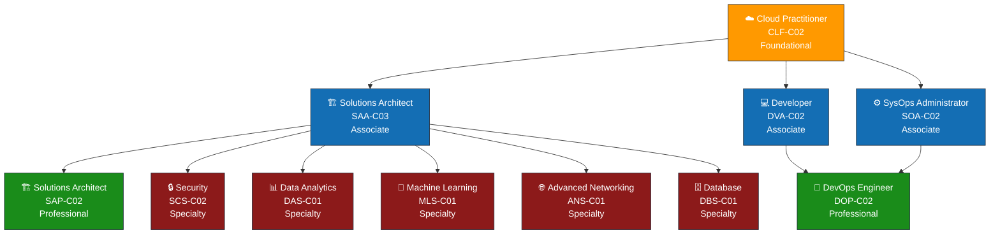

# ☁️ What is AWS & Why Use It

---

## 📖 What You'll Learn

By the end of this guide, you will understand:

- ✅ What Amazon Web Services (AWS) actually is
- ✅ The complete history of AWS from 2002 to 2025
- ✅ AWS Global Infrastructure — Regions, Availability Zones, Edge Locations
- ✅ 10+ compelling reasons to use AWS
- ✅ All major AWS service categories
- ✅ 30+ most popular AWS services (with descriptions)
- ✅ How AWS pricing works (Pay-as-you-go, Reserved, Spot)
- ✅ AWS Free Tier — what's free and for how long
- ✅ AWS Certifications roadmap
- ✅ AWS vs Traditional Hosting
- ✅ Real-world case studies (Netflix, Airbnb, NASA, etc.)
- ✅ The AWS Shared Responsibility Model
- ✅ Be ready to answer 15+ AWS interview questions

---

## 📋 Prerequisites

- ✅ Read [01 - Cloud Computing Introduction](./01-cloud-computing-introduction.md) first
- ✅ Understand what IaaS, PaaS, and SaaS mean
- ✅ Know the difference between public, private, and hybrid cloud

---

## 1. What is Amazon Web Services (AWS)? 🟠

### Simple Definition

**Amazon Web Services (AWS)** is a cloud computing platform provided by Amazon that offers over 200 services — including computing power, storage, databases, machine learning, analytics, networking, security, and more — all delivered over the internet on a pay-as-you-go basis.

### Real-World Analogy 🏪

Think of AWS as a **giant hardware store + tool rental shop**:

- Need a drill for one day? **Rent it.** (= Launch an EC2 server for a day)
- Need a storage unit for your boxes? **Rent one.** (= Store files in S3)
- Need a forklift for a heavy job? **Rent it for an hour.** (= Use a powerful GPU instance for ML training)
- Need nothing? **Pay nothing.** (= Stop instances and stop paying)

You don't buy the tools — you rent exactly what you need, when you need it, and return them when you're done.

### Key Facts About AWS

| Fact | Detail |
|------|--------|
| **Owned by** | Amazon.com, Inc. |
| **CEO of AWS** | Matt Garman (as of 2025) |
| **Launched** | 2006 (publicly) |
| **Revenue (2024)** | ~$107 billion annually |
| **Market Share** | ~31% of the global cloud market |
| **Services Offered** | 200+ |
| **Global Regions** | 34+ |
| **Availability Zones** | 108+ |
| **Customers** | Millions — from solo developers to Fortune 500 companies |
| **Data Centers** | Hundreds worldwide |

> 💡 **Fun Fact:** AWS generates more profit for Amazon than its entire e-commerce business! Amazon's online store operates on thin margins, but AWS has profit margins of around 30%.

---

## 2. History of AWS — The Complete Timeline 📜

```
2002 ─── Amazon internally starts building reusable infrastructure services
  │       └── Engineers realize they can offer infrastructure as a service
  │
2003 ─── Chris Pinkham and Benjamin Black write a paper proposing
  │       selling Amazon's infrastructure as a service
  │
2004 ─── SQS (Simple Queue Service) launches — AWS's first public service
  │
2006 ─── THE BIG LAUNCH YEAR ★
  │       ├── March: S3 (Simple Storage Service) launches
  │       ├── August: EC2 (Elastic Compute Cloud) launches in beta
  │       └── AWS is officially born as a business unit
  │
2007 ─── Over 180,000 developers sign up for AWS
  │       └── SimpleDB launches (early NoSQL database)
  │
2008 ─── EC2 exits beta and becomes generally available
  │       └── Elastic Block Store (EBS) launches
  │
2009 ─── Amazon RDS (Relational Database Service) launches
  │       ├── AWS Management Console launches (web-based UI)
  │       ├── CloudFront (CDN) launches
  │       └── VPC (Virtual Private Cloud) launches
  │
2010 ─── AWS revenue hits $500 million
  │       └── Amazon.com itself fully migrates to AWS
  │       └── Route 53 (DNS service) launches
  │
2011 ─── CloudFormation launches (Infrastructure as Code)
  │       ├── DynamoDB launches
  │       ├── Elastic Beanstalk launches (PaaS)
  │       └── AWS GovCloud launches (for government workloads)
  │
2012 ─── AWS re:Invent conference begins (now the world's largest cloud event)
  │       ├── DynamoDB launches (NoSQL database)
  │       ├── Redshift launches (data warehouse)
  │       └── Netflix becomes AWS's most famous customer
  │
2013 ─── AWS revenue exceeds $3 billion
  │       ├── Kinesis launches (real-time data streaming)
  │       ├── WorkSpaces launches (virtual desktops)
  │       └── CloudTrail launches (API logging/auditing)
  │
2014 ─── AWS Lambda launches — SERVERLESS COMPUTING IS BORN ★
  │       ├── Aurora launches (high-performance MySQL/PostgreSQL)
  │       ├── CodeDeploy, CodePipeline launch
  │       └── AWS revenue hits $4.6 billion
  │
2015 ─── Amazon publicly reports AWS revenue for the first time
  │       ├── AWS revenue: $7.88 billion
  │       ├── IoT Core launches
  │       ├── API Gateway launches
  │       └── AWS becomes Amazon's most profitable division
  │
2016 ─── AWS revenue hits $12.2 billion
  │       ├── Lightsail launches (simplified VPS)
  │       ├── Step Functions launches (serverless orchestration)
  │       ├── Rekognition launches (AI image analysis)
  │       └── Polly and Lex launch (AI text-to-speech, chatbot)
  │
2017 ─── AWS revenue hits $17.5 billion
  │       ├── SageMaker launches (ML platform) ★
  │       ├── Fargate launches (serverless containers)
  │       ├── EKS announced (managed Kubernetes)
  │       └── DeepLens launches (AI-enabled camera)
  │
2018 ─── AWS revenue hits $25.7 billion
  │       ├── AWS Ground Station launches (satellite data)
  │       ├── AWS Outposts announced (hybrid cloud)
  │       └── Amazon Comprehend Medical launches (healthcare NLP)
  │
2019 ─── AWS revenue hits $35 billion
  │       ├── AWS Outposts ships
  │       ├── Amazon EventBridge launches
  │       ├── AWS Local Zones announced
  │       └── AWS Wavelength announced (5G edge computing)
  │
2020 ─── COVID-19 pandemic drives massive cloud adoption ★
  │       ├── AWS revenue hits $45.4 billion
  │       ├── Remote work surge drives 30%+ growth
  │       ├── Amazon Honeycode launches (no-code)
  │       └── AWS launches 40+ new data center availability zones
  │
2021 ─── AWS revenue hits $62.2 billion
  │       ├── AWS CEO: Adam Selipsky succeeds Andy Jassy
  │       │   (Andy Jassy becomes Amazon CEO)
  │       ├── AWS Graviton3 chips announced (custom ARM processors)
  │       └── SageMaker Canvas launches (no-code ML)
  │
2022 ─── AWS revenue hits $80 billion
  │       ├── AWS Clean Rooms launches
  │       ├── AWS Supply Chain launches
  │       ├── Amazon CodeWhisperer launches (AI code generation)
  │       └── Cost optimization becomes #1 priority for customers
  │
2023 ─── AWS revenue hits $91 billion
  │       ├── Amazon Bedrock launches (generative AI platform) ★
  │       ├── Amazon Q launches (AI assistant for businesses)
  │       ├── AWS Trainium2 chips announced (custom AI chips)
  │       ├── Generative AI drives new wave of cloud adoption
  │       └── CodeWhisperer becomes Amazon Q Developer
  │
2024 ─── AWS revenue exceeds $107 billion
  │       ├── Matt Garman becomes AWS CEO
  │       ├── Amazon Nova foundation models launch
  │       ├── AWS invests $150 billion in data center expansion
  │       ├── Amazon Q Developer gains wide adoption
  │       └── Graviton4 processors launch
  │
2025 ─── AWS continues to lead the cloud market
          ├── AI-first approach across all services
          ├── Custom silicon (Graviton, Trainium, Inferentia) expands
          ├── 34+ regions, 108+ availability zones worldwide
          └── Focus on cost optimization and sustainability
```

> 📌 **Key Takeaway:** AWS started as an internal project at Amazon, became the first major cloud provider in 2006, and now generates over $107 billion in annual revenue. It has maintained market leadership for nearly 20 years.

---

## 3. AWS Global Infrastructure 🌍

### What Makes AWS Global?

AWS has the **largest and most comprehensive** global cloud infrastructure. Understanding it is crucial because:
- It determines **where your data lives**
- It affects **how fast your app responds** to users worldwide
- It impacts your **disaster recovery strategy**
- It matters for **compliance** (some data must stay in certain countries)

---

### 3.1 Regions 🌐

**What is a Region?**
A Region is a **physical location** in the world where AWS has a cluster of data centers. Each region is completely independent and isolated from others.

**As of 2025, AWS has 34+ Regions worldwide:**

```
                        AWS Global Regions Map (Simplified)
    ┌──────────────────────────────────────────────────────────────┐
    │                                                              │
    │          🇨🇦 Canada          🇬🇧🇩🇪🇫🇷🇮🇹🇪🇸🇸🇪🇨🇭                    │
    │         (Central,West)      Europe                          │
    │                          (8 regions)                         │
    │                                              🇯🇵 Tokyo       │
    │   🇺🇸 US                                     🇯🇵 Osaka       │
    │   (East, West,              🇮🇱 Israel       🇰🇷 Seoul       │
    │    GovCloud x2)             🇦🇪 UAE          🇭🇰 Hong Kong   │
    │                             🇧🇭 Bahrain      🇨🇳 China x2    │
    │                             🇮🇳 Mumbai                       │
    │   🇧🇷 São Paulo             🇮🇳 Hyderabad     🇸🇬 Singapore  │
    │                                              🇮🇩 Jakarta     │
    │                             🇿🇦 Cape Town     🇦🇺 Australia   │
    │                                              (Sydney,Melb)  │
    │                              🇳🇿 New Zealand                 │
    └──────────────────────────────────────────────────────────────┘
```

**How to choose a Region:**

| Factor | What to Consider |
|--------|-----------------|
| **Latency** | Choose the region closest to your users |
| **Compliance** | Some laws require data to stay in specific countries (e.g., GDPR in Europe) |
| **Service Availability** | Not all services are available in every region |
| **Pricing** | Prices vary by region (US East is usually cheapest) |

> 💡 **Pro Tip:** For most beginners, use **us-east-1 (N. Virginia)** — it has the most services available and is usually the cheapest. For Indian users, **ap-south-1 (Mumbai)** gives the lowest latency.

---

### 3.2 Availability Zones (AZs) 🏢

**What is an Availability Zone?**
An Availability Zone is **one or more discrete data centers** within a Region. Each AZ has independent power, cooling, and networking.

**Key points:**
- Each Region has **at least 3 AZs** (most have 3-6)
- AZs are connected via **high-speed, low-latency links**
- AZs are **physically separated** (different buildings, sometimes miles apart) to protect against disasters
- If one AZ goes down, the others in the same region keep running
- AWS has **108+ Availability Zones** globally

```
                    AWS Region: ap-south-1 (Mumbai)
    ┌─────────────────────────────────────────────────────┐
    │                                                     │
    │   ┌─────────────┐    ┌─────────────┐    ┌────────┐ │
    │   │  AZ-1 (1a)  │    │  AZ-2 (1b)  │    │AZ-3(1c)│ │
    │   │             │    │             │    │        │ │
    │   │ ┌─────────┐ │    │ ┌─────────┐ │    │┌──────┐│ │
    │   │ │Data Ctr │ │    │ │Data Ctr │ │    ││Data  ││ │
    │   │ │ 1 & 2   │ │    │ │ 3 & 4   │ │    ││Ctr 5 ││ │
    │   │ └─────────┘ │    │ └─────────┘ │    │└──────┘│ │
    │   │             │    │             │    │        │ │
    │   │ Own Power   │    │ Own Power   │    │Own Pwr │ │
    │   │ Own Cooling │    │ Own Cooling │    │Own Cool│ │
    │   │ Own Network │    │ Own Network │    │Own Net │ │
    │   └──────┬──────┘    └──────┬──────┘    └───┬────┘ │
    │          │                  │                │      │
    │          └──── High-Speed Links (< 2ms) ────┘      │
    │                                                     │
    └─────────────────────────────────────────────────────┘
```

**Why do AZs matter?**
> Deploy your application across multiple AZs. If one data center catches fire or floods, your application keeps running in another AZ — your users won't even notice!

---

### 3.3 Edge Locations 📡

**What are Edge Locations?**
Edge Locations are **small data centers** spread across 600+ locations worldwide. They're used for:
- **CloudFront (CDN)** — caching content close to users for faster delivery
- **Route 53 (DNS)** — responding to DNS queries quickly
- **AWS WAF** — filtering malicious requests at the edge
- **Lambda@Edge** — running code at edge locations

**Key points:**
- There are **600+ Edge Locations** and **13+ Regional Edge Caches**
- Edge Locations are in more cities than Regions
- They serve content from the location **nearest to the user**

```
    How Edge Locations Work (CDN Example):

    User in Tokyo          Edge Location in Tokyo       AWS Region (US East)
    ┌──────────┐           ┌──────────────────┐         ┌──────────────────┐
    │          │  Request  │                  │  First   │                  │
    │  👤 User │ ────────► │  📡 Edge Location│ ───────► │  🖥️ Your Server  │
    │          │           │                  │  request │  (Origin)        │
    │          │  ◄─────── │  Returns cached  │ ◄─────── │  Sends content   │
    │          │  FAST!    │  copy (< 10ms)   │          │                  │
    └──────────┘           └──────────────────┘         └──────────────────┘

    For the FIRST request: Data travels from US to Tokyo (slow ~ 200ms)
    For ALL subsequent requests: Data is served from Tokyo edge (fast ~ 10ms!)
```

---

### 📊 Infrastructure Summary

| Component | Count (2025) | Purpose |
|-----------|-------------|---------|
| **Regions** | 34+ | Geographic areas with data centers |
| **Availability Zones** | 108+ | Independent data centers within regions |
| **Edge Locations** | 600+ | CDN and DNS content delivery points |
| **Regional Edge Caches** | 13+ | Mid-tier caching between edge and region |
| **Local Zones** | 30+ | Low-latency compute in more cities |
| **Wavelength Zones** | 30+ | Ultra-low latency at 5G network edge |
| **Countries Served** | 245+ | Global coverage |

---

## 4. Why Use AWS? (10+ Reasons) 🎯

### Reason 1: 🏆 Market Leader
AWS has been the #1 cloud provider since 2006. With 31% market share, more companies trust AWS than any other cloud. This means more community support, more tutorials, and more job opportunities.

### Reason 2: 📦 Most Services (200+)
AWS offers the widest range of cloud services — over 200. Whatever you need (compute, storage, AI, IoT, robotics, satellite, quantum computing), AWS probably has a service for it.

### Reason 3: 🌍 Largest Global Infrastructure
34+ Regions, 108+ Availability Zones, 600+ Edge Locations. No other cloud provider has this reach. Your users anywhere in the world can get fast responses.

### Reason 4: 💰 Pay-As-You-Go Pricing
No upfront costs. No long-term contracts (unless you want them for discounts). Pay by the second/minute/hour for what you use. Scale down when you don't need resources and your bill drops immediately.

### Reason 5: 🆓 Generous Free Tier
AWS offers a free tier that includes:
- 750 hours/month of EC2 (t2.micro or t3.micro) for 12 months
- 5 GB of S3 storage for 12 months
- 25 GB of DynamoDB storage (always free)
- 1 million Lambda requests/month (always free)
- And much more — enough to learn and build real projects!

### Reason 6: 🔐 Enterprise-Grade Security
AWS meets the security requirements of military, global banks, and government agencies. It has more compliance certifications than any other cloud provider, including SOC, PCI DSS, HIPAA, FedRAMP, and GDPR.

### Reason 7: 🤖 Leading AI/ML Services
From SageMaker to Bedrock to Amazon Q, AWS offers cutting-edge AI/ML tools. You can train custom models, use pre-built AI services (image recognition, language processing, chatbots), or access foundation models from providers like Anthropic, Meta, and Mistral.

### Reason 8: 🧑‍💻 Largest Community & Ecosystem
- Most Stack Overflow answers about cloud
- Most YouTube tutorials
- Largest partner network (100,000+ AWS partners)
- Annual re:Invent conference with 60,000+ attendees
- AWS Heroes, User Groups, and Community Builders programs

### Reason 9: 📈 Proven Scalability
Netflix streams to 250+ million subscribers, Airbnb handles millions of bookings, NASA processes terabytes of satellite data — all on AWS. If they can do it, your app can too.

### Reason 10: 💼 Best for Career Growth
AWS certifications are the **most in-demand** cloud certifications. AWS skills command higher salaries than Azure or GCP skills in most markets. Almost every company hiring for cloud roles wants AWS experience.

### Reason 11: 🔧 Mature Tooling & DevOps Support
AWS has comprehensive tools for CI/CD (CodePipeline, CodeBuild, CodeDeploy), Infrastructure as Code (CloudFormation, CDK), monitoring (CloudWatch), and logging (CloudTrail). The AWS CLI and SDKs support every major programming language.

### Reason 12: 🔄 Continuous Innovation
AWS launches hundreds of new features and services every year. The annual re:Invent conference always introduces groundbreaking services. AWS invests billions in R&D, including custom silicon (Graviton, Trainium, Inferentia chips).

---

## 5. AWS Service Categories 📂

AWS services are organized into categories. Here's an overview:

```
                            AWS Service Categories
    ┌─────────────────────────────────────────────────────────────┐
    │                                                             │
    │  ┌──────────┐  ┌──────────┐  ┌──────────┐  ┌───────────┐  │
    │  │ Compute  │  │ Storage  │  │ Database │  │Networking │  │
    │  │ EC2      │  │ S3       │  │ RDS      │  │ VPC       │  │
    │  │ Lambda   │  │ EBS      │  │ DynamoDB │  │ Route 53  │  │
    │  │ ECS/EKS  │  │ EFS      │  │ Aurora   │  │ CloudFront│  │
    │  │ Fargate  │  │ Glacier  │  │ ElastiC. │  │ ELB       │  │
    │  └──────────┘  └──────────┘  └──────────┘  └───────────┘  │
    │                                                             │
    │  ┌──────────┐  ┌──────────┐  ┌──────────┐  ┌───────────┐  │
    │  │ Security │  │ AI / ML  │  │Analytics │  │  DevOps   │  │
    │  │ IAM      │  │SageMaker │  │ Athena   │  │CodePipeli.│  │
    │  │ KMS      │  │ Bedrock  │  │ Redshift │  │ CodeBuild │  │
    │  │ WAF      │  │ Rekognit.│  │ Glue     │  │CloudForm. │  │
    │  │ Shield   │  │ Polly    │  │ Kinesis  │  │CloudWatch │  │
    │  └──────────┘  └──────────┘  └──────────┘  └───────────┘  │
    │                                                             │
    │  ┌──────────┐  ┌──────────┐  ┌──────────┐  ┌───────────┐  │
    │  │App Integ.│  │Containers│  │  IoT     │  │Management │  │
    │  │ SQS      │  │ ECS      │  │ IoT Core │  │ Systems   │  │
    │  │ SNS      │  │ EKS      │  │ Greengrss│  │  Manager  │  │
    │  │ EventBr. │  │ Fargate  │  │ IoT Anal.│  │ Org.      │  │
    │  │ Step Fn  │  │ ECR      │  │ IoT Thin.│  │ Control   │  │
    │  └──────────┘  └──────────┘  └──────────┘  │  Tower    │  │
    │                                             └───────────┘  │
    └─────────────────────────────────────────────────────────────┘
```

---

## 6. Most Popular AWS Services (30+ Services) 📋

### 🖥️ Compute Services

| # | Service | Description |
|---|---------|------------|
| 1 | **EC2** (Elastic Compute Cloud) | Virtual servers in the cloud — the most fundamental AWS service. Launch any size server in minutes. |
| 2 | **Lambda** | Run code without managing servers. Pay only when your code runs. Serverless computing at its finest. |
| 3 | **ECS** (Elastic Container Service) | Run Docker containers on AWS. Manage clusters of containers without managing servers. |
| 4 | **EKS** (Elastic Kubernetes Service) | Managed Kubernetes — run containerized applications using the Kubernetes orchestration system. |
| 5 | **Fargate** | Serverless compute for containers — run containers without managing the underlying EC2 instances. |
| 6 | **Elastic Beanstalk** | PaaS service — upload your code and AWS handles deployment, scaling, and monitoring automatically. |
| 7 | **Lightsail** | Simplified VPS (Virtual Private Server) — the easiest way to launch a simple website or app. |

### 💾 Storage Services

| # | Service | Description |
|---|---------|------------|
| 8 | **S3** (Simple Storage Service) | Object storage — store unlimited files (images, videos, backups, data) with 99.999999999% durability. |
| 9 | **EBS** (Elastic Block Store) | Block storage — virtual hard drives for EC2 instances. Like attaching a USB drive to your server. |
| 10 | **EFS** (Elastic File System) | Managed file storage that can be shared across multiple EC2 instances simultaneously. |
| 11 | **S3 Glacier** | Ultra-low-cost archival storage for data you rarely access (backups, compliance archives). |

### 🗄️ Database Services

| # | Service | Description |
|---|---------|------------|
| 12 | **RDS** (Relational Database Service) | Managed SQL databases — supports MySQL, PostgreSQL, MariaDB, Oracle, SQL Server. |
| 13 | **Aurora** | AWS's own high-performance relational database — up to 5x faster than MySQL, 3x faster than PostgreSQL. |
| 14 | **DynamoDB** | Fully managed NoSQL database — single-digit millisecond performance at any scale. |
| 15 | **ElastiCache** | In-memory caching — supports Redis and Memcached. Makes your app faster by caching frequently accessed data. |
| 16 | **Redshift** | Cloud data warehouse — analyze petabytes of data using SQL queries. |
| 17 | **DocumentDB** | Managed MongoDB-compatible document database. |

### 🌐 Networking & Content Delivery

| # | Service | Description |
|---|---------|------------|
| 18 | **VPC** (Virtual Private Cloud) | Your own private, isolated network in AWS. Like having your own private office floor in a building. |
| 19 | **Route 53** | DNS service — translates domain names (google.com) to IP addresses. Also handles domain registration. |
| 20 | **CloudFront** | Content Delivery Network (CDN) — caches content at 600+ edge locations for fast global delivery. |
| 21 | **ELB** (Elastic Load Balancing) | Distributes incoming traffic across multiple servers for better performance and reliability. |
| 22 | **API Gateway** | Create, publish, and manage REST and WebSocket APIs at any scale. |

### 🔒 Security & Identity

| # | Service | Description |
|---|---------|------------|
| 23 | **IAM** (Identity & Access Management) | Control WHO can access WHAT in your AWS account. The most important security service. |
| 24 | **KMS** (Key Management Service) | Create and manage encryption keys to protect your data. |
| 25 | **WAF** (Web Application Firewall) | Protects your web apps from common web attacks (SQL injection, XSS, DDoS). |
| 26 | **Shield** | DDoS protection — prevents distributed denial-of-service attacks on your applications. |
| 27 | **Cognito** | User authentication — add sign-up, sign-in, and access control to your web and mobile apps. |
| 28 | **Secrets Manager** | Securely store API keys, database passwords, and other secrets. Rotate them automatically. |

### 🤖 Machine Learning & AI

| # | Service | Description |
|---|---------|------------|
| 29 | **SageMaker** | Build, train, and deploy machine learning models. End-to-end ML platform. |
| 30 | **Bedrock** | Access foundation models (Claude, Llama, Titan) for generative AI applications. |
| 31 | **Rekognition** | Image and video analysis — detect objects, faces, text, and inappropriate content. |
| 32 | **Polly** | Text-to-speech — convert text into lifelike speech in dozens of languages. |
| 33 | **Comprehend** | Natural Language Processing (NLP) — analyze text for sentiment, entities, and topics. |
| 34 | **Transcribe** | Speech-to-text — convert audio recordings to text transcriptions. |

### 🔧 Management & DevOps

| # | Service | Description |
|---|---------|------------|
| 35 | **CloudWatch** | Monitoring and observability — track metrics, collect logs, set alarms for your AWS resources. |
| 36 | **CloudFormation** | Infrastructure as Code — define your entire AWS infrastructure in JSON/YAML templates. |
| 37 | **CloudTrail** | Audit logging — records every API call made in your AWS account (who did what, when). |
| 38 | **Systems Manager** | Manage and configure your EC2 instances at scale — run commands, patch software, store parameters. |
| 39 | **CodePipeline** | CI/CD — automate your build, test, and deploy process. |
| 40 | **CodeBuild** | Managed build service — compile code, run tests, produce deployable packages. |

### 📨 Application Integration

| # | Service | Description |
|---|---------|------------|
| 41 | **SQS** (Simple Queue Service) | Message queuing — send, store, and receive messages between microservices. |
| 42 | **SNS** (Simple Notification Service) | Pub/sub messaging — send notifications via email, SMS, HTTP, or to other AWS services. |
| 43 | **EventBridge** | Serverless event bus — connect applications using events from AWS services, SaaS apps, or your own code. |
| 44 | **Step Functions** | Orchestrate multiple AWS services into serverless workflows using visual state machines. |

---

## 7. AWS Pricing Model Explained 💰

### The Core Principle

> **"Pay only for what you use, when you use it."**

Think of it like your electricity bill:
- You don't pay a flat fee for electricity each month
- You pay based on how many kilowatt-hours you actually consumed
- Use more → pay more. Use less → pay less. Use nothing → pay nothing.

---

### 7.1 Pay-As-You-Go (On-Demand) 💳

**What it is:** Pay for resources by the second/minute/hour with no upfront commitment.

**Best for:** Variable workloads, development/testing, unpredictable traffic.

| Service | Pricing Example |
|---------|----------------|
| EC2 (t3.micro) | ~$0.0104/hour (~$7.50/month if running 24/7) |
| S3 Storage | ~$0.023 per GB/month |
| Lambda | $0.20 per 1 million requests + compute time |
| RDS (db.t3.micro) | ~$0.017/hour |

> 💡 **Pro Tip:** Always stop your EC2 instances when you're not using them. A running instance = a running bill!

---

### 7.2 Reserved Instances (Savings Plans) 📋

**What it is:** Commit to using a specific amount of resources for 1 or 3 years in exchange for a significant discount (up to 72%).

**Best for:** Steady-state workloads, production databases, applications that run 24/7.

| Commitment | Discount vs On-Demand |
|-----------|----------------------|
| 1 year, no upfront | ~36% savings |
| 1 year, partial upfront | ~42% savings |
| 1 year, all upfront | ~45% savings |
| 3 year, no upfront | ~50% savings |
| 3 year, partial upfront | ~60% savings |
| 3 year, all upfront | ~72% savings |

**Example:**
- On-Demand EC2 (m5.large): ~$70/month
- 1-year Reserved: ~$45/month (36% cheaper)
- 3-year Reserved: ~$20/month (72% cheaper!)

---

### 7.3 Spot Instances 🎰

**What it is:** Use AWS's **unused** EC2 capacity at up to **90% discount**. But AWS can take the instance back with 2 minutes' notice when they need it.

**Best for:** Batch processing, data analysis, CI/CD builds, fault-tolerant workloads, machine learning training.

**NOT suitable for:** Databases, web servers, any application that can't handle interruptions.

| Pricing Example | On-Demand | Spot Price | Savings |
|----------------|-----------|------------|---------|
| c5.xlarge | $0.170/hr | $0.034/hr | 80% |
| m5.2xlarge | $0.384/hr | $0.077/hr | 80% |
| p3.2xlarge (GPU) | $3.06/hr | $0.918/hr | 70% |

> 💡 **Pro Tip:** Spot instances are perfect for ML model training. If your training gets interrupted, you can resume from a checkpoint.

---

### 7.4 Free Tier 🆓

AWS offers three types of free offerings:

| Type | Duration | Example |
|------|----------|---------|
| **12-Month Free** | First 12 months after sign-up | 750 hrs/month EC2 (t2.micro), 5 GB S3, 750 hrs/month RDS |
| **Always Free** | Forever, no expiration | 1M Lambda requests/month, 25 GB DynamoDB, 1M SNS publishes |
| **Short-Term Trials** | Varies by service | 60 days of SageMaker Studio, 2 months of Redshift |

> ⚠️ **Warning:** The Free Tier has limits! If you exceed them, you WILL be charged. Always set up billing alerts (we'll cover this in the next file).

---

### Pricing Comparison Diagram

```
    AWS Pricing Models Compared
    ════════════════════════════════════════════════════════

    On-Demand:    ████████████████████████████████████████  $100
                  (Full price, max flexibility)

    Reserved 1yr: ██████████████████████████░░░░░░░░░░░░░░  $60
                  (Commit 1 year, ~40% savings)

    Reserved 3yr: █████████████░░░░░░░░░░░░░░░░░░░░░░░░░░  $30
                  (Commit 3 years, ~70% savings)

    Spot:         ████░░░░░░░░░░░░░░░░░░░░░░░░░░░░░░░░░░░  $10
                  (Up to 90% off, can be interrupted)

    ════════════════════════════════════════════════════════
```

---

## 8. AWS Free Tier — Detailed Breakdown 🆓

### Most Important Free Tier Services

| Service | Free Tier Allowance | Duration |
|---------|-------------------|----------|
| **EC2** | 750 hours/month of t2.micro or t3.micro (Linux/Windows) | 12 months |
| **S3** | 5 GB of standard storage, 20,000 GET requests, 2,000 PUT requests | 12 months |
| **RDS** | 750 hours/month of db.t2.micro or db.t3.micro, 20 GB storage | 12 months |
| **Lambda** | 1 million requests/month, 400,000 GB-seconds of compute | Always free |
| **DynamoDB** | 25 GB of storage, 25 read/write capacity units | Always free |
| **CloudFront** | 1 TB of data transfer out, 10 million HTTP/HTTPS requests | Always free |
| **SNS** | 1 million publishes, 100,000 HTTP deliveries, 1,000 email deliveries | Always free |
| **SQS** | 1 million requests/month | Always free |
| **CloudWatch** | 10 custom metrics, 10 alarms, 1 million API requests | Always free |
| **API Gateway** | 1 million REST API calls/month | 12 months |
| **Cognito** | 50,000 monthly active users | Always free |
| **CodeBuild** | 100 build minutes/month | Always free |
| **CodePipeline** | 1 active pipeline/month | Always free |
| **CodeCommit** | 5 active users, 50 GB storage, 10,000 Git requests | Always free |

> 💡 **Pro Tip:** You can build a **complete full-stack application** without spending a single dollar using the Free Tier: EC2 for backend, S3 for storage, DynamoDB for database, Lambda for serverless functions, API Gateway for REST APIs, and CloudFront for CDN.

---

## 9. AWS Certifications Roadmap 🎓

AWS offers certifications at four levels. Here's the recommended path:



### Certification Details

| Level | Certification | Exam Code | Duration | Cost | Recommended Experience |
|-------|--------------|-----------|----------|------|----------------------|
| **Foundational** | Cloud Practitioner | CLF-C02 | 90 min | $100 | None (beginner-friendly) |
| **Associate** | Solutions Architect | SAA-C03 | 130 min | $150 | 1 year of AWS experience |
| **Associate** | Developer | DVA-C02 | 130 min | $150 | 1 year of development on AWS |
| **Associate** | SysOps Administrator | SOA-C02 | 130 min | $150 | 1 year of operations on AWS |
| **Professional** | Solutions Architect | SAP-C02 | 180 min | $300 | 2 years of AWS experience |
| **Professional** | DevOps Engineer | DOP-C02 | 180 min | $300 | 2 years of AWS DevOps experience |
| **Specialty** | Security | SCS-C02 | 170 min | $300 | 2 years of AWS security experience |
| **Specialty** | Machine Learning | MLS-C01 | 180 min | $300 | 2 years of ML experience on AWS |
| **Specialty** | Database | DBS-C01 | 180 min | $300 | 5 years of database + 2 years AWS |
| **Specialty** | Advanced Networking | ANS-C01 | 170 min | $300 | 5 years of networking + 2 years AWS |
| **Specialty** | Data Analytics | DAS-C01 | 180 min | $300 | 2 years of data analytics on AWS |

> 💡 **Recommended Path for Beginners:**
> 1. Start with **Cloud Practitioner** (CLF-C02) — great for understanding AWS basics
> 2. Then go for **Solutions Architect Associate** (SAA-C03) — the most popular and valuable AWS cert
> 3. Then choose your specialization based on your career goals

---

## 10. AWS vs Traditional Hosting 🏢 vs ☁️

| Feature | Traditional Hosting | AWS Cloud Hosting |
|---------|-------------------|-------------------|
| **Setup Time** | Days to weeks | Minutes |
| **Upfront Cost** | $1,000 — $100,000+ (buy servers, rent rack space) | $0 (pay-as-you-go) |
| **Monthly Cost** | Fixed (even when unused) | Variable (based on usage) |
| **Scalability** | Buy/install new hardware (weeks) | Click "scale" (seconds) |
| **Global Deployment** | Buy/rent servers in each location | Select a region from a dropdown |
| **Backup** | Set up manually (NAS, tape drives) | Automated with S3, snapshots |
| **Disaster Recovery** | Build a second data center ($$$) | Multi-AZ deployment (built-in) |
| **Security** | Hire security team, buy firewalls | AWS manages physical security; shared responsibility |
| **Maintenance** | Your team patches, updates, replaces hardware | AWS handles hardware; you handle software |
| **Monitoring** | Install monitoring tools (Nagios, Zabbix) | CloudWatch built-in |
| **Innovation** | Buy and install new technology manually | New AWS services available instantly |
| **Contract** | 1–3 year hosting contracts | No long-term contract required |
| **Control** | Full physical control | Full logical control (no physical access) |

### Example: Hosting a Website

```
    Traditional Hosting                      AWS Hosting
    ───────────────────                      ───────────────
    
    1. Buy a server ($2,000)                 1. Launch EC2 ($0 free tier)
    2. Rent rack space ($200/mo)             2. Configure in 5 minutes
    3. Install OS ($0-$500)                  3. Deploy code
    4. Configure networking                  4. Done! ✅
    5. Install web server
    6. Configure firewall
    7. Set up backup system
    8. Deploy code
    9. Pray it doesn't break 🤞
    
    Total time: 2–4 weeks                   Total time: 15 minutes
    Total cost: $3,000+ setup               Total cost: $0 (free tier)
    Monthly: $200+ fixed                    Monthly: ~$5-10 (or free)
```

---

## 11. Real-World AWS Case Studies 🏢

### 🎬 Netflix

| Detail | Information |
|--------|------------|
| **What they do** | World's largest streaming service (250M+ subscribers) |
| **AWS services used** | EC2, S3, DynamoDB, Lambda, CloudFront, SQS, and many more |
| **Why AWS?** | Need to stream video to millions simultaneously, globally |
| **Scale** | Handles billions of hours of streaming per quarter |
| **Key achievement** | Netflix runs 100% on AWS — zero own data centers |
| **Cost benefit** | Auto-scales for peak hours (8-11 PM) and scales down overnight |

> *"We chose AWS because it allowed us to use the right tools for each job... We can scale globally at a moment's notice."* — Netflix Tech Blog

---

### 🏠 Airbnb

| Detail | Information |
|--------|------------|
| **What they do** | World's largest accommodation platform |
| **AWS services used** | EC2, S3, RDS (MySQL), ElastiCache, EMR, Redshift |
| **Why AWS?** | Rapid global growth — needed to scale from thousands to millions of listings |
| **Scale** | 7+ million listings, 150+ million users across 220+ countries |
| **Key achievement** | Migrated from a single server to a massive AWS infrastructure |
| **Cost benefit** | Pays only for peak capacity during high-demand seasons (summer, holidays) |

---

### 🚀 NASA/JPL

| Detail | Information |
|--------|------------|
| **What they do** | Space exploration and research |
| **AWS services used** | EC2, S3, Lambda, SageMaker |
| **Why AWS?** | Process terabytes of satellite and Mars rover data in real-time |
| **Scale** | Processing data from Mars rovers, Hubble telescope, and dozens of satellites |
| **Key achievement** | Made Mars Curiosity rover landing images available to the public in real-time using AWS |

---

### 🎵 Spotify

| Detail | Information |
|--------|------------|
| **What they do** | World's largest music streaming service (600M+ users) |
| **Cloud provider** | Primarily Google Cloud, but uses AWS for some services |
| **Why mentioned?** | Shows that companies can use multiple cloud providers (multi-cloud) |

---

### 🏦 Capital One

| Detail | Information |
|--------|------------|
| **What they do** | Major US bank and financial services company |
| **AWS services used** | EC2, S3, Redshift, Lambda, DynamoDB |
| **Why AWS?** | First major US bank to go all-in on public cloud |
| **Key achievement** | Closed ALL data centers and moved entirely to AWS in 2020 |
| **Security note** | Uses AWS's extensive compliance certifications (PCI DSS, SOC) for banking requirements |

---

### 🎮 Epic Games (Fortnite)

| Detail | Information |
|--------|------------|
| **What they do** | Game developer behind Fortnite (80M+ monthly players) |
| **AWS services used** | EC2, EKS, S3, DynamoDB, GameLift |
| **Why AWS?** | Need to handle massive multiplayer sessions with low latency globally |
| **Scale** | 80+ million monthly active players with real-time matchmaking |
| **Key achievement** | Handles Fortnite live events with millions of concurrent players |

---

## 12. AWS Shared Responsibility Model 🔒

This is one of the **most important concepts** in AWS and appears in every AWS certification exam.

### The Concept

> AWS and the customer **share** the responsibility for security. AWS secures the cloud itself, and you secure what you put in the cloud.

```
    ┌──────────────────────────────────────────────────────────┐
    │            AWS SHARED RESPONSIBILITY MODEL                │
    ├──────────────────────────────────────────────────────────┤
    │                                                          │
    │   CUSTOMER RESPONSIBILITY                                │
    │   "Security IN the Cloud"                                │
    │   ┌──────────────────────────────────────────────────┐   │
    │   │ • Customer Data (what you store)                 │   │
    │   │ • Platform, Applications, IAM                    │   │
    │   │ • Operating System, Network, Firewall Config     │   │
    │   │ • Client-Side Data Encryption                    │   │
    │   │ • Server-Side Encryption                         │   │
    │   │ • Networking Traffic Protection                   │   │
    │   └──────────────────────────────────────────────────┘   │
    │                                                          │
    │   ─ ─ ─ ─ ─ ─ ─ ─ ─ BOUNDARY ─ ─ ─ ─ ─ ─ ─ ─ ─ ─ ─   │
    │                                                          │
    │   AWS RESPONSIBILITY                                     │
    │   "Security OF the Cloud"                                │
    │   ┌──────────────────────────────────────────────────┐   │
    │   │ • Physical Hardware & Data Centers               │   │
    │   │ • Global Infrastructure (Regions, AZs, Edge)     │   │
    │   │ • Compute, Storage, Database, Networking         │   │
    │   │ • Managed Services Software                      │   │
    │   │ • Hypervisor / Virtualization Layer               │   │
    │   │ • Physical Security (guards, cameras, access)    │   │
    │   └──────────────────────────────────────────────────┘   │
    │                                                          │
    └──────────────────────────────────────────────────────────┘
```

### Responsibility Changes by Service Type

| What | IaaS (EC2) | PaaS (Elastic Beanstalk) | SaaS (Amazon WorkMail) |
|------|-----------|-------------------------|----------------------|
| Customer Data | 👤 Customer | 👤 Customer | 👤 Customer |
| Application Code | 👤 Customer | 👤 Customer | ☁️ AWS |
| Operating System | 👤 Customer | ☁️ AWS | ☁️ AWS |
| Network Config | 👤 Customer | Shared | ☁️ AWS |
| Firewall Rules | 👤 Customer | 👤 Customer | ☁️ AWS |
| Encryption | 👤 Customer | Shared | ☁️ AWS |
| Physical Security | ☁️ AWS | ☁️ AWS | ☁️ AWS |
| Hardware | ☁️ AWS | ☁️ AWS | ☁️ AWS |

> 📌 **Key Takeaway:** The more "managed" the service is, the less you're responsible for. With Lambda (serverless), you only worry about your code and data. With EC2 (IaaS), you manage the OS, patches, firewall, and application.

---

## 13. Hands-On Practice 🧪

### Activity 1: Explore the AWS Console (Free, No Account Needed)

1. Go to [https://aws.amazon.com/products/](https://aws.amazon.com/products/)
2. Browse through all service categories
3. Click on at least 5 services you've never heard of
4. Read their one-line description and "How it works" diagram

### Activity 2: Check AWS's Global Infrastructure

1. Go to [https://aws.amazon.com/about-aws/global-infrastructure/](https://aws.amazon.com/about-aws/global-infrastructure/)
2. Explore the interactive map
3. Find the region closest to you
4. Note how many Availability Zones it has
5. Click on "Edge Locations" and see how many are near you

### Activity 3: Estimate Your AWS Bill

1. Go to [AWS Pricing Calculator](https://calculator.aws/)
2. Try configuring:
   - 1 EC2 t3.micro instance (Linux, us-east-1, 24/7)
   - 50 GB of S3 storage
   - 1 RDS db.t3.micro MySQL database
3. See the estimated monthly bill
4. Now try changing to Reserved Instances — see the savings!

### Activity 4: Read a Case Study

1. Go to [https://aws.amazon.com/solutions/case-studies/](https://aws.amazon.com/solutions/case-studies/)
2. Pick a company you know (Netflix, Airbnb, McDonald's, etc.)
3. Read how they use AWS and what benefits they got

---

## 14. Common Mistakes & Troubleshooting ⚠️

| Mistake | Why It's Wrong | Correct Understanding |
|---------|---------------|----------------------|
| "AWS is too expensive" | AWS is expensive only if you don't optimize | Use Free Tier, right-sizing, Reserved Instances, and Spot. A small app can run for $0–$10/month |
| "I need to learn ALL 200+ services" | Nobody knows all services | Focus on core services: EC2, S3, IAM, VPC, RDS, Lambda, DynamoDB, CloudFront — that covers 90% of use cases |
| "AWS is only for big companies" | Completely wrong | Millions of individual developers, startups, and students use AWS. The Free Tier is specifically designed for small users |
| "Once I choose AWS, I'm stuck forever" | Vendor lock-in is manageable | Use containers (Docker), Terraform, and open-source databases to stay portable. Many companies use multi-cloud |
| "AWS Region doesn't matter" | Choosing the wrong region affects latency, cost, and compliance | Always choose the region closest to your users. Check if your required services are available there |
| "Free Tier means everything is free" | Free Tier has STRICT limits | Going over limits WILL charge you. Always set up billing alerts on Day 1 |
| "I don't need IAM — I'll just use root account" | EXTREMELY dangerous | Never use root for daily tasks. Create IAM users immediately. This is AWS Security Rule #1 |
| "I can skip learning networking (VPC)" | VPC is fundamental to AWS security | Every EC2 instance, RDS database, and Lambda function runs inside a VPC. Understanding it is essential |

---

## 📌 Quick Summary

| Concept | Key Takeaway |
|---------|-------------|
| **AWS** | Amazon's cloud platform with 200+ services, 31% market share, $107B revenue |
| **Regions** | 34+ physical locations worldwide where AWS has data centers |
| **Availability Zones** | 108+ independent data centers within regions for high availability |
| **Edge Locations** | 600+ CDN and DNS endpoints for fast global content delivery |
| **Pricing** | Pay-as-you-go (flexible), Reserved (up to 72% off), Spot (up to 90% off) |
| **Free Tier** | 12-month free services + always-free services — enough to learn everything |
| **Core Services** | EC2, S3, IAM, VPC, RDS, Lambda, DynamoDB, CloudFront |
| **Shared Responsibility** | AWS secures the cloud; you secure what's in the cloud |
| **Certifications** | Start with Cloud Practitioner → Solutions Architect Associate |
| **Case Studies** | Netflix, Airbnb, NASA, Capital One — all run on AWS |

---

## 15. Interview Questions 🎤

### Beginner Level

**Q1: What is AWS? Give a brief overview.**
> **A:** AWS (Amazon Web Services) is a cloud computing platform by Amazon that provides over 200 services including compute (EC2), storage (S3), databases (RDS, DynamoDB), serverless (Lambda), and AI/ML (SageMaker, Bedrock) on a pay-as-you-go basis. Launched in 2006, AWS is the market leader with ~31% share, operating in 34+ regions with 108+ availability zones globally.

**Q2: What is an AWS Region?**
> **A:** An AWS Region is a geographic area where AWS has a cluster of data centers. Each region is fully independent and isolated from others. As of 2025, AWS has 34+ regions worldwide. Examples: us-east-1 (N. Virginia), ap-south-1 (Mumbai), eu-west-1 (Ireland). You choose a region based on user proximity (latency), data compliance, service availability, and pricing.

**Q3: What is an Availability Zone (AZ)?**
> **A:** An Availability Zone is one or more discrete data centers within an AWS Region. Each AZ has independent power, cooling, and networking. AZs are connected via high-speed, low-latency links but are physically separated to protect against disasters. Each region has at least 3 AZs. By deploying across multiple AZs, you achieve high availability — if one AZ fails, others continue serving traffic.

**Q4: What is an Edge Location?**
> **A:** An Edge Location is a small data center used by AWS CloudFront (CDN) and Route 53 (DNS) to cache content closer to end users. AWS has 600+ edge locations worldwide — far more than regions. When a user requests content, it's served from the nearest edge location, reducing latency from hundreds of milliseconds to single-digit milliseconds.

**Q5: What is the AWS Free Tier?**
> **A:** The AWS Free Tier offers three types of free usage: (1) 12-Month Free — services free for the first year (e.g., 750 hrs/month EC2 t2.micro, 5 GB S3), (2) Always Free — services that are always free within limits (e.g., 1M Lambda requests/month, 25 GB DynamoDB), and (3) Short-Term Trials — time-limited trials of specific services. It's designed for learning, testing, and building small applications without cost.

### Intermediate Level

**Q6: Explain the AWS Shared Responsibility Model.**
> **A:** The Shared Responsibility Model defines security responsibilities between AWS and the customer. AWS is responsible for "security OF the cloud" — physical hardware, data centers, global infrastructure, hypervisor, and managed service software. The customer is responsible for "security IN the cloud" — data, applications, IAM configuration, OS patching (for EC2), encryption, firewall rules, and network configuration. The split varies by service: for IaaS (EC2) you manage more; for SaaS (WorkMail) you manage less.

**Q7: Compare On-Demand, Reserved, and Spot instances.**
> **A:** On-Demand: Pay by the second with no commitment, full price, maximum flexibility — best for unpredictable workloads. Reserved: Commit for 1-3 years for up to 72% discount — best for steady-state production workloads. Spot: Use AWS's unused capacity at up to 90% discount, but instances can be interrupted with 2 minutes' notice — best for batch processing, CI/CD, and fault-tolerant workloads. Most companies use a mix of all three.

**Q8: What is Amazon S3? What makes it special?**
> **A:** Amazon S3 (Simple Storage Service) is an object storage service that offers 99.999999999% (11 nines) durability. You can store virtually unlimited data — files, images, videos, backups — organized in "buckets." S3 offers multiple storage classes (Standard, Infrequent Access, Glacier) for cost optimization. Key features: versioning, lifecycle policies, server-side encryption, static website hosting, and cross-region replication. It was one of the first AWS services (launched 2006).

**Q9: What is Amazon EC2? What are instance types?**
> **A:** Amazon EC2 (Elastic Compute Cloud) provides resizable virtual servers in the cloud. Instance types are categorized by use case: General Purpose (t3, m5 — balanced CPU/memory), Compute Optimized (c5 — high CPU for batch processing), Memory Optimized (r5 — large in-memory databases), Storage Optimized (i3 — high I/O), and Accelerated Computing (p3, g4 — GPU for ML/gaming). You choose an instance type based on your workload's CPU, memory, storage, and networking needs.

**Q10: What is AWS Lambda?**
> **A:** AWS Lambda is a serverless compute service that runs your code in response to events without you managing any servers. You upload your code, define triggers (HTTP request via API Gateway, S3 file upload, DynamoDB change, etc.), and Lambda runs the code automatically. You pay only for the compute time consumed (per 1ms). Lambda supports Node.js, Python, Java, C#, Go, and Ruby. Max execution time is 15 minutes. It's ideal for microservices, event-driven architectures, and API backends.

### Advanced Level

**Q11: How would you design a highly available architecture on AWS?**
> **A:** Deploy across multiple AZs in a region. Use an Application Load Balancer (ALB) to distribute traffic across EC2 instances in different AZs. Use Auto Scaling Groups to maintain desired instance count and handle traffic spikes. Use Multi-AZ RDS for database high availability. Store static assets in S3 with CloudFront CDN. Use Route 53 health checks for DNS failover. For disaster recovery across regions, use S3 cross-region replication, Aurora Global Database, and Route 53 latency-based routing. Implement infrastructure as code with CloudFormation for reproducibility.

**Q12: Explain VPC and its components.**
> **A:** A VPC (Virtual Private Cloud) is your isolated virtual network in AWS. Components: Subnets (public for internet-facing resources, private for backend/databases), Internet Gateway (connects VPC to the internet), NAT Gateway (lets private subnet instances access internet without being directly accessible), Route Tables (define traffic routing rules), Security Groups (instance-level stateful firewall), Network ACLs (subnet-level stateless firewall), VPC Peering (connect two VPCs), and VPN/Direct Connect (connect VPC to on-premises network). Every AWS resource runs inside a VPC.

**Q13: What is CloudFormation? Why is Infrastructure as Code important?**
> **A:** AWS CloudFormation is an Infrastructure as Code (IaC) service that lets you define your entire AWS infrastructure in JSON or YAML templates. You describe resources (EC2, S3, RDS, VPC, etc.) and their configurations, and CloudFormation creates/updates/deletes them automatically. Benefits: version control (track changes in Git), reproducibility (deploy identical environments in minutes), consistency (no manual configuration drift), automation (integrate with CI/CD), and disaster recovery (recreate entire infrastructure from template). Alternatives include AWS CDK (write IaC in TypeScript/Python) and Terraform (multi-cloud IaC).

**Q14: How does AWS ensure data security and compliance?**
> **A:** AWS uses multiple layers: Physical security (biometric access, 24/7 surveillance, security guards at data centers), Network security (DDoS protection with Shield, WAF for web app protection, VPC for network isolation), Data encryption (KMS for key management, S3/EBS/RDS encryption at rest, TLS for data in transit), Identity management (IAM for fine-grained access control, MFA, STS for temporary credentials), Auditing (CloudTrail logs every API call, AWS Config tracks resource changes, GuardDuty for threat detection). AWS holds 143+ compliance certifications including SOC 1/2/3, PCI DSS, HIPAA, FedRAMP, GDPR, and ISO 27001.

**Q15: Explain AWS Well-Architected Framework.**
> **A:** The Well-Architected Framework provides best practices across six pillars: (1) Operational Excellence — automate operations, make frequent small changes, anticipate failure. (2) Security — implement strong identity, enable traceability, apply security at all layers. (3) Reliability — auto-recover from failure, scale horizontally, stop guessing capacity. (4) Performance Efficiency — use serverless, experiment more often, go global in minutes. (5) Cost Optimization — pay only for what you use, measure efficiency, analyze spending. (6) Sustainability — understand environmental impact, reduce downstream resources, maximize utilization. AWS provides the Well-Architected Tool to assess workloads against these pillars.

**Q16: What is AWS Organizations and how does multi-account management work?**
> **A:** AWS Organizations lets you centrally manage multiple AWS accounts under one billing umbrella. Key features: Consolidated Billing (one bill for all accounts), Service Control Policies (SCPs — restrict what services accounts can use), Organizational Units (OUs — group accounts by function like Dev, Staging, Production), and AWS Control Tower (automated multi-account setup with guardrails). Best practice is to have separate accounts for different environments (dev/staging/prod), security (audit, log archive), shared services, and individual teams. This provides blast radius limitation, billing isolation, and security boundaries.

**Q17: How would you optimize costs on AWS?**
> **A:** Key strategies: (1) Right-sizing — use AWS Compute Optimizer to identify over-provisioned instances. (2) Reserved Instances/Savings Plans — commit for 1-3 years for up to 72% savings on steady workloads. (3) Spot Instances — use for fault-tolerant batch workloads at up to 90% discount. (4) Auto Scaling — scale in during low demand. (5) S3 Lifecycle Policies — move old data to cheaper storage classes (Infrequent Access, Glacier). (6) Delete unused resources — terminate stopped instances' EBS volumes, release unused Elastic IPs, delete old snapshots. (7) Use serverless — Lambda charges only per invocation. (8) Monitor with Cost Explorer and set budget alerts. (9) Use Trusted Advisor for recommendations. (10) Consider Graviton instances — 40% better price-performance than x86.

---

## 🔜 What's Next?

Now that you know what AWS is and why it's the leading cloud provider, let's create your **FREE AWS account** and start building!

**Next file:** [03 - Setting Up AWS Free Tier Account →](./03-aws-free-tier-account.md)

---

> *"There is no compression algorithm for experience."*
> — **Andy Jassy**, former CEO of AWS, current CEO of Amazon

---

[← Back to Main Index](./README.md) | [← Previous: Cloud Computing Introduction](./01-cloud-computing-introduction.md)
