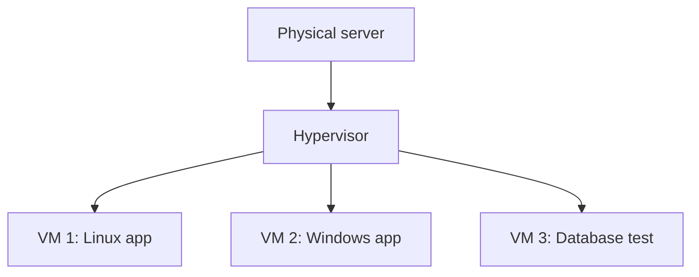
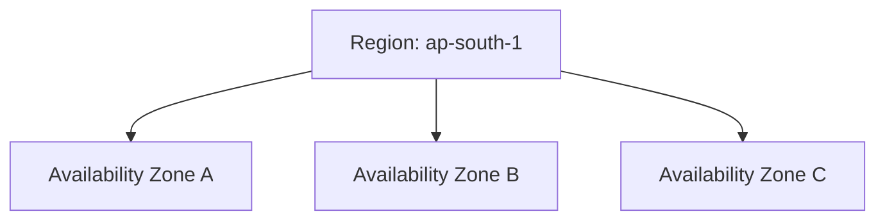
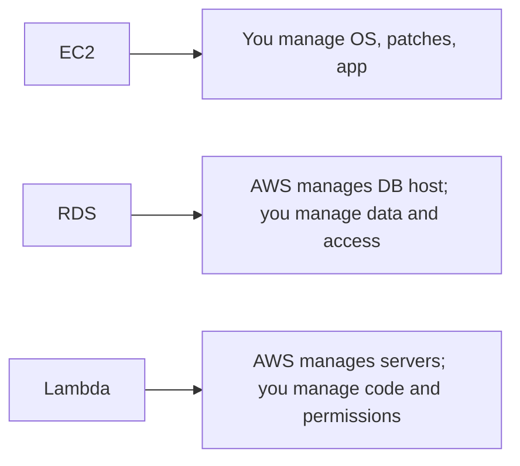

# 01. Cloud And AWS Foundations

## 1. What Is Virtualization?

Virtualization means running a software-based computer inside a physical computer.

A physical server has CPU, memory, disk, and networking. A virtual machine gets a slice of those resources and behaves like a separate computer.



### Why Virtualization Exists

Before virtualization, many companies bought one physical server per application. Most servers were underused. Virtualization allowed many isolated machines to run on one physical machine.

Benefits:

- Better hardware usage.
- Faster server creation.
- Isolation between workloads.
- Snapshots and backups.
- Easier testing.
- Easier migration.

## 2. Hypervisor Types

A hypervisor is software that creates and manages virtual machines.

### Type 1 Hypervisor

Runs directly on physical hardware.

Examples:

- VMware ESXi.
- Microsoft Hyper-V Server.
- KVM.
- Xen.

Used in data centers because it is efficient and stable.

### Type 2 Hypervisor

Runs on top of a normal operating system.

Examples:

- VirtualBox.
- VMware Workstation.
- Parallels.

Used mostly on laptops and desktops for learning and development.

## 3. What Is A Virtual Machine?

A virtual machine has:

- Virtual CPU.
- Virtual memory.
- Virtual disk.
- Virtual network card.
- Operating system.
- Applications.

In AWS, an EC2 instance is a virtual server. You choose instance type, operating system image, storage, network, and security rules.

## 4. What Is Cloud Computing?

Cloud computing means renting computing resources over the internet instead of buying and managing physical data centers yourself.

You can rent:

- Compute.
- Storage.
- Databases.
- Networking.
- Security services.
- Analytics.
- Machine learning.
- Developer tools.

### Simple Analogy

Owning servers is like buying a generator for electricity. Cloud is like using the electric grid. You still need to design your usage carefully, but you do not build the whole power station.

## 5. Cloud Service Models

### IaaS: Infrastructure As A Service

You rent infrastructure and manage the OS and app.

AWS examples:

- EC2.
- EBS.
- VPC.

You control:

- Operating system.
- Runtime.
- Application.
- Updates.

AWS controls:

- Physical server.
- Data center.
- Hardware.

### PaaS: Platform As A Service

You deploy code; the platform manages much of the infrastructure.

AWS examples:

- Elastic Beanstalk.
- App Runner.
- Lambda in some use cases.
- Amplify Hosting.

### SaaS: Software As A Service

You use a complete application.

Examples:

- Gmail.
- Salesforce.
- Microsoft 365.

AWS has SaaS-like managed services, but AWS itself is mostly a cloud platform.

## 6. Cloud Deployment Models

Public cloud:

- Shared cloud provider infrastructure.
- Examples: AWS, Azure, Google Cloud.

Private cloud:

- Cloud-like infrastructure used by one organization.

Hybrid cloud:

- Mix of on-premises and public cloud.

Multi-cloud:

- Use of more than one cloud provider.

## 7. What Is AWS?

Amazon Web Services is a cloud platform with services for compute, storage, databases, networking, security, analytics, machine learning, deployment, monitoring, and more.

AWS is not one product. It is a collection of services that can be combined.

Example:

- Route 53 sends users to your domain.
- CloudFront caches content globally.
- S3 stores static files.
- EC2 or ECS runs backend code.
- RDS stores relational data.
- IAM controls permissions.
- CloudWatch monitors logs and metrics.

## 8. Regions And Availability Zones

An AWS Region is a geographic area, such as `us-east-1` or `ap-south-1`.

An Availability Zone is an isolated data center group inside a Region.



Why it matters:

- Put resources close to users for low latency.
- Use multiple Availability Zones for high availability.
- Some services are regional, some are global, and some are zonal.

## 9. Global, Regional, And Zonal Services

Global examples:

- IAM.
- Route 53.
- CloudFront.

Regional examples:

- S3 buckets are created in a Region.
- Lambda functions.
- DynamoDB tables.
- VPCs.

Zonal examples:

- EC2 instance placement.
- EBS volumes.
- Subnets.

## 10. Shared Responsibility Model

AWS is responsible for security of the cloud. You are responsible for security in the cloud.

AWS manages:

- Physical data centers.
- Hardware.
- Global network.
- Managed service infrastructure.

You manage:

- IAM permissions.
- Data protection.
- Application security.
- Network rules.
- OS patching on EC2.
- Encryption choices.

The more managed the service, the less infrastructure you manage.



## 11. AWS Pricing Basics

AWS pricing is usually pay-as-you-go. You pay for what you use.

Common cost dimensions:

- Compute hours or seconds.
- Storage GB-month.
- Requests.
- Data transfer.
- Provisioned capacity.
- Managed service units.

High-risk cost services for learners:

- NAT Gateway.
- Load Balancer.
- RDS.
- Large EC2 instances.
- EBS volumes left unattached.
- Data transfer out.

## 12. Billing Safety Setup

Beginner checklist:

1. Create AWS account.
2. Enable MFA on root user.
3. Do not use root for daily work.
4. Create an admin identity using IAM Identity Center or IAM.
5. Create a budget.
6. Enable billing alerts.
7. Check Cost Explorer.
8. Delete lab resources after practice.

## 13. AWS Access Methods

You can use AWS through:

- AWS Management Console.
- AWS CLI.
- SDKs.
- CloudFormation.
- Terraform.
- CDK.

CLI example:

```bash
aws sts get-caller-identity
```

Line by line:

- `aws` runs the AWS CLI.
- `sts` calls the Security Token Service.
- `get-caller-identity` shows which AWS identity your credentials belong to.

## 14. AWS CLI Configuration

Install AWS CLI, then run:

```bash
aws configure
```

It asks for:

- Access key ID.
- Secret access key.
- Default Region.
- Output format.

For production, prefer temporary credentials through IAM Identity Center, roles, or federation instead of long-lived access keys.

## 15. Core AWS Categories

Compute:

- EC2.
- Lambda.
- ECS.
- EKS.
- Elastic Beanstalk.

Storage:

- S3.
- EBS.
- EFS.
- FSx.

Database:

- RDS.
- Aurora.
- DynamoDB.
- ElastiCache.
- Redshift.

Networking:

- VPC.
- Route 53.
- CloudFront.
- API Gateway.
- Elastic Load Balancing.

Security:

- IAM.
- KMS.
- Secrets Manager.
- WAF.
- GuardDuty.
- Security Hub.

Operations:

- CloudWatch.
- CloudTrail.
- Config.
- Systems Manager.
- Backup.

## 16. What To Learn First

Best beginner order:

1. Cloud basics.
2. IAM.
3. EC2.
4. Security groups.
5. EBS and AMI.
6. S3.
7. VPC basics.
8. RDS.
9. Lambda.
10. ECS/Fargate.
11. Route 53 and CloudFront.
12. CloudFormation/Terraform.
13. Monitoring and cost.

