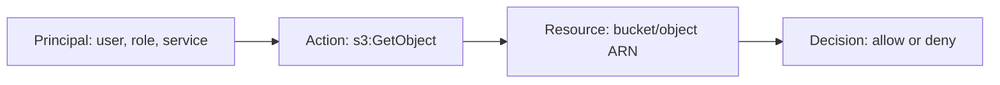
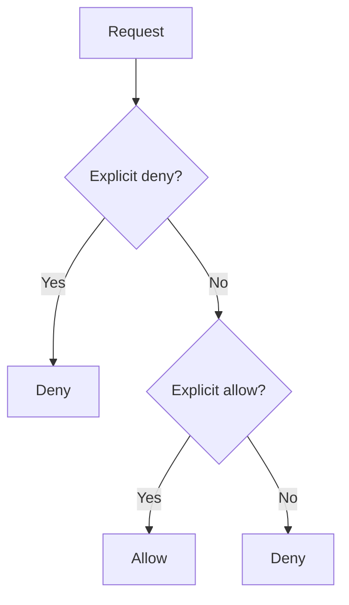
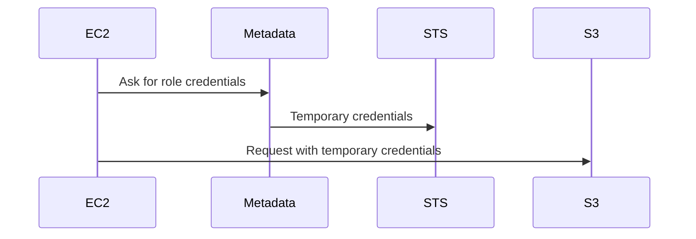
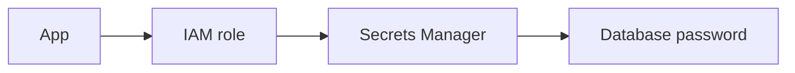

# 02. AWS Account, IAM, And Security

## 1. Account Setup

An AWS account is the top-level container for resources, billing, identities, and security settings.

Basic signup flow:

1. Go to AWS signup.
2. Enter email and account name.
3. Verify email.
4. Add payment method.
5. Verify phone number.
6. Choose support plan.
7. Sign in to the console.

After signup, do security setup before creating resources.

## 2. Root User

The root user is the original identity created with the AWS account. It has complete access.

Do:

- Enable MFA.
- Use a strong password.
- Store recovery details securely.
- Use root only for tasks that require root.

Do not:

- Use root for daily work.
- Create root access keys.
- Share root credentials.

## 3. IAM Big Idea

IAM controls who can do what on which AWS resources.



Important words:

- Authentication: proving who you are.
- Authorization: deciding what you can do.
- Principal: identity making a request.
- Policy: JSON permission document.
- Role: identity that can be assumed.
- Permission boundary: maximum permissions an identity can receive.

## 4. IAM Users, Groups, Roles, Policies

IAM user:

- Represents a person or workload.
- Can have console password or access keys.
- Use carefully; for humans, IAM Identity Center is often better.

IAM group:

- Collection of users.
- Attach policies to group.

IAM role:

- Assumable identity.
- Does not have permanent credentials.
- Best for AWS services, EC2, Lambda, cross-account access, and federation.

Policy:

- JSON document that allows or denies actions.

## 5. IAM Policy Anatomy

Example policy:

```json
{
  "Version": "2012-10-17",
  "Statement": [
    {
      "Effect": "Allow",
      "Action": ["s3:GetObject"],
      "Resource": ["arn:aws:s3:::example-bucket/*"]
    }
  ]
}
```

Line by line:

- `Version` is the policy language version.
- `Statement` is a list of permission rules.
- `Effect` is `Allow` or `Deny`.
- `Action` is the API operation.
- `Resource` is the target resource ARN.

## 6. Explicit Deny Wins

IAM evaluation has many details, but remember:

- Default is deny.
- Explicit allow grants access.
- Explicit deny overrides allow.



## 7. Least Privilege

Least privilege means giving only the permissions needed.

Bad policy:

```json
{
  "Effect": "Allow",
  "Action": "*",
  "Resource": "*"
}
```

Better policy:

```json
{
  "Effect": "Allow",
  "Action": ["s3:PutObject", "s3:GetObject"],
  "Resource": ["arn:aws:s3:::my-app-uploads/*"]
}
```

## 8. IAM Role For EC2

If an EC2 instance needs to read S3, do not put access keys on the server. Attach an IAM role to the instance.

Flow:



Why this is better:

- No hardcoded keys.
- Credentials rotate automatically.
- Permissions are managed centrally.

## 9. IAM Role For Lambda

Every Lambda function has an execution role.

If Lambda writes logs, it needs CloudWatch Logs permissions.

If Lambda reads DynamoDB, add DynamoDB permissions.

Example idea:

```json
{
  "Effect": "Allow",
  "Action": ["dynamodb:GetItem", "dynamodb:PutItem"],
  "Resource": "arn:aws:dynamodb:ap-south-1:123456789012:table/Orders"
}
```

## 10. IAM Identity Center

IAM Identity Center helps manage workforce access to AWS accounts and applications.

Use it when:

- Multiple people need access.
- You manage many AWS accounts.
- You want temporary credentials.
- You want permission sets.

Beginner mental model:

- User logs into access portal.
- User chooses AWS account and role.
- AWS gives temporary credentials.

## 11. AWS Organizations

AWS Organizations lets you manage multiple AWS accounts.

Common structure:

```txt
Organization
  Security account
  Logging account
  Shared services account
  Production account
  Development account
```

Service Control Policies can set guardrails across accounts.

Example guardrail idea:

- Deny disabling CloudTrail.
- Deny creating resources outside approved Regions.
- Deny public S3 buckets.

## 12. MFA

Multi-factor authentication adds a second proof after password.

Enable MFA for:

- Root user.
- Admin users.
- Sensitive roles.

MFA types can include authenticator apps, hardware keys, and passkeys depending on account setup and AWS support.

## 13. Access Keys

Access keys are long-lived credentials for programmatic access.

Rules:

- Do not store keys in Git.
- Do not paste keys into chat.
- Rotate old keys.
- Delete unused keys.
- Prefer roles and temporary credentials.
- Use named profiles locally.

AWS CLI profile:

```bash
aws configure --profile dev
aws s3 ls --profile dev
```

## 14. KMS

AWS Key Management Service manages encryption keys.

Use KMS for:

- S3 encryption.
- EBS encryption.
- RDS encryption.
- Secrets Manager.
- Application-level encryption.

Key ideas:

- AWS managed keys are easy.
- Customer managed keys provide more control.
- Key policies control who can use keys.
- Rotation can reduce long-term exposure.

## 15. Secrets Manager And Parameter Store

Do not put passwords in code.

Use:

- AWS Secrets Manager for secrets with rotation.
- Systems Manager Parameter Store for configuration and some secrets.

Example app flow:



## 16. CloudTrail

CloudTrail records AWS API activity.

Use it to answer:

- Who created this resource?
- Who deleted this bucket?
- Which role made this API call?
- When did this change happen?

CloudTrail is essential for auditing.

## 17. Security Services Overview

GuardDuty:

- Threat detection from logs and network signals.

Security Hub:

- Central security findings.

Inspector:

- Vulnerability management.

Macie:

- Sensitive data discovery in S3.

WAF:

- Web application firewall.

Shield:

- DDoS protection.

Config:

- Tracks resource configuration and compliance.

## 18. Beginner Security Checklist

1. Enable root MFA.
2. Do not use root for daily work.
3. Create admin access through IAM Identity Center or IAM.
4. Use least privilege.
5. Use roles for AWS services.
6. Delete unused access keys.
7. Enable CloudTrail.
8. Keep S3 Block Public Access on unless intentionally hosting public content.
9. Encrypt data.
10. Set budgets and alerts.

