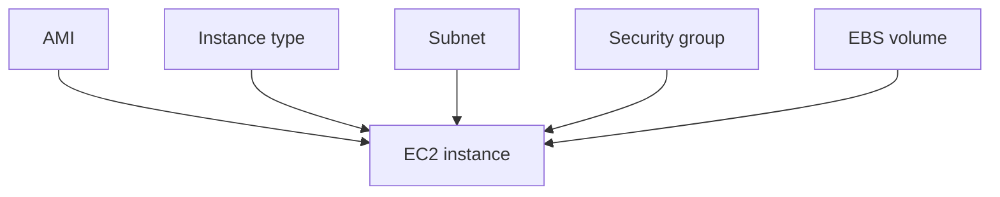
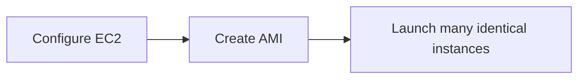
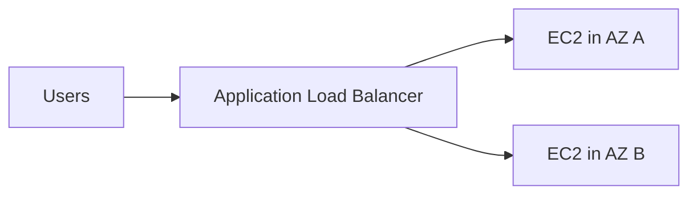
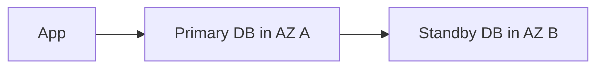
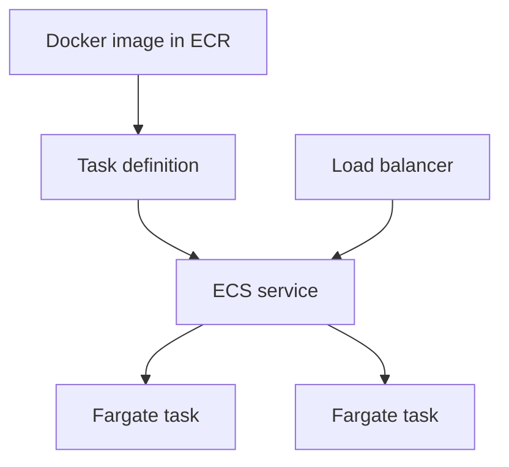

# 03. Compute, Storage, And Databases

## 1. EC2

Amazon EC2 gives you virtual servers in AWS.

An EC2 instance needs:

- AMI: operating system and starting software.
- Instance type: CPU, memory, networking capacity.
- Key pair or SSM access.
- VPC and subnet.
- Security group.
- Storage, usually EBS.



## 2. EC2 Launch Procedure

Console steps:

1. Open EC2.
2. Choose Launch Instance.
3. Enter name.
4. Choose AMI, for example Amazon Linux.
5. Choose instance type.
6. Choose key pair or use Systems Manager later.
7. Choose network and subnet.
8. Configure security group.
9. Configure storage.
10. Launch.

CLI example:

```bash
aws ec2 run-instances \
  --image-id ami-xxxxxxxx \
  --instance-type t3.micro \
  --key-name my-key \
  --security-group-ids sg-xxxxxxxx \
  --subnet-id subnet-xxxxxxxx
```

Line by line:

- `run-instances` creates EC2 instances.
- `--image-id` chooses the AMI.
- `--instance-type` chooses compute size.
- `--key-name` chooses SSH key pair.
- `--security-group-ids` attaches firewall rules.
- `--subnet-id` chooses where the instance lives.

## 3. Security Groups

A security group is a virtual firewall for resources such as EC2, RDS, and load balancers.

Rules are stateful:

- If inbound traffic is allowed, response traffic is allowed back.
- You usually define inbound rules carefully.

Example:

- Allow SSH port 22 only from your IP.
- Allow HTTP port 80 from anywhere.
- Allow HTTPS port 443 from anywhere.

Never allow SSH from `0.0.0.0/0` in production.

## 4. EBS

Elastic Block Store provides block storage volumes for EC2.

Think of EBS as a cloud hard disk.

Key points:

- EBS volume is in one Availability Zone.
- Attach it to an EC2 instance in the same AZ.
- Data persists after instance stop.
- Delete-on-termination can remove root volumes when instance is terminated.
- Snapshots back up EBS to S3-managed storage.

Common EBS volume types:

- General purpose SSD.
- Provisioned IOPS SSD.
- Throughput optimized HDD.
- Cold HDD.

## 5. Resize EBS

High-level steps:

1. Modify volume size in EC2 console or CLI.
2. Extend partition if needed.
3. Extend file system inside the OS.

Linux example:

```bash
lsblk
sudo growpart /dev/xvda 1
sudo xfs_growfs -d /
```

Meaning:

- `lsblk` shows disks and partitions.
- `growpart` expands the partition.
- `xfs_growfs` expands the XFS file system.

Commands vary by OS and file system.

## 6. EBS Snapshots

Snapshots are backups of EBS volumes.

Use snapshots for:

- Backup.
- Migration.
- Creating new volumes.
- Disaster recovery.

Important:

- Snapshots are incremental.
- First snapshot stores used blocks.
- Later snapshots store changed blocks.

## 7. AMI

An Amazon Machine Image is a template for EC2 instances.

An AMI can include:

- Operating system.
- Packages.
- Configuration.
- Application code.
- EBS snapshot references.

Use AMIs when:

- You want repeatable server builds.
- You need faster instance launch.
- You want a golden image.

Flow:



## 8. Elastic Load Balancing

A load balancer distributes traffic across targets.

Types:

- Application Load Balancer: HTTP/HTTPS, path and host routing.
- Network Load Balancer: high-performance TCP/UDP/TLS.
- Gateway Load Balancer: virtual appliances.

Example:



## 9. Auto Scaling Groups

An Auto Scaling Group keeps the desired number of EC2 instances running.

It can:

- Replace unhealthy instances.
- Scale out when load increases.
- Scale in when load decreases.
- Launch instances from a launch template.

Key terms:

- Minimum capacity.
- Desired capacity.
- Maximum capacity.
- Scaling policy.
- Health check.

## 10. S3

Amazon S3 is object storage.

Object storage means data is stored as objects inside buckets.

Object:

- File data.
- Metadata.
- Key name.

Bucket:

- Top-level container.
- Created in a Region.
- Name must be unique depending on namespace rules.

Common use cases:

- Static websites.
- Images and videos.
- Backups.
- Data lakes.
- Logs.
- Build artifacts.

## 11. S3 Permissions

By default, S3 buckets are private.

Access can be controlled by:

- IAM policies.
- Bucket policies.
- Access points.
- Block Public Access.
- ACLs, although modern designs usually prefer policies.

Example bucket policy for public read of website objects:

```json
{
  "Version": "2012-10-17",
  "Statement": [
    {
      "Effect": "Allow",
      "Principal": "*",
      "Action": "s3:GetObject",
      "Resource": "arn:aws:s3:::example-site-bucket/*"
    }
  ]
}
```

Only use public access intentionally.

## 12. S3 Storage Classes

Common classes:

- S3 Standard.
- S3 Intelligent-Tiering.
- S3 Standard-IA.
- S3 One Zone-IA.
- S3 Glacier Instant Retrieval.
- S3 Glacier Flexible Retrieval.
- S3 Glacier Deep Archive.

Choose based on:

- Access frequency.
- Retrieval time.
- Durability and availability needs.
- Cost.

## 13. RDS

Amazon RDS is a managed relational database service.

Engines include:

- PostgreSQL.
- MySQL.
- MariaDB.
- Oracle.
- SQL Server.
- Db2.
- Aurora.

RDS manages:

- Database server provisioning.
- Backups.
- Patching options.
- Replication features.
- Monitoring integrations.

You manage:

- Schema.
- Queries.
- Indexes.
- Access.
- Application connection logic.

## 14. RDS High Availability

Multi-AZ RDS improves availability by keeping a standby in another Availability Zone.



If primary fails, RDS can fail over.

Read replicas are different:

- Used for read scaling.
- Can be cross-Region.
- Usually asynchronous.

## 15. DynamoDB

DynamoDB is a managed NoSQL key-value and document database.

Core concepts:

- Table.
- Item.
- Attribute.
- Partition key.
- Sort key.
- Global secondary index.
- Local secondary index.

Good for:

- High-scale applications.
- Serverless apps.
- Shopping carts.
- User sessions.
- IoT events.
- Metadata lookup.

Bad fit if:

- You need many complex joins.
- You do not know access patterns.
- You need ad hoc relational queries.

## 16. Lambda

AWS Lambda runs code without managing servers.

You write a handler:

```js
export const handler = async event => {
  return {
    statusCode: 200,
    body: JSON.stringify({ message: "Hello from Lambda" })
  };
};
```

Line by line:

- `handler` is the function Lambda invokes.
- `event` contains request or trigger data.
- The returned object is an HTTP-like response when used with API Gateway or Function URLs.
- `JSON.stringify` converts the body to a string.

Lambda is good for:

- APIs.
- Automation.
- File processing.
- Event-driven workflows.
- Scheduled jobs.

Watch out for:

- Timeout.
- Memory size.
- Cold starts.
- IAM permissions.
- VPC networking complexity.
- Payload limits.

## 17. ECS And Fargate

ECS is a container orchestration service.

Fargate runs containers without you managing EC2 servers.

Key terms:

- Image: packaged application.
- ECR: container image registry.
- Task definition: blueprint for containers.
- Task: running copy of a task definition.
- Service: keeps tasks running.
- Cluster: logical grouping.



## 18. Choosing Compute

Use EC2 when:

- You need full server control.
- You run legacy software.
- You need custom networking or OS setup.

Use Lambda when:

- Work is event-driven.
- Requests are short.
- You want minimal infrastructure management.

Use ECS/Fargate when:

- You use Docker.
- You want long-running services.
- You need more control than Lambda but less server management than EC2.

Use EKS when:

- You need Kubernetes.
- Your team already knows Kubernetes.
- You need Kubernetes ecosystem tools.

