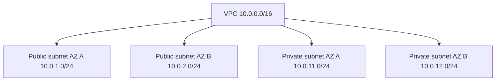
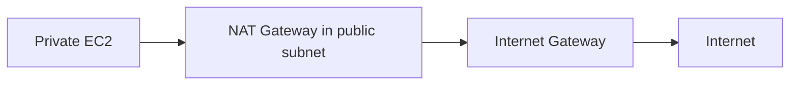
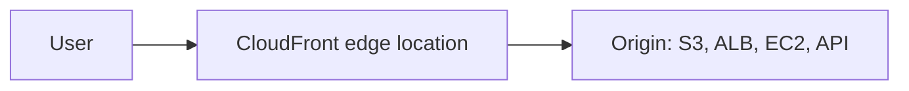
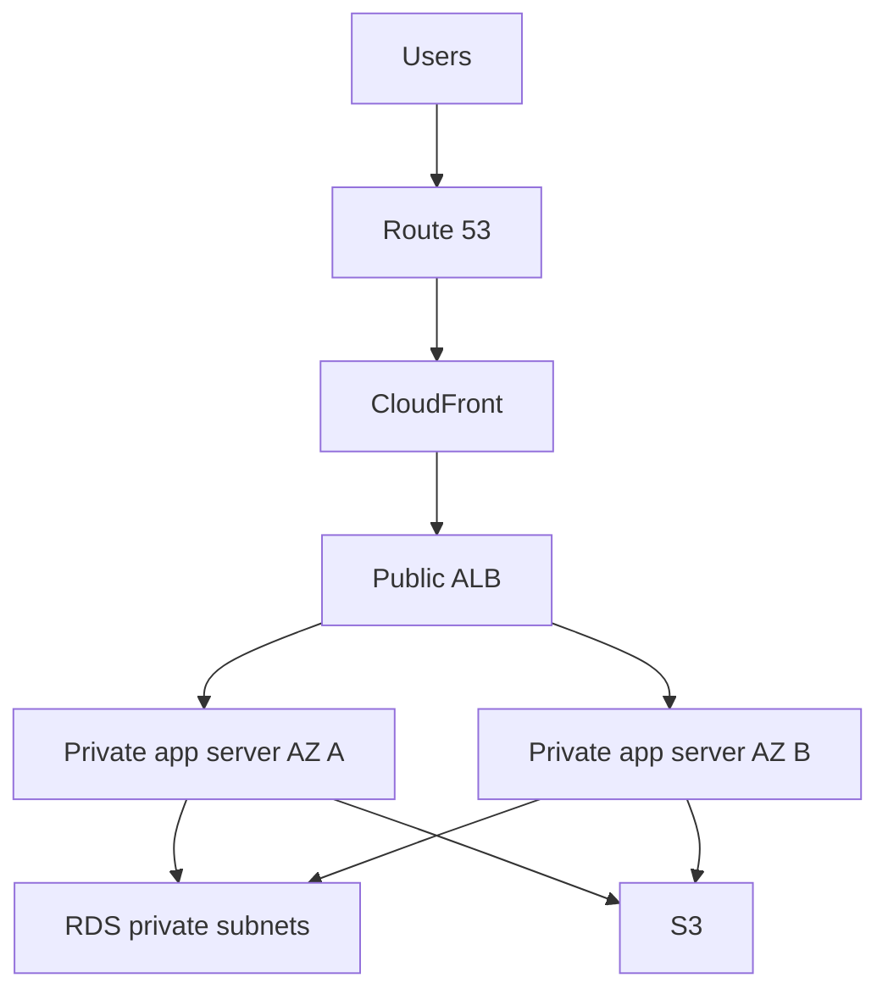

# 04. Networking, VPC, Route 53, And CloudFront

## 1. Networking Foundation

Networking answers:

- Where does traffic come from?
- Where should traffic go?
- Is the destination reachable?
- Is traffic allowed?
- Is traffic encrypted?

In AWS, networking is built around VPCs, subnets, route tables, gateways, security groups, and DNS.

## 2. VPC

A VPC is your private network inside AWS.

When creating a VPC, you choose a CIDR range.

Example:

```txt
10.0.0.0/16
```

This means the VPC can contain IP addresses from `10.0.0.0` to `10.0.255.255`.

## 3. CIDR Basics

CIDR controls network size.

Examples:

```txt
10.0.0.0/16    large network
10.0.1.0/24    smaller subnet
10.0.1.0/28    tiny subnet
```

Lower slash number means more IP addresses. Higher slash number means fewer IP addresses.

## 4. Subnets

A subnet is a slice of a VPC CIDR inside one Availability Zone.

Example VPC:

```txt
VPC: 10.0.0.0/16
Public subnet A: 10.0.1.0/24
Private subnet A: 10.0.11.0/24
Public subnet B: 10.0.2.0/24
Private subnet B: 10.0.12.0/24
```



## 5. Public Vs Private Subnet

A public subnet has a route to an internet gateway.

A private subnet does not have a direct route to an internet gateway.

Public subnet commonly contains:

- Load balancer.
- NAT gateway.
- Bastion host, if used.

Private subnet commonly contains:

- Application servers.
- ECS tasks.
- RDS databases.
- Internal services.

## 6. Internet Gateway

An internet gateway connects a VPC to the public internet.

For an EC2 instance to be reachable from the internet:

1. VPC has internet gateway.
2. Subnet route table sends `0.0.0.0/0` to internet gateway.
3. Instance has public IPv4 or IPv6 route.
4. Security group allows inbound traffic.
5. Network ACL allows traffic.
6. OS firewall allows traffic.
7. Application listens on the port.

## 7. Route Tables

A route table decides where packets go.

Public route table example:

```txt
10.0.0.0/16     local
0.0.0.0/0       internet-gateway-id
```

Private route table example:

```txt
10.0.0.0/16     local
0.0.0.0/0       nat-gateway-id
```

Meaning:

- Local VPC traffic stays inside VPC.
- Internet-bound traffic from public subnet goes to internet gateway.
- Internet-bound traffic from private subnet goes to NAT gateway.

## 8. NAT Gateway

A NAT gateway lets private subnet resources initiate outbound internet requests without becoming publicly reachable.

Use case:

- Private EC2 instance needs package updates.
- Private ECS task needs to call external API.

Flow:



Cost warning: NAT gateways can become expensive for learners. Delete them after labs.

## 9. Security Groups Vs NACLs

Security group:

- Attached to resources.
- Stateful.
- Allows rules only.
- Common daily firewall.

Network ACL:

- Attached to subnets.
- Stateless.
- Allows and denies rules.
- Evaluated by rule number.
- Useful for subnet-level guardrails.

Most beginners should focus first on security groups.

## 10. VPC Endpoint

A VPC endpoint lets private resources access AWS services without public internet.

Types:

- Gateway endpoint: commonly for S3 and DynamoDB.
- Interface endpoint: powered by AWS PrivateLink for many services.

Example:

Private EC2 can access S3 through an S3 gateway endpoint instead of NAT gateway.

## 11. VPC Peering

VPC peering connects two VPCs privately.

Rules:

- CIDR ranges cannot overlap.
- Peering is not transitive.
- Update route tables on both sides.

If A peers with B and B peers with C, A does not automatically reach C.

## 12. Transit Gateway

Transit Gateway is a hub for connecting many VPCs and networks.

Use when:

- Many VPCs need controlled connectivity.
- You connect on-premises networks.
- Peering mesh becomes too complex.

## 13. VPN And Direct Connect

Site-to-Site VPN:

- Encrypted tunnel over internet.
- Faster to set up.
- Depends on internet path.

Direct Connect:

- Dedicated network connection to AWS.
- More predictable bandwidth and latency.
- Used by enterprises.

## 14. DNS Basics

DNS turns names into IP addresses.

Example:

```txt
example.com -> 203.0.113.10
```

Common record types:

- A: name to IPv4.
- AAAA: name to IPv6.
- CNAME: alias to another DNS name.
- MX: mail server.
- TXT: text verification.
- NS: name servers.

## 15. Route 53

Route 53 is AWS DNS and domain routing service.

Use it for:

- Registering domains.
- Hosted zones.
- DNS records.
- Health checks.
- Routing policies.

Hosted zone:

- Container for DNS records for a domain.

Example:

```txt
example.com hosted zone
  A record: example.com -> CloudFront
  CNAME: www.example.com -> example.com
```

## 16. Route 53 Routing Policies

Simple:

- One record returns one or more values.

Weighted:

- Split traffic by percentage.

Latency-based:

- Send users to low-latency Region.

Failover:

- Use primary when healthy, secondary when not.

Geolocation:

- Route based on user location.

Geoproximity:

- Route based on location and optional bias.

## 17. CloudFront

CloudFront is a CDN. It caches content closer to users.



Benefits:

- Lower latency.
- Reduced origin load.
- HTTPS support.
- Global caching.
- WAF integration.

Origins can include:

- S3 bucket.
- Application Load Balancer.
- API Gateway.
- Custom HTTP server.

## 18. CloudFront Cache Behavior

CloudFront uses cache behaviors to decide how requests are handled.

A behavior can control:

- Path pattern.
- Allowed HTTP methods.
- Cache policy.
- Origin request policy.
- Viewer protocol policy.
- Response headers policy.

Example:

```txt
/assets/* -> cache for long time
/api/*    -> forward to ALB, low/no cache
```

## 19. SSL/TLS Certificates

Use AWS Certificate Manager to request certificates.

For CloudFront, public certificates must be in `us-east-1`.

For regional services like ALB, request certificate in the same Region as the service.

## 20. Standard Web App Network Architecture



Key idea:

- Only the load balancer is public.
- App servers are private.
- Database is private.
- S3 access is controlled.
- Route 53 and CloudFront improve global access.

## 21. Common Networking Troubleshooting

If EC2 is not reachable:

1. Is instance running?
2. Is it in the correct subnet?
3. Does it have a public IP?
4. Does route table have `0.0.0.0/0` to IGW?
5. Does security group allow inbound port?
6. Does NACL allow traffic?
7. Is app listening on the right port?
8. Is OS firewall blocking?

If private instance cannot reach internet:

1. Is NAT gateway running?
2. Is NAT in public subnet?
3. Does NAT have Elastic IP?
4. Does public subnet route to IGW?
5. Does private route table send default route to NAT?
6. Does security group allow outbound?

## 22. VPC Manual Creation Procedure

Goal: create a VPC with two public and two private subnets.

Steps:

1. Create VPC `10.0.0.0/16`.
2. Create public subnet A `10.0.1.0/24`.
3. Create public subnet B `10.0.2.0/24`.
4. Create private subnet A `10.0.11.0/24`.
5. Create private subnet B `10.0.12.0/24`.
6. Create and attach internet gateway.
7. Create public route table.
8. Add route `0.0.0.0/0` to internet gateway.
9. Associate public subnets with public route table.
10. Create NAT gateway in public subnet.
11. Create private route table.
12. Add route `0.0.0.0/0` to NAT gateway.
13. Associate private subnets with private route table.

## 23. Minimal AWS CLI VPC Sketch

```bash
aws ec2 create-vpc --cidr-block 10.0.0.0/16
aws ec2 create-subnet --vpc-id vpc-xxx --cidr-block 10.0.1.0/24 --availability-zone ap-south-1a
aws ec2 create-internet-gateway
aws ec2 attach-internet-gateway --internet-gateway-id igw-xxx --vpc-id vpc-xxx
```

This is only a sketch. Real scripts must capture IDs, create route tables, add routes, tag resources, and handle errors.

