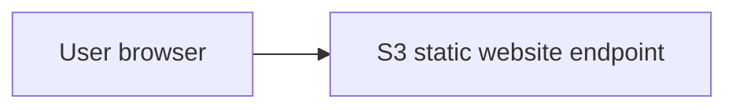
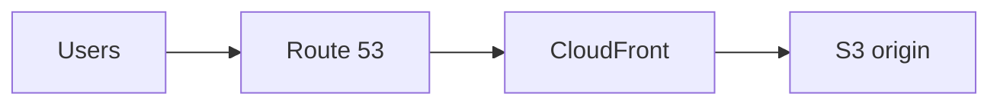
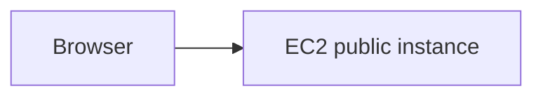
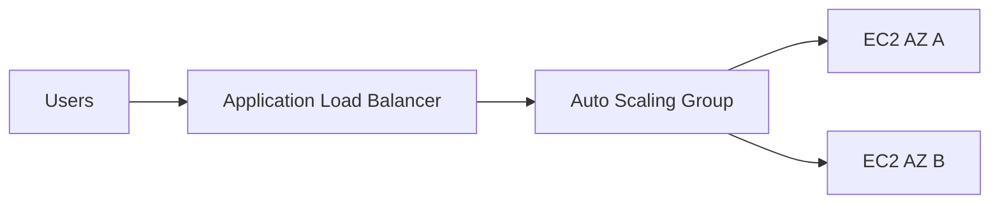
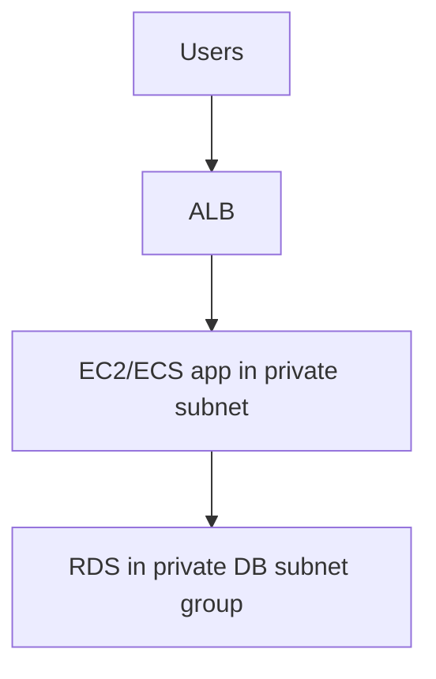
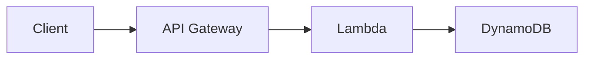
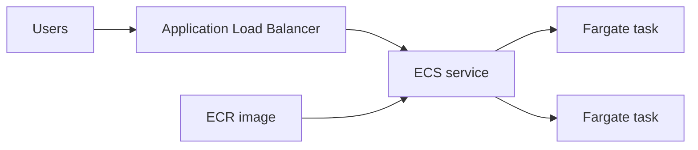

# 05. AWS Deployment Projects

This file gives practical project paths. Every project includes the aim, architecture, steps, code or config, and cleanup.

## Project 1: Static Website On S3

### Aim

Deploy a plain HTML/CSS/JS website using S3 static website hosting.

### Architecture



### Files

`index.html`:

```html
<!DOCTYPE html>
<html>
  <head>
    <title>AWS Static Site</title>
    <link rel="stylesheet" href="styles.css" />
  </head>
  <body>
    <h1>Hello from S3</h1>
    <p>This site is hosted on Amazon S3.</p>
  </body>
</html>
```

`styles.css`:

```css
body {
  font-family: Arial, sans-serif;
  margin: 40px;
}
```

### Console Steps

1. Open S3.
2. Create bucket with globally unique name.
3. Choose Region.
4. Upload `index.html` and `styles.css`.
5. Enable static website hosting.
6. Set index document to `index.html`.
7. If public website is intended, adjust Block Public Access and add bucket policy.
8. Open website endpoint.

### Bucket Policy

```json
{
  "Version": "2012-10-17",
  "Statement": [
    {
      "Sid": "PublicReadGetObject",
      "Effect": "Allow",
      "Principal": "*",
      "Action": "s3:GetObject",
      "Resource": "arn:aws:s3:::YOUR_BUCKET_NAME/*"
    }
  ]
}
```

Replace `YOUR_BUCKET_NAME`.

### Cleanup

1. Empty bucket.
2. Delete bucket.

## Project 2: Static Website With CloudFront And HTTPS

### Aim

Serve a static website globally with HTTPS and caching.

### Architecture



### Steps

1. Create S3 bucket.
2. Upload website build files.
3. Keep bucket private when using Origin Access Control.
4. Create CloudFront distribution.
5. Set S3 bucket as origin.
6. Configure Origin Access Control.
7. Allow CloudFront to read bucket.
8. Request ACM certificate in `us-east-1`.
9. Add alternate domain name.
10. Create Route 53 alias record to CloudFront.
11. Test HTTPS URL.

### Why CloudFront

S3 website hosting alone is simple but not ideal for HTTPS with custom domains. CloudFront gives caching, TLS, custom domain, WAF integration, and better global performance.

## Project 3: Deploy React App To S3 And CloudFront

### Aim

Build a React app and host the compiled static files.

### Local Build

```bash
npm install
npm run build
```

Vite usually outputs to `dist`.

### Upload

```bash
aws s3 sync dist/ s3://YOUR_BUCKET_NAME --delete
```

Line by line:

- `aws s3 sync` copies local files to S3.
- `dist/` is the local build folder.
- `s3://YOUR_BUCKET_NAME` is the destination bucket.
- `--delete` removes old files that no longer exist locally.

### CloudFront Invalidation

```bash
aws cloudfront create-invalidation \
  --distribution-id DISTRIBUTION_ID \
  --paths "/*"
```

This asks CloudFront to refresh cached files.

## Project 4: EC2 Web Server

### Aim

Launch an EC2 instance and run a simple web server.

### Architecture



### User Data Example

```bash
#!/bin/bash
yum update -y
yum install -y httpd
systemctl enable httpd
systemctl start httpd
echo "<h1>Hello from EC2</h1>" > /var/www/html/index.html
```

Line by line:

- `#!/bin/bash` tells Linux to run this as a shell script.
- `yum update -y` updates packages.
- `yum install -y httpd` installs Apache.
- `systemctl enable httpd` starts Apache after reboot.
- `systemctl start httpd` starts Apache now.
- `echo ... > index.html` writes a simple page.

### Security Group

Inbound:

- HTTP 80 from `0.0.0.0/0`.
- SSH 22 only from your IP, if using SSH.

### Cleanup

Terminate instance and delete unused EBS volumes.

## Project 5: EC2 Behind Load Balancer And Auto Scaling

### Aim

Run a highly available web app across two Availability Zones.

### Architecture



### Steps

1. Create launch template with AMI, instance type, user data, and security group.
2. Create target group.
3. Create Application Load Balancer in public subnets.
4. Create Auto Scaling Group using launch template.
5. Attach ASG to target group.
6. Configure health checks.
7. Set min, desired, max capacity.
8. Add scaling policy.
9. Test load balancer DNS name.

### Scaling Policy Example

Scale based on average CPU:

```txt
Target tracking policy:
  Metric: Average CPU utilization
  Target: 50 percent
```

## Project 6: Backend API With RDS

### Aim

Deploy an application server that connects to a managed relational database.

### Architecture



### Security Groups

ALB security group:

- Allow 80/443 from internet.

App security group:

- Allow app port from ALB security group.

DB security group:

- Allow database port only from app security group.

For PostgreSQL, database port is usually `5432`. For MySQL, usually `3306`.

### App Environment Variables

```txt
DB_HOST=mydb.xxxxxx.ap-south-1.rds.amazonaws.com
DB_PORT=5432
DB_NAME=appdb
DB_USER=appuser
DB_PASSWORD=from-secrets-manager
```

Do not store real passwords in Git.

## Project 7: Serverless API With Lambda And API Gateway

### Aim

Create an API without managing servers.

### Architecture



### Lambda Code

```js
export const handler = async event => {
  const name = event.queryStringParameters?.name || "world";

  return {
    statusCode: 200,
    headers: {
      "Content-Type": "application/json"
    },
    body: JSON.stringify({
      message: `Hello, ${name}`
    })
  };
};
```

Line by line:

- Reads `name` from query string.
- Uses `world` if no name exists.
- Returns status code `200`.
- Sends JSON response.

### Steps

1. Create Lambda function.
2. Add code.
3. Create API Gateway HTTP API.
4. Connect route to Lambda.
5. Grant invoke permission.
6. Deploy API.
7. Test endpoint.
8. Add DynamoDB permissions if storing data.

## Project 8: Docker App On ECS Fargate

### Aim

Deploy a Dockerized app without managing servers.

### Architecture



### Dockerfile Example

```dockerfile
FROM node:22-alpine
WORKDIR /app
COPY package*.json ./
RUN npm ci --omit=dev
COPY . .
EXPOSE 3000
CMD ["node", "server.js"]
```

Line by line:

- `FROM` chooses base image.
- `WORKDIR` sets app folder.
- `COPY package*.json` copies dependency files.
- `RUN npm ci --omit=dev` installs production dependencies.
- `COPY . .` copies application code.
- `EXPOSE` documents the port.
- `CMD` starts the app.

### Build And Push To ECR

```bash
aws ecr create-repository --repository-name my-app
aws ecr get-login-password --region ap-south-1 | docker login --username AWS --password-stdin ACCOUNT_ID.dkr.ecr.ap-south-1.amazonaws.com
docker build -t my-app .
docker tag my-app:latest ACCOUNT_ID.dkr.ecr.ap-south-1.amazonaws.com/my-app:latest
docker push ACCOUNT_ID.dkr.ecr.ap-south-1.amazonaws.com/my-app:latest
```

Replace `ACCOUNT_ID`, Region, and repository name.

### ECS Steps

1. Create ECS cluster.
2. Create task definition.
3. Set image URI.
4. Set CPU and memory.
5. Add container port.
6. Create service.
7. Choose Fargate.
8. Select VPC and subnets.
9. Attach load balancer.
10. Configure desired task count.
11. Check service events and logs.

## Project 9: AWS Amplify Hosting For React

### Aim

Deploy a frontend app with Git-based CI/CD.

### Steps

1. Push React app to GitHub.
2. Open Amplify.
3. Choose Host web app.
4. Connect repository.
5. Choose branch.
6. Confirm build settings.
7. Deploy.
8. Add custom domain if needed.

Typical build settings for Vite:

```yaml
version: 1
frontend:
  phases:
    preBuild:
      commands:
        - npm ci
    build:
      commands:
        - npm run build
  artifacts:
    baseDirectory: dist
    files:
      - "**/*"
  cache:
    paths:
      - node_modules/**/*
```

## Cleanup Checklist

After labs, delete:

- EC2 instances.
- Load balancers.
- Target groups.
- Auto Scaling Groups.
- NAT gateways.
- Elastic IPs.
- RDS databases and snapshots if not needed.
- ECS services.
- ECR images.
- CloudFront distributions if no longer needed.
- S3 buckets.
- Lambda functions.
- API Gateway APIs.

