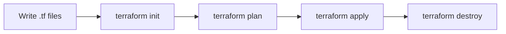

# 06. Infrastructure As Code

## 1. What Is Infrastructure As Code?

Infrastructure as Code means defining cloud resources in files instead of clicking manually in the console.

Benefits:

- Repeatable environments.
- Version control.
- Code review.
- Easier disaster recovery.
- Less manual drift.
- Automation.

Manual infrastructure:

```txt
Click -> create VPC -> click -> create subnet -> click -> create EC2
```

Infrastructure as Code:

```txt
Write template -> plan/review -> apply -> resources created
```

## 2. CloudFormation

CloudFormation is AWS native infrastructure as code.

You write a template in YAML or JSON. AWS creates a stack from that template.

Stack:

- A managed collection of AWS resources.

Template:

- The file that describes resources.

Change set:

- Preview of changes before update.

## 3. CloudFormation Template Structure

```yaml
AWSTemplateFormatVersion: "2010-09-09"
Description: Simple S3 bucket

Resources:
  WebsiteBucket:
    Type: AWS::S3::Bucket
    Properties:
      BucketName: my-example-bucket-12345
```

Line by line:

- `AWSTemplateFormatVersion` identifies template format.
- `Description` explains purpose.
- `Resources` contains resources to create.
- `WebsiteBucket` is logical ID.
- `Type` tells CloudFormation this is an S3 bucket.
- `Properties` configures the bucket.

## 4. Parameters And Outputs

```yaml
Parameters:
  EnvironmentName:
    Type: String
    Default: dev

Resources:
  AppBucket:
    Type: AWS::S3::Bucket
    Properties:
      Tags:
        - Key: Environment
          Value: !Ref EnvironmentName

Outputs:
  BucketName:
    Value: !Ref AppBucket
```

`!Ref` returns a useful value for a parameter or resource.

## 5. CloudFormation EC2 Example

```yaml
AWSTemplateFormatVersion: "2010-09-09"
Description: EC2 web server

Parameters:
  LatestAmiId:
    Type: AWS::SSM::Parameter::Value<AWS::EC2::Image::Id>
    Default: /aws/service/ami-amazon-linux-latest/al2023-ami-kernel-default-x86_64

Resources:
  WebSecurityGroup:
    Type: AWS::EC2::SecurityGroup
    Properties:
      GroupDescription: Allow HTTP
      SecurityGroupIngress:
        - IpProtocol: tcp
          FromPort: 80
          ToPort: 80
          CidrIp: 0.0.0.0/0

  WebServer:
    Type: AWS::EC2::Instance
    Properties:
      ImageId: !Ref LatestAmiId
      InstanceType: t3.micro
      SecurityGroupIds:
        - !Ref WebSecurityGroup
      UserData:
        Fn::Base64: |
          #!/bin/bash
          dnf install -y httpd
          systemctl enable httpd
          systemctl start httpd
          echo "<h1>Hello from CloudFormation</h1>" > /var/www/html/index.html

Outputs:
  InstanceId:
    Value: !Ref WebServer
```

## 6. CloudFormation Commands

Create stack:

```bash
aws cloudformation create-stack \
  --stack-name web-server \
  --template-body file://template.yaml
```

Update stack:

```bash
aws cloudformation update-stack \
  --stack-name web-server \
  --template-body file://template.yaml
```

Delete stack:

```bash
aws cloudformation delete-stack --stack-name web-server
```

## 7. Terraform

Terraform is a popular infrastructure as code tool from HashiCorp. It can manage AWS and many other providers.

Core workflow:

```txt
write -> init -> plan -> apply -> destroy
```



## 8. Terraform Provider

```hcl
terraform {
  required_providers {
    aws = {
      source  = "hashicorp/aws"
      version = "~> 5.0"
    }
  }
}

provider "aws" {
  region = "ap-south-1"
}
```

Line by line:

- `terraform` block configures Terraform itself.
- `required_providers` declares provider plugins.
- `source` points to AWS provider.
- `version` pins compatible versions.
- `provider "aws"` configures AWS access.
- `region` chooses AWS Region.

## 9. Terraform S3 Bucket Example

```hcl
resource "aws_s3_bucket" "site" {
  bucket = "my-example-site-bucket-12345"
}

output "bucket_name" {
  value = aws_s3_bucket.site.bucket
}
```

Run:

```bash
terraform init
terraform plan
terraform apply
```

## 10. Terraform Variables

`variables.tf`:

```hcl
variable "environment" {
  type    = string
  default = "dev"
}
```

Use variable:

```hcl
resource "aws_s3_bucket" "logs" {
  bucket = "my-app-${var.environment}-logs-12345"
}
```

## 11. Terraform State

Terraform state records what Terraform manages.

State answers:

- What resources exist?
- What IDs do they have?
- What changed since last apply?

Do not casually edit state files.

For teams, store remote state in S3 with locking using DynamoDB or a managed Terraform platform.

## 12. Terraform EC2 Example

```hcl
resource "aws_security_group" "web" {
  name        = "web-sg"
  description = "Allow HTTP"

  ingress {
    from_port   = 80
    to_port     = 80
    protocol    = "tcp"
    cidr_blocks = ["0.0.0.0/0"]
  }

  egress {
    from_port   = 0
    to_port     = 0
    protocol    = "-1"
    cidr_blocks = ["0.0.0.0/0"]
  }
}

resource "aws_instance" "web" {
  ami           = "ami-xxxxxxxx"
  instance_type = "t3.micro"
  vpc_security_group_ids = [aws_security_group.web.id]

  user_data = <<-EOF
    #!/bin/bash
    dnf install -y httpd
    systemctl enable httpd
    systemctl start httpd
    echo "<h1>Hello from Terraform</h1>" > /var/www/html/index.html
  EOF
}
```

Replace AMI ID with a current AMI for your Region.

## 13. Modules

Modules organize reusable infrastructure.

Example:

```txt
modules/
  vpc/
    main.tf
    variables.tf
    outputs.tf
environments/
  dev/
    main.tf
  prod/
    main.tf
```

Use modules when:

- Same pattern repeats.
- You need cleaner files.
- You want standard infrastructure across environments.

## 14. CloudFormation Vs Terraform

CloudFormation:

- Native AWS service.
- No separate state file to manage.
- Deep AWS integration.
- AWS-only.

Terraform:

- Multi-cloud.
- Strong ecosystem.
- Plan output is central workflow.
- State management is your responsibility.

Use either. The main professional skill is understanding infrastructure as code, dependencies, state, review, and safe rollout.

## 15. IaC Safety Rules

1. Never apply changes you have not reviewed.
2. Use separate dev and prod environments.
3. Use version control.
4. Protect state.
5. Avoid hardcoding secrets.
6. Use tags.
7. Add outputs for important values.
8. Destroy lab stacks when finished.
9. Prefer small changes.
10. Understand replacement behavior before applying.

## 16. Tagging Strategy

Common tags:

```txt
Project=shopping-app
Environment=dev
Owner=team-name
CostCenter=training
ManagedBy=terraform
```

Tags help with:

- Cost tracking.
- Search.
- Automation.
- Compliance.

