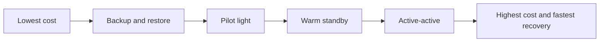
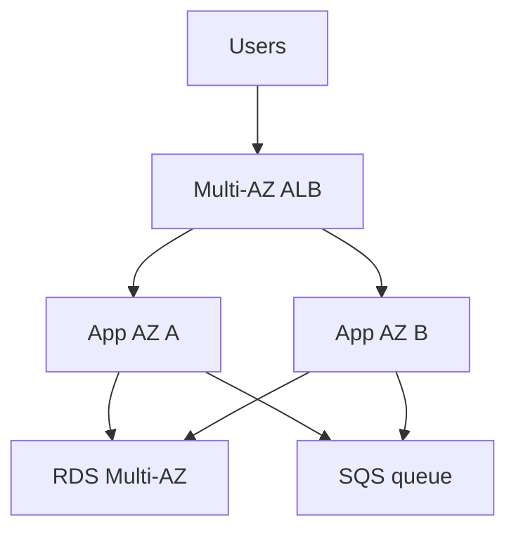
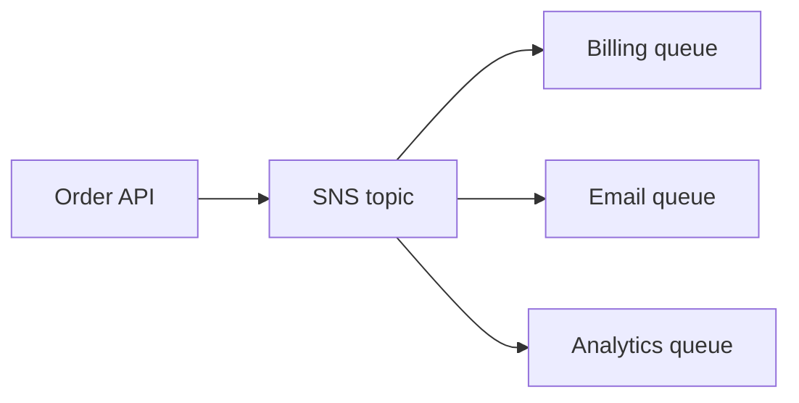
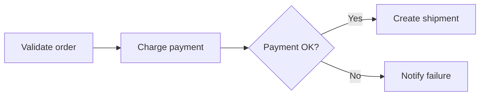
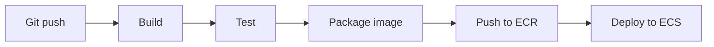

# 07. Operations, Architecture, And Advanced AWS

## 1. Operational Excellence

Operational excellence means running systems safely and improving them over time.

Practices:

- Use infrastructure as code.
- Automate deployments.
- Monitor important metrics.
- Write runbooks.
- Practice incident response.
- Learn from failures.

## 2. CloudWatch

CloudWatch collects metrics, logs, alarms, and dashboards.

Use CloudWatch for:

- EC2 CPU utilization.
- Lambda errors and duration.
- ALB request counts.
- RDS CPU, connections, storage.
- Custom app metrics.
- Log search.

Alarm example idea:

```txt
If average EC2 CPU > 80 percent for 5 minutes, notify SNS topic.
```

## 3. Logs

Logs explain what happened inside your system.

Good logs include:

- Timestamp.
- Request ID.
- User or account ID when safe.
- Operation name.
- Error message.
- Duration.

Avoid logging:

- Passwords.
- Access tokens.
- Full credit card numbers.
- Secrets.

## 4. Metrics

Metrics are numbers over time.

Examples:

- Request count.
- Error rate.
- Latency p95.
- CPU utilization.
- Memory usage.
- Queue depth.

Golden signals:

- Latency.
- Traffic.
- Errors.
- Saturation.

## 5. CloudTrail And Audit

CloudTrail records API activity.

Use CloudTrail to investigate:

- Resource creation.
- Resource deletion.
- Permission changes.
- Console and API actions.

For production, centralize logs in a separate logging account.

## 6. AWS Config

AWS Config tracks resource configuration.

Questions Config can answer:

- Was this S3 bucket public yesterday?
- Who changed this security group?
- Which resources are non-compliant?

Config rules can detect:

- Unencrypted volumes.
- Public buckets.
- Open security groups.
- Missing tags.

## 7. Backup And Disaster Recovery

Backup means having recoverable copies.

Disaster recovery means restoring service after major failure.

DR strategies:

- Backup and restore.
- Pilot light.
- Warm standby.
- Multi-site active-active.



Important terms:

- RPO: maximum acceptable data loss.
- RTO: maximum acceptable downtime.

## 8. Cost Optimization

AWS cost problems usually come from forgotten resources, overprovisioning, or data transfer.

Tools:

- AWS Budgets.
- Cost Explorer.
- Cost and Usage Reports.
- Trusted Advisor.
- Compute Optimizer.

Habits:

- Tag resources.
- Delete unused resources.
- Use right-sized instances.
- Use Savings Plans for steady compute.
- Use Spot for interruption-tolerant workloads.
- Move old data to cheaper S3 storage classes.
- Watch NAT Gateway and data transfer charges.

## 9. Reliability

Reliable systems continue working during failure.

Practices:

- Deploy across multiple Availability Zones.
- Use health checks.
- Use Auto Scaling.
- Use managed databases with backups.
- Test restore procedures.
- Avoid single points of failure.
- Use queues to absorb spikes.

Example reliable web app:



## 10. Performance Efficiency

Performance means using resources efficiently to meet user needs.

Ideas:

- Use CloudFront for caching.
- Use proper EC2 instance families.
- Use RDS indexes.
- Use DynamoDB access patterns.
- Use async processing for slow tasks.
- Use horizontal scaling.
- Measure before optimizing.

## 11. Security Architecture

Security principles:

- Strong identity foundation.
- Least privilege.
- Defense in depth.
- Encrypt data.
- Keep people away from production when possible.
- Automate detection.
- Prepare incident response.

Defense in depth example:

```txt
Route 53 -> CloudFront -> WAF -> ALB -> Security Groups -> App auth -> IAM -> KMS
```

## 12. Sustainability

Sustainability means reducing wasted resources and environmental impact.

Practices:

- Right-size infrastructure.
- Turn off unused environments.
- Use managed services when appropriate.
- Improve code efficiency.
- Use scaling.
- Delete unused data.

## 13. Decoupling With SQS And SNS

SQS is a queue.

SNS is pub/sub messaging.

Use SQS when:

- Work should be processed asynchronously.
- You need retry behavior.
- You need to absorb traffic spikes.

Use SNS when:

- One event should notify many subscribers.

Example:



## 14. EventBridge

EventBridge routes events between services and applications.

Use it for:

- Event-driven architecture.
- Scheduled jobs.
- Integration between services.
- SaaS event ingestion.

Example:

```txt
OrderCreated event -> EventBridge -> Lambda updates loyalty points
```

## 15. Step Functions

Step Functions orchestrates workflows.

Use it when:

- Multiple steps need coordination.
- You need retries and branching.
- You need visual workflow history.
- Lambda-only chaining becomes messy.

Example:



## 16. API Gateway

API Gateway creates managed APIs.

Use it with:

- Lambda.
- HTTP backends.
- Private integrations.

Features:

- Routes.
- Authorization.
- Throttling.
- CORS.
- Custom domains.
- Stages.

## 17. Containers And Kubernetes

ECS:

- AWS-native container orchestration.
- Simpler than Kubernetes.
- Works well with Fargate.

EKS:

- Managed Kubernetes control plane.
- Good when you need Kubernetes APIs and ecosystem.
- More operational complexity.

Choose ECS first unless Kubernetes is a real requirement.

## 18. CI/CD On AWS

AWS services:

- CodeCommit, though many teams use GitHub or GitLab.
- CodeBuild.
- CodeDeploy.
- CodePipeline.
- ECR.

Common pipeline:



## 19. Blue/Green And Canary Deployments

Rolling:

- Replace old tasks gradually.

Blue/green:

- Run old and new environments.
- Shift traffic after validation.

Canary:

- Send small percentage to new version.
- Increase if healthy.

These reduce deployment risk.

## 20. Well-Architected Framework

The AWS Well-Architected Framework helps evaluate architectures using pillars:

- Operational excellence.
- Security.
- Reliability.
- Performance efficiency.
- Cost optimization.
- Sustainability.

Use it as a thinking checklist, not as a one-time form.

## 21. Production Readiness Checklist

Before production:

1. IAM least privilege.
2. MFA and federation configured.
3. Infrastructure as code.
4. Backups tested.
5. Logs centralized.
6. Metrics and alarms configured.
7. Budget alerts configured.
8. Secrets managed outside code.
9. TLS enabled.
10. Public access reviewed.
11. Multi-AZ where needed.
12. Runbook written.
13. Deployment rollback planned.
14. Load test completed.
15. Security review completed.

## 22. Common AWS Architecture Patterns

Static frontend plus API:

```txt
Route 53 -> CloudFront -> S3 frontend
CloudFront/API -> API Gateway -> Lambda -> DynamoDB
```

Traditional web app:

```txt
Route 53 -> ALB -> ECS/EC2 -> RDS
```

Async processing:

```txt
API -> SQS -> Worker Lambda/ECS -> Database
```

Data lake:

```txt
S3 -> Glue -> Athena/Redshift -> QuickSight
```

## 23. Advanced Services To Explore

Analytics:

- Glue.
- Athena.
- Redshift.
- EMR.
- Kinesis.

Machine learning:

- SageMaker.
- Bedrock.
 
Edge and security:

- WAF.
- Shield.
- Global Accelerator.

Developer and platform:

- CDK.
- App Runner.
- Elastic Beanstalk.
- Amplify.

Enterprise:

- Control Tower.
- Organizations.
- IAM Identity Center.
- Service Catalog.

