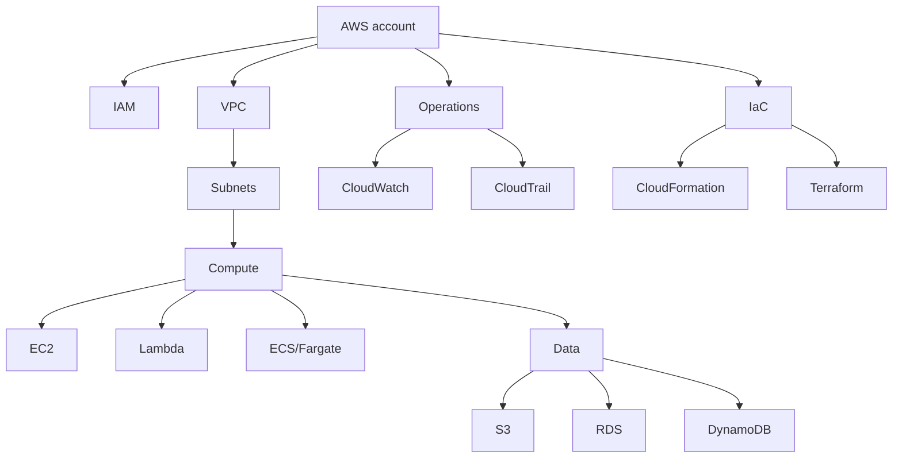

# 08. Cheat Sheets, Roadmap, And Sources

## 1. AWS Beginner Roadmap

Week 1:

- Cloud basics.
- AWS account setup.
- IAM and MFA.
- Budgets.

Week 2:

- EC2.
- Security groups.
- EBS.
- AMI.
- User data.

Week 3:

- S3.
- Static website.
- CloudFront.
- Route 53 basics.

Week 4:

- VPC.
- Subnets.
- Routing.
- NAT.
- Private/public architecture.

Week 5:

- RDS.
- DynamoDB.
- Lambda.
- API Gateway.

Week 6:

- ECS/Fargate.
- Docker.
- ECR.
- Load balancing.

Week 7:

- CloudFormation.
- Terraform.
- Tags.
- Environments.

Week 8:

- Monitoring.
- Logging.
- Backups.
- Cost optimization.
- Well-Architected review.

## 2. AWS CLI Cheat Sheet

Identity:

```bash
aws sts get-caller-identity
```

S3:

```bash
aws s3 ls
aws s3 mb s3://my-bucket-name
aws s3 sync ./dist s3://my-bucket-name --delete
aws s3 rb s3://my-bucket-name --force
```

EC2:

```bash
aws ec2 describe-instances
aws ec2 describe-security-groups
aws ec2 stop-instances --instance-ids i-xxxxxxxx
aws ec2 terminate-instances --instance-ids i-xxxxxxxx
```

CloudFormation:

```bash
aws cloudformation deploy \
  --template-file template.yaml \
  --stack-name my-stack \
  --capabilities CAPABILITY_NAMED_IAM
```

CloudFront:

```bash
aws cloudfront create-invalidation \
  --distribution-id DISTRIBUTION_ID \
  --paths "/*"
```

## 3. Terraform Cheat Sheet

```bash
terraform init
terraform fmt
terraform validate
terraform plan
terraform apply
terraform destroy
```

Meaning:

- `init`: install providers and prepare working directory.
- `fmt`: format files.
- `validate`: check syntax and basic correctness.
- `plan`: preview changes.
- `apply`: make changes.
- `destroy`: delete managed resources.

## 4. IAM Cheat Sheet

Policy decision:

```txt
Default deny
Explicit allow grants access
Explicit deny overrides allow
```

Best practices:

- Use roles for AWS services.
- Use temporary credentials.
- Avoid root user.
- Enable MFA.
- Avoid wildcard permissions.
- Review access regularly.

## 5. EC2 Troubleshooting Cheat Sheet

Cannot SSH:

- Instance running?
- Correct public IP?
- Security group allows 22 from your IP?
- Route table to internet gateway?
- Correct key?
- OS user correct, such as `ec2-user` or `ubuntu`?

Website not loading:

- App running?
- Listening on `0.0.0.0`, not only `localhost`?
- Security group allows port 80 or 443?
- NACL allows traffic?
- Health check path correct?

## 6. VPC Cheat Sheet

Public subnet:

```txt
Route: 0.0.0.0/0 -> Internet Gateway
```

Private subnet:

```txt
Route: 0.0.0.0/0 -> NAT Gateway
```

Database subnet:

```txt
No public route
Only app security group can connect
```

## 7. S3 Cheat Sheet

Concepts:

- Bucket: container.
- Object: stored file.
- Key: object name/path.
- Versioning: multiple versions.
- Lifecycle: move or expire objects.
- Bucket policy: resource policy.
- Block Public Access: public access safety control.

Use cases:

- Static site.
- Backups.
- Logs.
- Data lake.
- Media storage.

## 8. Service Selection Guide

Need virtual machine:

- EC2.

Need object storage:

- S3.

Need block disk:

- EBS.

Need relational database:

- RDS or Aurora.

Need NoSQL database:

- DynamoDB.

Need serverless function:

- Lambda.

Need containers:

- ECS/Fargate or EKS.

Need DNS:

- Route 53.

Need CDN:

- CloudFront.

Need infrastructure as code:

- CloudFormation, CDK, or Terraform.

Need logs and metrics:

- CloudWatch.

Need audit:

- CloudTrail.

## 9. Interview Questions

Beginner:

- What is cloud computing?
- What is the difference between IaaS, PaaS, and SaaS?
- What is an AWS Region?
- What is an Availability Zone?
- What is EC2?
- What is S3?
- What is IAM?

Intermediate:

- Security group vs NACL?
- Public subnet vs private subnet?
- EBS snapshot vs AMI?
- RDS Multi-AZ vs read replica?
- S3 bucket policy vs IAM policy?
- Load balancer vs Auto Scaling Group?
- Lambda vs EC2?

Advanced:

- How would you design a highly available web application?
- How would you secure production AWS accounts?
- How would you reduce AWS costs?
- How would you design disaster recovery?
- How would you deploy containers safely?
- How would you manage infrastructure across dev, staging, and prod?

## 10. Visual Summary



## 11. Official Sources Used

These notes were grounded against current official documentation pages checked on 2026-07-09:

- AWS Well-Architected Framework: https://docs.aws.amazon.com/wellarchitected/latest/framework/welcome.html
- AWS IAM User Guide: https://docs.aws.amazon.com/IAM/latest/UserGuide/introduction.html
- Amazon EC2 User Guide: https://docs.aws.amazon.com/AWSEC2/latest/UserGuide/concepts.html
- Amazon VPC User Guide: https://docs.aws.amazon.com/vpc/latest/userguide/what-is-amazon-vpc.html
- Amazon S3 User Guide: https://docs.aws.amazon.com/AmazonS3/latest/userguide/Welcome.html
- AWS Lambda Developer Guide: https://docs.aws.amazon.com/lambda/latest/dg/welcome.html
- Amazon ECS Developer Guide: https://docs.aws.amazon.com/AmazonECS/latest/developerguide/Welcome.html
- AWS CloudFormation User Guide: https://docs.aws.amazon.com/AWSCloudFormation/latest/UserGuide/Welcome.html
- Terraform introduction: https://developer.hashicorp.com/terraform/intro

## 12. Final Practice Path

Build these in order:

1. S3 static website.
2. S3 plus CloudFront plus Route 53.
3. EC2 web server.
4. EC2 plus ALB plus Auto Scaling.
5. VPC with public and private subnets.
6. RDS private database with app server.
7. Lambda API with DynamoDB.
8. Docker app on ECS Fargate.
9. Same projects using CloudFormation.
10. Same projects using Terraform.

The real skill is not memorizing every AWS service. The real skill is seeing a requirement and choosing the right combination of identity, network, compute, storage, data, security, observability, and automation.

