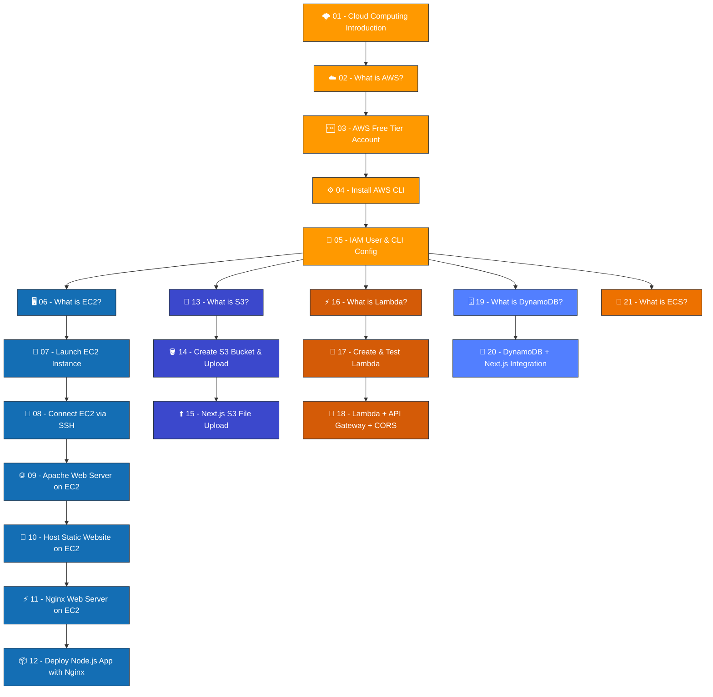

# ☁️ AWS Complete Documentation - Beginner to Advanced

---

> **Welcome, Future Cloud Engineer!** 🎉
>
> This is your **one-stop guide** to learning Amazon Web Services (AWS) from absolute scratch. Whether you've never touched a cloud service or you're looking to level up your skills, this documentation will walk you through everything — step by step, with real-world examples, hands-on practice, and interview preparation.
>
> **No prior cloud experience needed.** Just bring your curiosity!

---

## 📌 How to Use This Guide

1. **Follow the order** — each file builds on the previous one
2. **Don't skip the hands-on sections** — reading alone won't make you an expert
3. **Try the interview questions** — they'll test your understanding
4. **Bookmark this page** — come back whenever you need a refresher

---

## 🗺️ Learning Path Roadmap

---

## 📚 Table of Contents

### 🟠 Section 1: Getting Started (Foundation)

> *Build your cloud foundation — understand what cloud computing is, set up your AWS account, and configure your tools.*

| # | Topic | File | ⏱️ Reading Time |
|---|-------|------|-----------------|
| 01 | 🌩️ Introduction to Cloud Computing | [01-cloud-computing-introduction.md](./01-cloud-computing-introduction.md) | 20 min |
| 02 | ☁️ What is AWS & Why Use It | [02-what-is-aws.md](./02-what-is-aws.md) | 25 min |
| 03 | 🆓 Setting Up AWS Free Tier Account | [03-aws-free-tier-account.md](./03-aws-free-tier-account.md) | 15 min |
| 04 | ⚙️ Installing AWS CLI on Windows | [04-install-aws-cli-windows.md](./04-install-aws-cli-windows.md) | 10 min |
| 05 | 🔑 IAM User Creation & CLI Configuration | [05-iam-user-and-cli-config.md](./05-iam-user-and-cli-config.md) | 20 min |

---

### 🔵 Section 2: EC2 & Web Servers (Compute)

> *Launch your first virtual server and deploy real websites and applications on the cloud.*

| # | Topic | File | ⏱️ Reading Time |
|---|-------|------|-----------------|
| 06 | 🖥️ What is EC2? | [06-what-is-ec2.md](./06-what-is-ec2.md) | 20 min |
| 07 | 🚀 Launching Your First EC2 Instance | [07-launch-ec2-instance.md](./07-launch-ec2-instance.md) | 25 min |
| 08 | 🔗 Connecting to EC2 via SSH | [08-connect-ec2-ssh.md](./08-connect-ec2-ssh.md) | 15 min |
| 09 | 🌐 Apache Web Server on EC2 | [09-apache-web-server-ec2.md](./09-apache-web-server-ec2.md) | 20 min |
| 10 | 📄 Hosting a Static Website on EC2 | [10-host-static-website-ec2.md](./10-host-static-website-ec2.md) | 20 min |
| 11 | ⚡ Nginx Web Server on EC2 | [11-nginx-web-server-ec2.md](./11-nginx-web-server-ec2.md) | 20 min |
| 12 | 📦 Deploy Node.js App with EC2 & Nginx | [12-deploy-nodejs-app-ec2-nginx.md](./12-deploy-nodejs-app-ec2-nginx.md) | 30 min |

---

### 🟣 Section 3: S3 Storage

> *Learn how to store files, images, and data in the cloud using Amazon S3.*

| # | Topic | File | ⏱️ Reading Time |
|---|-------|------|-----------------|
| 13 | 📂 What is S3? | [13-what-is-s3.md](./13-what-is-s3.md) | 20 min |
| 14 | 🪣 Create S3 Bucket & Upload Files | [14-create-s3-bucket-upload-files.md](./14-create-s3-bucket-upload-files.md) | 20 min |
| 15 | ⬆️ Next.js S3 File Upload Integration | [15-nextjs-s3-file-upload.md](./15-nextjs-s3-file-upload.md) | 30 min |

---

### 🟤 Section 4: Serverless (Lambda)

> *Run code without managing servers — the modern way to build backends.*

| # | Topic | File | ⏱️ Reading Time |
|---|-------|------|-----------------|
| 16 | ⚡ What is AWS Lambda? | [16-what-is-aws-lambda.md](./16-what-is-aws-lambda.md) | 20 min |
| 17 | 🧪 Create & Test a Lambda Function | [17-create-test-lambda-function.md](./17-create-test-lambda-function.md) | 20 min |
| 18 | 🌉 Lambda + API Gateway + CORS | [18-lambda-api-gateway-cors.md](./18-lambda-api-gateway-cors.md) | 30 min |

---

### 🔷 Section 5: Database (DynamoDB)

> *Store and retrieve data at any scale with AWS's NoSQL database.*

| # | Topic | File | ⏱️ Reading Time |
|---|-------|------|-----------------|
| 19 | 🗄️ What is DynamoDB? | [19-what-is-dynamodb.md](./19-what-is-dynamodb.md) | 20 min |
| 20 | 🔗 DynamoDB + Next.js Integration | [20-dynamodb-nextjs-integration.md](./20-dynamodb-nextjs-integration.md) | 30 min |

---

### 🟠 Section 6: Containers (ECS)

> *Containerize your applications and run them at scale with AWS ECS.*

| # | Topic | File | ⏱️ Reading Time |
|---|-------|------|-----------------|
| 21 | 🐳 What is Amazon ECS? | [21-what-is-ecs.md](./21-what-is-ecs.md) | 25 min |

---

## ⏱️ Total Estimated Reading Time: ~7 hours 30 minutes

---

## 🎯 Who Is This For?

| Audience | What You'll Get |
|----------|----------------|
| 🧑‍🎓 **Complete Beginners** | Start from zero — learn what cloud computing is before touching AWS |
| 💻 **Web Developers** | Deploy your websites, apps, and APIs on real cloud infrastructure |
| 🎓 **Students** | Free tier guides + interview prep for cloud/DevOps roles |
| 🏢 **Working Professionals** | Level up from local development to cloud deployment |
| 📝 **Certification Aspirants** | Solid foundation for AWS Cloud Practitioner & Solutions Architect exams |

---

## 🛠️ What You'll Build

By the end of this documentation, you'll have hands-on experience with:

- ✅ Setting up an AWS account and configuring CLI tools
- ✅ Launching and managing virtual servers (EC2)
- ✅ Deploying websites with Apache and Nginx
- ✅ Deploying a full Node.js application on the cloud
- ✅ Storing and managing files with S3
- ✅ Building a file upload feature with Next.js + S3
- ✅ Creating serverless functions with Lambda
- ✅ Building REST APIs with API Gateway
- ✅ Working with NoSQL databases (DynamoDB)
- ✅ Integrating DynamoDB with Next.js
- ✅ Understanding container orchestration with ECS

---

## 💡 Pro Tips Before You Start

> **💰 Cost Warning:** Most of what we cover fits within the AWS Free Tier. However, always monitor your billing dashboard. Set up billing alerts FIRST (covered in File 03).

> **🔑 Security First:** Never share your AWS access keys. Never commit them to Git. We'll cover secure practices in File 05.

> **📌 Bookmark AWS Console:** [https://console.aws.amazon.com](https://console.aws.amazon.com) — you'll visit it hundreds of times.

---

## 📖 Conventions Used in This Guide

| Symbol | Meaning |
|--------|---------|
| ✅ | Completed step or correct approach |
| ⚠️ | Warning — pay attention to avoid mistakes |
| 💡 | Pro tip or helpful hint |
| 🔑 | Important security-related information |
| 📌 | Key concept to remember |
| 🚨 | Common mistake or danger zone |

---

## 🤝 Contributing

Found an error? Have a suggestion? Feel free to:
1. Open an issue
2. Submit a pull request
3. Leave a comment

---

## 📅 Last Updated

**June 2026** — All content is up-to-date with the latest AWS Console UI and services.

---

> *"The cloud is not about the cloud. It's about what you can do with it."*
> — **Werner Vogels**, CTO of Amazon

**Happy Learning! 🚀**
