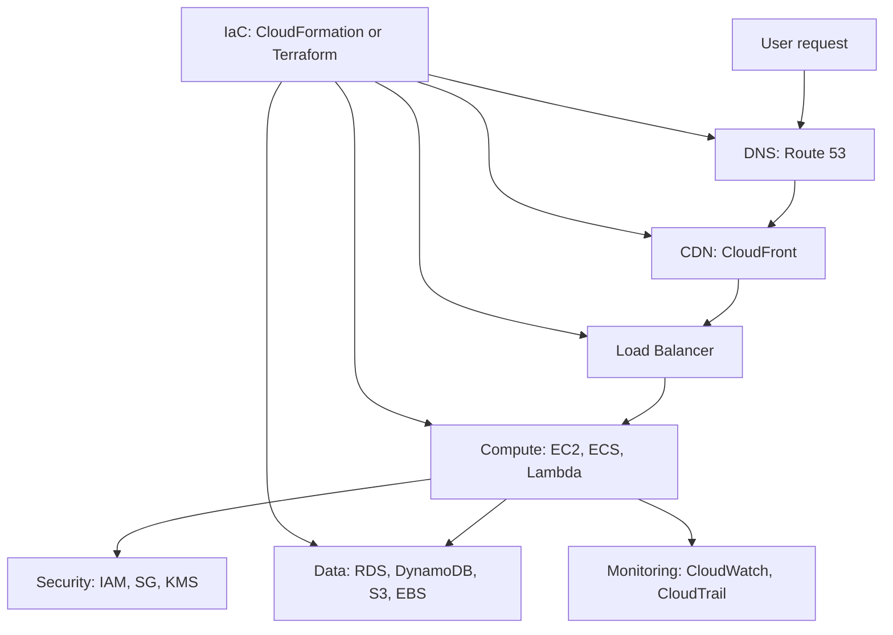

# Complete AWS Notes: Beginner To Advanced

These notes are a structured AWS learning path. Read them in order if you are new. Use them as a reference when building projects.

AWS is very large and changes often. These notes focus on the durable ideas, core services, practical procedures, architecture patterns, deployment steps, security habits, and infrastructure-as-code workflows you need to become productive.

## Files

- [01-cloud-and-aws-foundations.md](./01-cloud-and-aws-foundations.md): virtualization, cloud computing, AWS overview, regions, availability zones, shared responsibility, pricing.
- [02-account-iam-security.md](./02-account-iam-security.md): account setup, root user safety, IAM users, groups, roles, policies, MFA, least privilege, organizations.
- [03-compute-storage-databases.md](./03-compute-storage-databases.md): EC2, AMI, EBS, snapshots, ELB, Auto Scaling, S3, RDS, DynamoDB, Lambda, ECS/Fargate.
- [04-networking-vpc-route53-cloudfront.md](./04-networking-vpc-route53-cloudfront.md): VPC, subnets, routing, internet gateway, NAT, security groups, NACLs, Route 53, CloudFront.
- [05-deployment-projects.md](./05-deployment-projects.md): static website, React deployment, EC2 app, RDS backend, serverless API, Docker on ECS Fargate.
- [06-infrastructure-as-code.md](./06-infrastructure-as-code.md): CloudFormation, Terraform, state, modules, variables, outputs, deployment workflow.
- [07-operations-architecture-advanced.md](./07-operations-architecture-advanced.md): monitoring, logging, backups, cost, Well-Architected Framework, reliability, security, performance, advanced patterns.
- [08-cheatsheets-roadmap-sources.md](./08-cheatsheets-roadmap-sources.md): commands, diagrams, interview topics, roadmap, official source links.

## Big AWS Mental Model

## How To Study AWS

1. Learn the concept.
2. Draw the architecture.
3. Build it manually once in the console.
4. Rebuild it with CLI or infrastructure as code.
5. Delete everything you created.
6. Explain why each service exists.

## Important Safety Note

AWS resources can cost money. Before doing projects:

- Set a budget alert.
- Use a non-root IAM admin user or IAM Identity Center.
- Delete unused EC2 instances, NAT gateways, load balancers, RDS databases, and EBS volumes.
- Never publish access keys.
- Prefer temporary credentials and roles.

